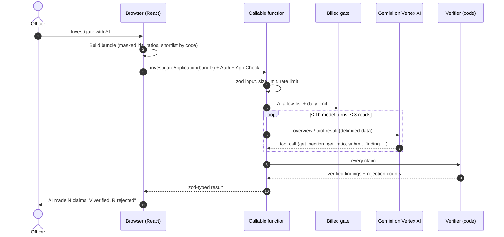
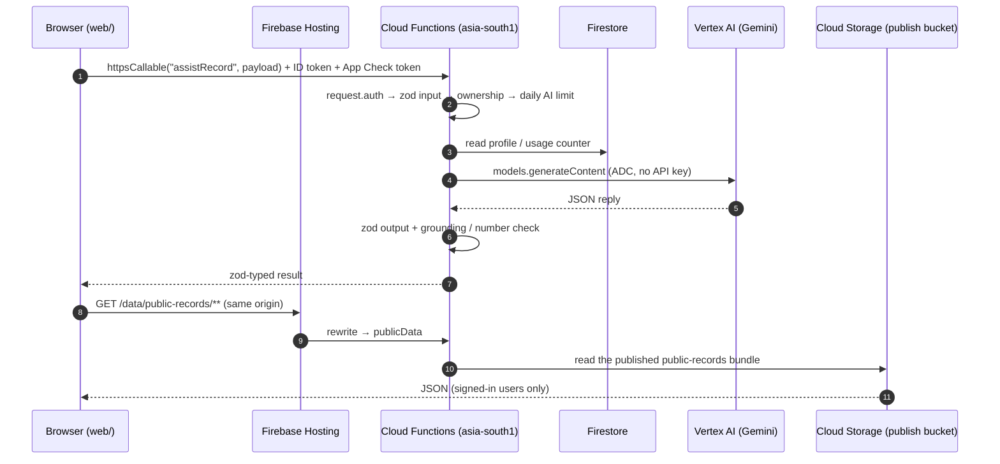
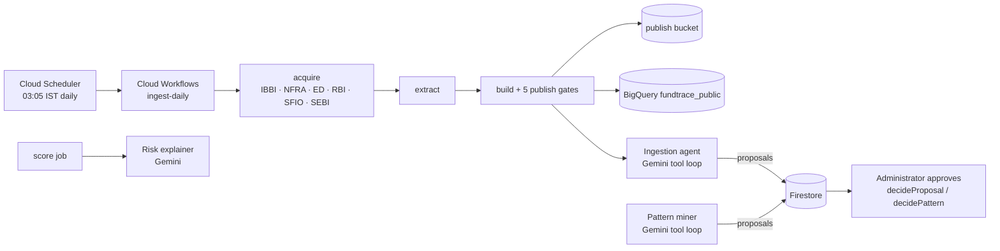
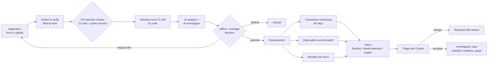
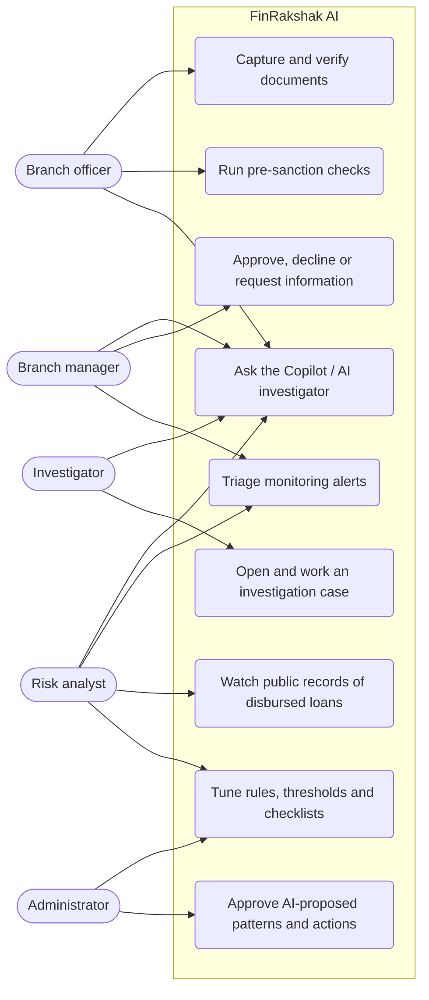
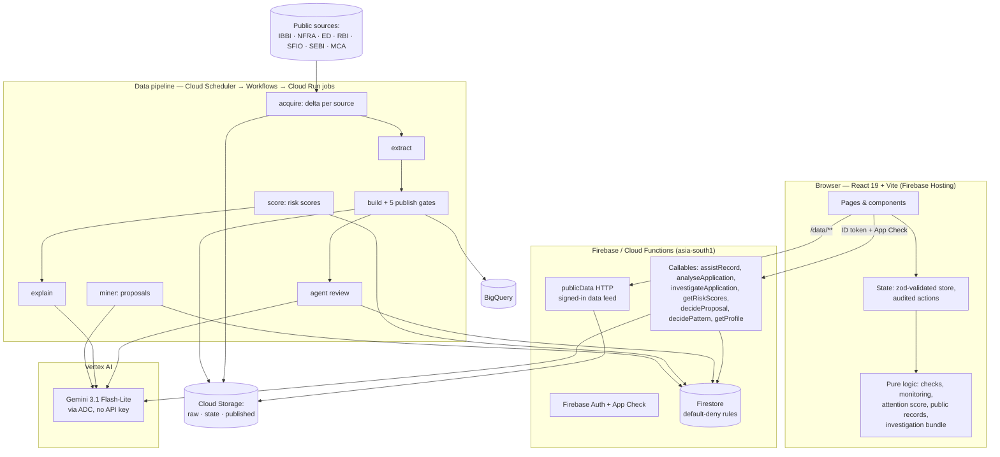

# FinRakshak AI — Loan Lifecycle Intelligence

> **Evidence-backed early warnings for every rupee a bank lends, from application to repayment.
> The AI proposes with cited evidence, code verifies, a person decides.**

[](https://github.com/Sanchit-Datir/finrakshak-ai/actions/workflows/ci.yml)


Repository: `finrakshak-ai` · Product: **FinRakshak AI** · Stack:
TypeScript monorepo on Google Cloud and Firebase.

> **Judges and reviewers:** start with [`how-to-use/`](how-to-use/README.md): every user flow with
> screenshots, the AI agents, the Google Cloud services and a 5-minute demo script.

---

## Contents

1. [Description](#1-description)
2. [Opportunity](#2-opportunity)
3. [Features](#3-features)
4. [How Gen AI is used](#4-how-gen-ai-is-used)
5. [API calls, datasets and AI](#5-api-calls-datasets-and-ai)
6. [Agents](#6-agents)
7. [Process flow and use-case diagrams](#7-process-flow-and-use-case-diagrams)
8. [Wireframes and mock-ups](#8-wireframes-and-mock-ups)
9. [Architecture](#9-architecture)
10. [Technologies](#10-technologies)
11. [Repository structure](#11-repository-structure)
12. [Prerequisites and installation](#12-prerequisites-and-installation)
13. [Usage guide](#13-usage-guide)
14. [Estimated implementation cost](#14-estimated-implementation-cost)
15. [Prototype performance and benchmarks](#15-prototype-performance-and-benchmarks)
16. [Security, privacy and responsible AI](#16-security-privacy-and-responsible-ai)
17. [Scalability and sustainability](#17-scalability-and-sustainability)
18. [Additional details and future development](#18-additional-details-and-future-development)
19. [Contribution guidelines](#19-contribution-guidelines)
20. [License and credits](#20-license-and-credits)

---

## 1. Description

### The problem

Indian banks, especially rural, cooperative and MSME lenders, lose money in three places:

1. **Before sanction.** Paper documents (7/12 land extracts, Aadhaar, bank statements, warehouse
   receipts) are typed in by hand. Inconsistencies, such as a reused survey number,
   a land area that does not match the 7/12 extract, or declared income far above bank credits, are
   spotted late or not at all.
2. **Right after disbursement.** Loan money can be moved on within hours to related parties, split
   into cash withdrawals or routed in a circle back to the borrower. By the time the account turns
   NPA, the trail is months old.
3. **During the loan.** A borrower or its biggest customer can enter insolvency, liquidation or an
   Enforcement Directorate (ED) action. That information is public (IBBI, NFRA, ED, RBI, SFIO, SEBI,
   MCA) but scattered across sites that nobody at the branch checks.

### The solution

FinRakshak AI is a loan-lifecycle workspace for branch officers, managers, risk analysts and
investigators. It joins the three stages into one evidence trail:

- **Capture and verify:** documents are reviewed field by field against the source image.
- **Pre-sanction checks:** deterministic rules plus a public-records check of the applicant and its
  customers, an **attention score** from 0 to 100, Gemini analysis and an **AI investigator**.
- **Post-disbursement monitoring:** transaction rules (rapid onward transfer, linked counterparty,
  circular flow, split cash), a **daily public-records watch** of every disbursed loan and a
  synthetic risk-scoring job.
- **Investigate:** alerts become cases with a checklist, evidence, an entity graph and a
  relationship graph of the public records.
- **FinRakshak Copilot:** on every screen, it answers "why was this flagged?", "what should I
  verify?" and "draft the information request" from the record on screen. Every sentence cites a
  fact, and the grounding check removes anything it cannot support.

Every output is a **lead for a person to verify** (Routine review / Needs attention / Urgent
review), never a verdict.

---

## 2. Opportunity

### How it differs from existing solutions

| Existing approach                            | Limitation                                                                                | FinRakshak AI                                                                                                                            |
| -------------------------------------------- | ----------------------------------------------------------------------------------------- | ---------------------------------------------------------------------------------------------------------------------------------------- |
| Core-banking EWS (early-warning) modules     | Start after an account shows stress (overdue days, limit breaches); blind before sanction | One trail from the first document to the last repayment; checks run **before** money leaves                                              |
| Rule-based AML / transaction monitoring      | Many alerts with little context; analysts rebuild the story by hand                       | Each alert carries its evidence and a cited Copilot explanation; graph view of related parties                                           |
| Credit bureaus / commercial data APIs        | Paid per lookup; cover the borrower, rarely the borrower's **customers**                  | Built from free public records (IBBI, NFRA, ED, RBI, SFIO, SEBI, MCA); checks the chain of unpaid dues to customers in liquidation       |
| Generic "chat with your documents" LLM tools | Free-form answers that can invent numbers; no audit trail; data leaves the bank's control | Closed tool lists, delimited data, **code-verified citations and numbers**, verdict words blocked, counts-only logs, Vertex AI in-region |
| Manual public-record searches                | Slow, inconsistent, never repeated after disbursement                                     | Automatic daily watch of every disbursed loan; any record dated after disbursement raises an Urgent review alert                         |

### How it solves the problem

1. **Catches document problems at the counter.** Twelve deterministic checks run on the
   reviewed fields, and every finding links to the exact field and document region.
2. **Looks past the borrower.** Business applicants list their largest customers. The
   public-records check follows the chain of unpaid dues and flags a customer in liquidation, with
   its share of receivables.
3. **Watches the money for 90 days.** Monitoring rules read the loan's transactions and draw the
   money trail as a flow graph.
4. **Keeps watching after disbursement.** A daily, delta-based pipeline refreshes public records,
   and new records against a borrower raise an alert.
5. **Saves analyst time without hiding the evidence.** The Copilot, the application analysis and
   the AI investigator turn the evidence into plain sentences and draft questions. The officer
   still sees every fact the AI used.

### USP (unique selling points)

- **Verified Gen AI, not free text.** Every AI sentence must cite facts that were sent, and every
  number it writes must appear in those facts. Code rejects the rest and shows the officer how many
  claims were kept and why others were dropped.
- **Pre- and post-disbursement in one product,** linked by the same entities, documents and audit
  log.
- **Third-party exposure:** it finds risk in the borrower's customers, not only in the borrower.
- **Built for Indian branches:** Devanagari digits and names, 7/12 extracts and gat numbers, paise
  arithmetic, IST days, rupee formatting.
- **Cost-capped by design:** mock provider by default, the cheapest model that passes our checks,
  per-user daily AI limits, `maxInstances` caps, scale to zero and budget alerts. A full month of
  the cloud pipeline is estimated at under US$10.

---

## 3. Features

| Area                              | Feature                                                                                                                                                                                                           | Status                                        |
| --------------------------------- | ----------------------------------------------------------------------------------------------------------------------------------------------------------------------------------------------------------------- | --------------------------------------------- |
| **Capture**                       | New loan from the form or from uploaded documents; PDF page count, blur, darkness and resolution warnings (local, pdf.js + canvas); field-by-field review against the source region; Devanagari digits and names  | Real (local)                                  |
| **Pre-sanction checks**           | 12 rules: required fields, missing documents, name and date-of-birth conflicts, land area vs 7/12, existing charges, survey number / warehouse receipt reuse, income vs bank credits, relationships to open cases | Real (`web/src/lib/checks/`)                  |
| **Public-records check**          | Applicant and declared customers vs 18,286 entities and 57,382 relationships from IBBI, NFRA, ED, RBI, SFIO, SEBI and MCA; chain of unpaid dues; impact on receivables                                            | Real dataset (`ingest/`)                      |
| **Attention score**               | 0–100 score computed by code from unresolved findings, with bands and top drivers                                                                                                                                 | Real (`web/src/lib/attention-score.ts`)       |
| **AI analysis of an application** | Gemini summary, facts tied to recorded fields, a note per finding; verdict words withheld                                                                                                                         | Built (Vertex AI; mock locally)               |
| **AI investigator**               | Gemini tool loop over 8 tools; proposes findings and draft questions; code verifies every citation, quote and number                                                                                              | Built (Vertex AI; mock locally)               |
| **FinRakshak Copilot**            | Ask about any record (Ctrl/⌘ J): why flagged, what to verify, draft an info request, draft risk observations, where did the money go                                                                              | Built (Vertex AI); simulated in demo sessions |
| **Transaction monitoring**        | Rapid onward transfer, linked counterparty, repeated counterparty, circular flow, split cash; thresholds editable; CSV import; flow graph                                                                         | Real (`web/src/lib/monitoring.ts`)            |
| **Public-records watch**          | Every disbursed loan re-checked daily; each record dated after disbursement raises an Urgent review alert                                                                                                         | Real (`web/src/lib/public-watch.ts`)          |
| **Synthetic risk scores**         | Monthly 0–100 behaviour + pattern score per loan, replayed over 24 months against ground-truth labels                                                                                                             | Real job (`ingest/src/risk/`), synthetic data |
| **Investigation**                 | Cases with status, assignee, checklist, evidence, notes and audit; entity graph; relationship graph of public records                                                                                             | Real (local workspace)                        |
| **Cloud data pipeline**           | Daily delta ingestion, publish gates, versioned publish and rollback, BigQuery loads; Gemini ingestion agent, pattern miner and risk explainer (off by default)                                                   | Built (Cloud Run jobs, Workflows)             |
| **Shell and UX**                  | Role-aware navigation, branch scope, My queue, pinned records, command palette, mobile tab bar, dark mode, keyboard shortcuts, guided help                                                                        | Real                                          |
| **Reports and exports**           | Period and branch reports, CSV/TXT exports with formula-injection protection                                                                                                                                      | Real                                          |

**What is not connected yet:** OCR and handwriting recognition (sample documents show labelled
_simulated demo output_), the bank's core-banking feed, SMS and email. The demo workspace stores data
in the browser; names, accounts and amounts are fictional, except the TEST loans whose real
borrowers are matched against public records.

---

## 4. How Gen AI is used

Gen AI does work that rules cannot do well: reading the evidence for a whole record and explaining
it, connecting sections that do not agree, and drafting questions and notes. Each of the six
features below follows the same pattern: **code builds the evidence → Gemini proposes → code
verifies → a person decides.**

| Feature                           | What Gemini does                                                                                                                        | What code guarantees                                                                                                                                    | Code                                                                               |
| --------------------------------- | --------------------------------------------------------------------------------------------------------------------------------------- | ------------------------------------------------------------------------------------------------------------------------------------------------------- | ---------------------------------------------------------------------------------- |
| **FinRakshak Copilot**            | Answers questions about the record on screen and drafts information requests and risk observations                                      | ≤ 60 numbered facts, identifiers masked; each statement must cite facts that were sent; numbers must appear in them; verdict words removed              | `functions/src/callable/assistRecord.ts`, `packages/shared/src/assistGrounding.ts` |
| **AI analysis of an application** | Risk summary, facts per document field, a note per finding                                                                              | Facts must quote a field that was sent; one note per finding; summary withheld on verdict words or a stated score                                       | `functions/src/services/applicationAnalysis.ts`                                    |
| **AI investigator**               | Reads the application through 8 tools (sections, ratios, public-record candidates, related entities) and submits findings and questions | Closed tool list, temperature 0, ≤ 8 reads / 10 turns; every citation, quote and number checked; rejection reasons counted; the AI never sets the score | `functions/src/services/investigation/`                                            |
| **Ingestion agent**               | Explains a daily pipeline run and proposes allowlisted actions                                                                          | Findings and numbers come from code; proposals need the owner's approval (`decideProposal`); healthy days skip the model                                | `ingest/src/agent/`, `ingest/src/ai/toolLoop.ts`                                   |
| **Pattern miner**                 | Proposes new risk patterns from seed cases                                                                                              | Proposals only; the owner approves each one (`decidePattern`); rejected candidates are counted, not stored                                              | `ingest/src/miner/`                                                                |
| **Risk explainer**                | Words the recorded reasons of a risk alert in plain language                                                                            | The number check rejects sentences with unknown numbers; stored apart from the alert                                                                    | `ingest/src/explain/`                                                              |



**Guardrails in every AI path:** sign-in and App Check; zod-validated input and output; a size check
before any use is counted; a burst rate limit plus a per-user daily limit that is never crossed;
user content in delimited data blocks (prompt-injection defence); JSON-only replies with one retry;
logs that hold counts only (no names, values or model text); and a **mock provider** that is the
default in tests, CI and the emulator, so no test ever calls a billed model.

Details: [`docs/COPILOT.md`](docs/COPILOT.md), [`docs/APPLICATION_AI_ANALYSIS.md`](docs/APPLICATION_AI_ANALYSIS.md),
[`docs/AI_INVESTIGATOR.md`](docs/AI_INVESTIGATOR.md), [`docs/plans/AGENTS_PLAN.md`](docs/plans/AGENTS_PLAN.md).

---

## 5. API calls, datasets and AI

Every call below is a real call made by the deployed system: the browser calls our Cloud Functions,
the functions call **Gemini on Vertex AI** and read Firestore and Cloud Storage, and the daily
pipeline downloads **official public records** and loads them into **BigQuery**. Nothing in this
section is a sample or a placeholder.

### How a request travels



### Our APIs (Cloud Functions, `functions/src/`)

The web app calls these with `httpsCallable` from `@firebase/functions` (`web/src/lib/cloud/`).
Every callable checks `request.auth`, validates input with zod, enforces App Check
(`enforceAppCheck: true`), authorises the caller and returns a zod-typed result.

| Endpoint                 | Type     | Called by                                                         | What it does                                                                                                            | External calls                               |
| ------------------------ | -------- | ----------------------------------------------------------------- | ----------------------------------------------------------------------------------------------------------------------- | -------------------------------------------- |
| `assistRecord`           | callable | FinRakshak Copilot (Ctrl/⌘ J)                                     | Answers a question about the record on screen from ≤ 60 numbered facts; every sentence must cite a fact                 | Vertex AI Gemini, Firestore                  |
| `analyseApplication`     | callable | Risk step → _Analyse with Gemini_                                 | Risk summary, facts tied to recorded fields, one note per finding                                                       | Vertex AI Gemini, Firestore                  |
| `investigateApplication` | callable | Risk step → _Investigate with AI_                                 | Gemini tool loop (≤ 10 turns, ≤ 8 reads) over 8 tools; code verifies every citation, quote and number                   | Vertex AI Gemini (function calling)          |
| `askGemini`              | callable | `web/src/lib/cloud/gemini.ts`                                     | One short prompt and reply (connection check for the model)                                                             | Vertex AI Gemini                             |
| `getRiskScores`          | callable | Risk scores page                                                  | Reads the monthly risk scores written by the scoring job                                                                | Firestore                                    |
| `decideProposal`         | callable | Administrator → ingestion agent proposals                         | Approves or rejects an action the ingestion agent proposed                                                              | Firestore                                    |
| `decidePattern`          | callable | Administrator → pattern miner proposals                           | Approves or rejects a risk pattern the miner proposed                                                                   | Firestore                                    |
| `getProfile`             | callable | Sign-in                                                           | Returns the user's role, branch and AI access                                                                           | Firestore                                    |
| `health`                 | callable | Deploy check                                                      | Liveness                                                                                                                | —                                            |
| `publicData`             | HTTP     | Public-records check, watch and graph (`/data/public-records/**`) | Serves the latest published public-records bundle to signed-in users, same origin so the CSP stays `connect-src 'self'` | Cloud Storage (`fund-tracer-ingest-publish`) |

### AI: Gemini on Vertex AI

| Setting  | Value                                                                                                                                                  |
| -------- | ------------------------------------------------------------------------------------------------------------------------------------------------------ |
| SDK      | `@google/genai` → `new GoogleGenAI({ vertexai: true, project, location })` (`functions/src/services/gemini.ts`)                                        |
| Model    | `gemini-3.1-flash-lite` (`GEMINI_MODEL`), location `global` (`VERTEX_LOCATION`)                                                                        |
| Auth     | Application Default Credentials of the function's service account (`roles/aiplatform.user`); **no API key in code or bundle**                          |
| Call     | `models.generateContent` with JSON output; function calling for the investigator and the pipeline agents                                               |
| Limits   | 30 s timeout, prompt and output caps, burst rate limit, per-user daily limit (`GEMINI_DAILY_LIMIT`), AI allow-list per user                            |
| Pipeline | `ingest/src/ai/geminiModel.ts`, same SDK and model; settings `FINRAKSHAK_AI_AI_PROVIDER=vertex`, `FINRAKSHAK_AI_AI_MODEL`, `FINRAKSHAK_AI_AI_LOCATION` |

### Public data sources (fetched by `ingest/src/sources/`)

The pipeline reads only pages that `robots.txt` allows, identifies itself as
`FinRakshakAIResearchBot`, waits between requests and keeps every original file (named by SHA-256)
as evidence. Terms and access audit: [`data/registry/sources.json`](data/registry/sources.json).

| Source                           | Endpoint fetched                                                                         | What we take                                     |
| -------------------------------- | ---------------------------------------------------------------------------------------- | ------------------------------------------------ |
| IBBI (insolvency)                | `https://ibbi.gov.in/public-announcement`                                                | CIRP and liquidation announcements               |
| NFRA (audit regulator)           | `https://nfra.gov.in/document-category/orders/`                                          | Orders against auditors and companies            |
| ED (Enforcement Directorate)     | `https://enforcementdirectorate.gov.in/umbraco/backoffice/api/PressReleaseApi/GetPublic` | Press releases: searches, attachments, arrests   |
| RBI                              | `https://www.rbi.org.in/Scripts/BS_PressReleaseDisplay.aspx`                             | Penalties and enforcement press releases         |
| SFIO                             | `https://sfio.gov.in/document-category/prosecution/`                                     | Prosecution notices                              |
| SEBI                             | `https://www.sebi.gov.in/sebiweb/ajax/home/getnewslistinfo.jsp`                          | Enforcement orders                               |
| MCA company master (data.gov.in) | `https://www.data.gov.in/resource/registrars-companies-roc-wise-company-master-data`     | Company names, CINs, status (Maharashtra master) |

### Datasets

| Dataset                                  | Where                                                         | Contents                                                                                            |
| ---------------------------------------- | ------------------------------------------------------------- | --------------------------------------------------------------------------------------------------- |
| Raw evidence                             | `data/raw/` locally; bucket `fund-tracer-ingest-raw` in cloud | Original PDFs, HTML and API responses, create-only                                                  |
| Processed public-records dataset         | `data/processed/*.jsonl`; BigQuery dataset `fundtrace_public` | 18,286 entities, 57,382 relationships, 46,907 evidence claims, 19,624 case events, 19,628 documents |
| Relationship graph                       | `data/graph/`, `web/public/graph-lab/`                        | Nodes, edges, networks and the graph-lab bundle the app loads                                       |
| Published bundle                         | bucket `fund-tracer-ingest-publish` (versioned, rollback)     | What `publicData` serves to the app after the 5 publish gates pass                                  |
| Synthetic loans and transactions (SYNTH) | `data/synthetic/`; BigQuery dataset `fundtrace_synth`         | Labelled synthetic loan book used to test risk scoring; never mixed with real data (B-54)           |
| Firestore                                | collections behind default-deny rules                         | Profiles, AI usage counters, risk scores, agent runs, proposals, patterns, explanations             |

The GCP project ID (`fund-tracer`), its buckets and BigQuery datasets keep their original names:
Google Cloud project IDs, bucket names and dataset names cannot be renamed in place.

---

## 6. Agents

Four Gemini agents run in FinRakshak AI. Each one gets a **closed list of tools**, sees user and
public-record content only inside delimited data blocks, and can only **propose**: code verifies
what it says, and a person approves anything that changes state.

| Agent               | Runs in                                                | Trigger                                                  | Tools the model can call                                                                                                                                | Output and who decides                                                                        |
| ------------------- | ------------------------------------------------------ | -------------------------------------------------------- | ------------------------------------------------------------------------------------------------------------------------------------------------------- | --------------------------------------------------------------------------------------------- |
| **AI investigator** | `investigateApplication` callable                      | Officer clicks _Investigate with AI_                     | `get_section`, `get_ratio`, `get_public_record_candidates`, `get_record`, `get_related_entities`, `submit_finding`, `submit_question`, `submit_summary` | Verified findings and draft questions; the officer approves each question                     |
| **Ingestion agent** | Cloud Run job `ingest-agent` (`ingest/src/agent/`)     | Daily workflow, after the build; skipped on healthy days | `get_run_summary`, `get_delta`, `get_source_history`, `get_diagnostic_page`, `propose_action`, `submit_review`                                          | Run review + allowlisted action proposals; the owner approves via `decideProposal`            |
| **Pattern miner**   | Cloud Run job `ingest-miner` (`ingest/src/miner/`)     | On demand (`minerCli` or the job), when switched on      | `get_candidate`, `get_case_timeline`, `propose_pattern`, `reject_candidate`, `submit_summary`                                                           | Back-tested pattern proposals; the owner approves via `decidePattern`                         |
| **Risk explainer**  | Cloud Run job `ingest-explain` (`ingest/src/explain/`) | After the monthly risk-scoring job                       | None (single structured call over the alert's recorded reasons)                                                                                         | Plain-language explanation stored next to the alert; the number check rejects unknown numbers |



**Shared agent runtime:** `ingest/src/ai/toolLoop.ts` runs the model ↔ tool loop with hard caps on
turns and tool calls (`FINRAKSHAK_AI_AI_MAX_TOOL_CALLS`, `FINRAKSHAK_AI_MINER_MAX_TOOL_CALLS`), input
size (`FINRAKSHAK_AI_AI_MAX_INPUT_CHARS`) and output tokens. Each agent is switched on per job
(`FINRAKSHAK_AI_AGENT_ENABLED`, `FINRAKSHAK_AI_MINER_ENABLED`, `FINRAKSHAK_AI_EXPLAIN_ENABLED`), and
logs hold counts only. Plans: [`docs/plans/AGENTS_PLAN.md`](docs/plans/AGENTS_PLAN.md),
[`docs/ingestion-agent-readme.md`](docs/ingestion-agent-readme.md).

---

## 7. Process flow and use-case diagrams

### Process flow: one loan, end to end



### Use cases



---

## 8. Wireframes and mock-ups

The screens below are wireframes of the working prototype, with illustrative values (run it with `npm run dev -w web` to see
them live; the layout follows [`docs/finrakshak-ai-ui-spec.md`](docs/finrakshak-ai-ui-spec.md)).

**Command center (dashboard)**

```text
┌──────────────┬──────────────────────────────────────────────────────────────────────┐
│ FinRakshak AI│  Command center                 [Branch: All ▾] [⌘K Search] [Ask AI] 🔔│
│──────────────│──────────────────────────────────────────────────────────────────────│
│ PRE-SANCTION │  ┌ Awaiting decision ┐ ┌ Urgent alerts ┐ ┌ Open cases ┐ ┌ Watched ┐  │
│  Applications│  │        4          │ │      7        │ │     3      │ │   12    │  │
│  My queue  3 │  └───────────────────┘ └───────────────┘ └────────────┘ └─────────┘  │
│ ₹ DISBURSED  │  ┌ Risk mix (donut) ───────┐  ┌ Recent alerts ─────────────────────┐ │
│  Loan book   │  │  ● Urgent  ● Attention  │  │ ▲ Urgent  Circular flow  L-…0110  │ │
│  Public rec. │  │  ● Routine              │  │ ● Attn.   Rapid onward   L-…0108  │ │
│ POST-DISB.   │  └─────────────────────────┘  └────────────────────────────────────┘ │
│  Alerts    7 │  ┌ Public records on disbursed loans ─────────────────────────────┐  │
│ INVESTIGATE  │  │ L-2023-0601  Advantage Overseas  CIRP, liquidation, ED  ▲ Urgent│  │
│  Cases       │  └────────────────────────────────────────────────────────────────┘  │
└──────────────┴──────────────────────────────────────────────────────────────────────┘
```

**Application → Risk step (checks, attention score and AI)**

```text
┌ A-1013 · Shree Traders · MSME working capital ₹ 8,00,000 ── [Ask AI] [Decision ▾] ┐
│ Steps: Application ✓ ─ Extract & verify ✓ ─ Review ✓ ─ ● Risk analysis            │
│ ┌ Attention score ─────────────┐ ┌ Findings (by code) ───────────────────────────┐ │
│ │  68 / 100   ▲ Urgent review  │ │ ▲ Customer in liquidation (4 links)  [Open]  │ │
│ │  top: customer in public rec.│ │ ● Income vs bank credits            [Open]  │ │
│ └──────────────────────────────┘ │ ● Relationship to open case          [Open]  │ │
│                                  └───────────────────────────────────────────────┘ │
│ ┌ AI-assisted document analysis ─── [Analyse with Gemini] ── Mock / Vertex AI ─┐   │
│ │ Summary (≤ 6 sentences) · Facts per field · Note per finding                 │   │
│ └──────────────────────────────────────────────────────────────────────────────┘   │
│ ┌ AI investigator ───────────────── [Investigate with AI] ─────────────────────┐   │
│ │ AI made 9 claims: 7 verified, 2 rejected (unknown_number, quote_mismatch)    │   │
│ │ ● Possible match — needs verification   Evidence (checked by code) ▾         │   │
│ │ Draft question for the applicant  [Edit] [Approve question]                  │   │
│ └──────────────────────────────────────────────────────────────────────────────┘   │
└────────────────────────────────────────────────────────────────────────────────────┘
```

**FinRakshak Copilot (side panel, Ctrl/⌘ J)**

```text
┌ FinRakshak Copilot · Loan L-2026-0110 ─────────────── ✕ ┐
│ [Why was this flagged?] [What should I verify?]         │
│ [Where did the money go?] [Draft risk observations]     │
│ ─────────────────────────────────────────────────────── │
│ 1. ₹4,50,000 moved to Bhosale Infra within 2 days [T3]  │
│ 2. Bhosale Infra shares a director with the borrower[R2]│
│ 3. ₹4,20,000 came back to the borrower's account  [T7]  │
│ Kept 3 of 4 statements · 1 removed (number not in facts)│
│ ▸ Data the copilot can use (24 facts)                   │
│ [ Ask about this loan…                         ] [Send] │
└─────────────────────────────────────────────────────────┘
```

**Mobile (360 px):** a single column with a bottom tab bar (Home, My queue, Applications, Alerts). The
review form's actions stick to the bottom, and there is no horizontal scroll (tested in the
Playwright `mobile-360` project).

---

## 9. Architecture



**Layering rules (enforced in review and CI):**

- `web` never calls Gemini. Every AI call goes through a callable that (1) checks `request.auth`,
  (2) validates input with zod, (3) authorises, (4) acts through a service, and (5) returns a
  zod-typed result. App Check is enforced.
- `functions/src/callable/` is thin; logic lives in `services/`; configuration is read once in
  `config/env.ts`; secrets come from Secret Manager; Vertex AI uses Application Default Credentials.
- `packages/shared` is the single source of truth for types: zod schemas used by the browser, the
  functions and the pipeline.
- Money is integer paise plus an ISO-4217 code; timestamps are UTC ISO-8601; a day is an IST day.

More: [`docs/ARCHITECTURE.md`](docs/ARCHITECTURE.md), [`docs/ingestion-agent-readme.md`](docs/ingestion-agent-readme.md).

---

## 10. Technologies

| Layer          | Technology                                                                                                                      | Why                                                                             |
| -------------- | ------------------------------------------------------------------------------------------------------------------------------- | ------------------------------------------------------------------------------- |
| Language       | TypeScript 5 (`strict`, `noUncheckedIndexedAccess`, `exactOptionalPropertyTypes`)                                               | One language and one type system across web, backend and pipeline               |
| Web            | React 19, React Router, Vite 6, Tailwind CSS 4, lucide-react, pdf.js, Inter + Noto Sans Devanagari                              | Fast, accessible UI with Devanagari text; local PDF and image checks            |
| Validation     | zod 4 (in `packages/shared`)                                                                                                    | Parse, don't cast: every external value is validated at the boundary            |
| Backend        | Firebase Cloud Functions v2 (Node 22), Firebase Auth, App Check, Firestore                                                      | Serverless, scale to zero, per-function limits                                  |
| Gen AI         | Gemini (`gemini-3.1-flash-lite` by default) on **Vertex AI**, function calling, JSON output; mock provider                      | Cheapest model that passes our checks; in-region; no API key in code            |
| Data pipeline  | Cloud Run jobs, Cloud Workflows, Cloud Scheduler, Cloud Storage, BigQuery, Artifact Registry                                    | Daily batch at low cost; versioned, reversible publishing                       |
| Testing        | Vitest, Firebase Emulator Suite (rules + Firestore code), Playwright (desktop + 360 px)                                         | Unit, emulator and browser-scenario tests; no billed call in any test           |
| Quality and CI | ESLint (typescript-eslint strict type-checked, jsx-a11y strict, react-hooks), Prettier, GitHub Actions, Dependabot, `npm audit` | Same gate locally and in CI; 0 known vulnerabilities in production dependencies |

---

## 11. Repository structure

```text
web/                    React + Vite app (Firebase Hosting)
  src/pages/            one lazy-loaded route per page
  src/components/       UI by area: applications/ (review/, detail/), monitoring/, investigations/,
                        copilot/, graph/, settings/, dashboard/, ui/ (design-system primitives)
  src/lib/              pure, unit-tested logic: checks/, monitoring, attention score, public records,
                        investigation bundle, assist (Copilot context), review-form, report-data, CSV
  src/state/            zod-validated store; actions/ (every mutation writes an audit entry)
  src/domain/           schemas/ (zod, one module per aggregate) and user-facing labels
  src/demo/             synthetic seed/ (one module per section) and samples/
  e2e/                  Playwright tests for the app (desktop + 360 px)
functions/src/          callable/ (thin) → services/ (logic, Gemini) → config/ (env, limits, secrets)
packages/shared/src/    zod contracts: money, time, AI I/O, grounding check, evidence graph, risk, synth
ingest/src/             public-data pipeline: sources/, delta/, extract/, graph/, cloud/, agent/, miner/,
                        explain/, risk/ (scoring + replay), synth/ (synthetic transactions)
e2e/                    Playwright end-to-end scenarios (real public records + TEST loans)
data/                   source registry, MCA master, processed dataset, graph (see data/README.md)
infra/                  Workflows, monitoring alerts, storage lifecycle, registry cleanup
scripts/                GCP setup and deploy scripts
docs/                   architecture, Gen AI features, boundary conditions, cost, deploy, plans/
```

Coding standards for contributors (and AI agents) are in [`CLAUDE.md`](CLAUDE.md); edge cases
that must be handled are in [`docs/BOUNDARY_CONDITIONS.md`](docs/BOUNDARY_CONDITIONS.md).

---

## 12. Prerequisites and installation

**Prerequisites**

- Node.js **22** (`.nvmrc`) and npm 10
- Java 21 (only for the Firebase emulators: `npm run test:emulators`)
- Chromium for Playwright (only for browser tests)
- For deployment: a Firebase project on the Blaze plan with Auth, Firestore, App Check and the
  Vertex AI API enabled

**Install and verify**

```bash
git clone https://github.com/Sanchit-Datir/finrakshak-ai.git
cd finrakshak-ai
nvm use                      # Node 22
npm ci                       # exact versions from the lockfile
npm run check                # prettier + eslint (0 warnings) + tsc + all unit tests
npm run build                # shared, functions, ingest and web
npm run test:emulators       # Firestore rules + Firestore code against the emulator (Java 21)
```

**Public-records data for the app** (needed for the public-records check, the watch and the graph):

```bash
npm run build -w @finrakshak-ai/shared && npm run build -w ingest
node ingest/dist/graphCli.js --web   # publishes web/public/graph-lab/ (git-ignored)
```

**Firebase (one-time, for a deployed copy)**

1. Put the project ID in `.firebaserc`; copy `web/.env.example` to `web/.env.local` and fill in the
   web app config.
2. Grant the functions' runtime account `roles/aiplatform.user` (`scripts/setup-gcp.sh`).
3. `npm run build && npx firebase deploy`. Full steps: [`docs/DEPLOY.md`](docs/DEPLOY.md).

---

## 13. Usage guide

```bash
npm run dev -w web           # http://localhost:5173 → "Continue with quick sign-in"
```

1. **Sign in** with a demo role (Branch officer, Branch manager, Risk analyst, Investigator or
   Administrator). Roles change navigation and what can be edited.
2. **New loan → Application form.** Fill in the form, or choose _Upload documents instead_ and
   review each extracted field against the document region.
3. **Risk analysis:** _Run checks_ runs the rules and the public-records check. Read the attention
   score and its drivers, then open a finding to see its evidence and harmless explanations.
4. **AI:** _Analyse with Gemini_ and _Investigate with AI_ on the Risk step, or press **Ctrl/⌘ J**
   anywhere for the Copilot. In a demo session the Copilot gives labelled simulated answers; signed
   in with a cloud account, it calls Gemini on Vertex AI.
5. **Loan book → Monitoring:** open a loan to see the transaction flow graph and its alerts; import
   a transaction CSV; adjust thresholds in Settings (Risk analyst / Administrator).
6. **Alerts:** triage (in review, resolved with a reason, escalated). **Escalate** opens an
   investigation case with a checklist, evidence and notes.
7. **Public records** (`/monitoring/public-records`) shows every disbursed loan checked after
   sign-in, and **Relationship graph** (`/graph-lab`) explores the public-records network.
8. **Settings → Data** resets or clears the demo workspace; **Help** has a guided walkthrough.

Other commands:

| Command                               | What it does                                                         |
| ------------------------------------- | -------------------------------------------------------------------- |
| `npm run e2e`                         | Browser scenarios (build + preview on :4173)                         |
| `npm run test:e2e`                    | Playwright tests of the app (desktop + 360 px)                       |
| `npm run synth && npm run score`      | Generate synthetic loans and replay 24 months of risk scoring        |
| `node ingest/dist/cli.js acquire all` | Daily delta fetch of public sources (`--full` forces a relist)       |
| `node ingest/dist/cli.js build`       | Rebuild `data/processed` from `data/raw` (~30 s)                     |
| `npm run serve:live -w functions`     | Functions against the real model (rarely, tiny prompts; costs money) |

---

## 14. Estimated implementation cost

**Running cost (prototype volume, per month)** — from [`docs/COST_GUIDELINES.md`](docs/COST_GUIDELINES.md),
region `asia-south1`; confirm against the first month's bill.

| Item                                                   | What stops it growing                                              | Estimate                   |
| ------------------------------------------------------ | ------------------------------------------------------------------ | -------------------------- |
| Firebase Hosting, Auth, Firestore, Functions           | Free tiers; `maxInstances` 2–5, 256 MiB, `minInstances: 0`         | free tier                  |
| Cloud Run jobs (~40 min acquire, ~5 min build per day) | Jobs scale to zero; CPU, memory and timeout capped                 | free tier to ~US$3         |
| Workflows + Scheduler                                  | One schedule a day                                                 | free tier                  |
| Cloud Storage (~1–3 GB)                                | Create-only raw; state versions expire after 90 days               | < US$0.20                  |
| BigQuery (~100 MB)                                     | Batch loads (free), partitioned tables                             | < US$0.50                  |
| Artifact Registry                                      | Cleanup policy keeps 10 images                                     | < US$0.20                  |
| Gemini, ingestion agent                                | Called only on days that need attention; ≤ 8 tool calls            | < US$0.10                  |
| Gemini, app features (Copilot, analysis, investigator) | Per-user daily limit (`GEMINI_DAILY_LIMIT`, 30) and burst limits   | see per-call figures below |
| **Total (prototype)**                                  | Budget alerts at ₹450/month (project) and ₹200/month (AI services) | **≈ US$5–10 / month**      |

**Per AI call** (Gemini 3.1 Flash-Lite at US$0.25 per 1M input tokens and US$1.50 per 1M output
tokens, the paid-tier price checked on 16 Oct 2026). These are upper-bound estimates from the input
caps:

| Call                          | Input cap                             | Approx. cost per call |
| ----------------------------- | ------------------------------------- | --------------------- |
| Copilot answer                | ≤ 60 facts (~4k tokens), short answer | ≈ US$0.002            |
| AI analysis of an application | ≤ 20,000 characters (~5k tokens)      | ≈ US$0.003            |
| AI investigator run           | ≤ 10 turns, tool replies ≤ 30k chars  | ≤ US$0.04             |

At scale, 100 branches × 20 applications a day × (1 analysis + 1 investigation + 5 Copilot
questions) ≈ 2,000 applications a day, or under US$110 a day of model cost at the upper bound
(typically far less). Infrastructure stays serverless, so cost follows usage.

**Build effort to production (estimate):** about 3–4 months for a team of 4 (2 full-stack, 1 data,
1 QA/security). The work is OCR integration, a core-banking connector, moving the workspace to
Firestore, role enforcement in rules and callables, a bank security review, and a pilot at 2–3
branches.

---

## 15. Prototype performance and benchmarks

All numbers below were measured on this repository; nothing here comes from a real bank.
The full measured report (speed, memory, scaling, web, APIs and limits) is
[`docs/PERFORMANCE_REPORT.md`](docs/PERFORMANCE_REPORT.md).

**Quality gate (every commit, enforced in CI)**

| Measure             | Result                                                                                |
| ------------------- | ------------------------------------------------------------------------------------- |
| Unit tests (Vitest) | **1,579 tests in 169 files, all passing** (shared, functions, ingest, web)            |
| Emulator tests      | Firestore rules and the pipeline's Firestore code (`npm run test:emulators`)          |
| Browser tests       | Playwright scenarios for 3 real public-record cases + app flows at desktop and 360 px |
| Lint                | ESLint strict type-checked + jsx-a11y strict, `--max-warnings 0`                      |
| Types               | `tsc` strict across 5 workspaces; no `any`, no `!`, no `enum`                         |
| Dependencies        | **0 known vulnerabilities** in production dependencies (`npm audit`)                  |

**Detection quality on synthetic loans** (risk-scoring replay, 24 months, seed 20261017; full table
in [`docs/RISK_SCORING.md`](docs/RISK_SCORING.md))

| Settings                                  | Alerts per 1,000 loan-months | Controls and look-alikes alerted | Defaulters caught |
| ----------------------------------------- | ---------------------------: | -------------------------------: | ----------------: |
| v2 (published)                            |                         28.5 |                          0 of 85 |         85 of 105 |
| v2 + behaviour option 4 + prepayment rule |                         30.4 |                          0 of 85 |    **105 of 105** |

**Public-records dataset** (built by `ingest/`): 18,286 entities, 57,382 relationships, 46,907
evidence claims, 19,624 case events and 19,628 documents from 7 official sources, with a full
rebuild from raw files in about 30 seconds.

**Gen AI reliability:** the grounding check and the investigator's verifier run on shared test
cases (`packages/shared/src/assist-grounding-cases.json`). Every simulated Copilot answer passes
the same check, and logs record how many claims were kept and rejected for each run.

**Web performance:** every page is lazy-loaded, PDFs and images are processed locally (no upload
round trip), and checks and monitoring run in the browser on each change.

### What the benchmark measures

| Area                  | Measures                                                                                                                                                    |
| --------------------- | ----------------------------------------------------------------------------------------------------------------------------------------------------------- |
| Detection quality     | Defaulters caught, false alarms, alerts per 1,000 loan-months, months from onset to alert (synthetic loans)                                                 |
| Data pipeline         | Rebuild and graph build time, peak memory, rows per second, MCA match rate                                                                                  |
| Scalability           | Risk-scoring time and memory at 200, 2,000 and 20,000 loans                                                                                                 |
| Web app               | Bundle sizes, Lighthouse performance and accessibility at desktop and 360 px, in-browser check timings                                                      |
| APIs                  | p50 / p95 latency of every callable, cold and warm                                                                                                          |
| Throttling and limits | Burst rate limits (`retryAfterSeconds`), the per-user daily AI limit under parallel calls, the AI allow-list, oversized input refused before use is counted |
| Gen AI and agents     | Model latency, tokens and cost per call; Copilot grounding and investigator verifier results; turns and tool calls per run                                  |

### Run the benchmark

> The benchmark scripts are being added in `bench/`; the plan and status are in
> [`docs/plans/PERFORMANCE_BENCHMARK_PLAN.md`](docs/plans/PERFORMANCE_BENCHMARK_PLAN.md).

```bash
npm ci
npm run build
node ingest/dist/graphCli.js --web     # public-records bundle for the app
npm run bench                          # offline: detection, pipeline, scaling, web (free, no credentials)
npm run bench:api                      # APIs, throttling and limits on the Firebase emulators, mock model (free)
npm run bench:report                   # writes docs/PERFORMANCE_REPORT.md from the results
```

The first two commands never call a billed API. A live run against a deployed project
(`BENCH_LIVE=1 BENCH_PROJECT=<project-id> npm run bench:live`) measures real latency and Gemini
tokens; it needs credentials, a TEST user with AI enabled and an App Check debug token, and costs
under US$1. Results are saved in `bench/results/` with the machine, Node version and commit they
ran on.

---

## 16. Security, privacy and responsible AI

- **Leads, not verdicts:** status wording is fixed (Routine review / Needs attention / Urgent
  review), and verdict words such as "fraud", "scam" or "guilty" are blocked in AI output.
- **Privacy:** PAN, Aadhaar, GSTIN, Udyam, account and phone numbers are masked before any AI call;
  date of birth, mobile and street address are left out; logs hold counts only.
- **Prompt-injection defence:** user content goes in delimited data blocks, tool lists are closed,
  and model output cannot write anything without schema validation and an ownership check.
- **Web hardening:** strict Content-Security-Policy, HSTS, no `dangerouslySetInnerHTML`, safe URLs
  only, CSV formula-injection protection, upload size and decompression limits.
- **Backend:** default-deny Firestore rules with emulator tests; App Check on every callable;
  least-privilege service accounts; secrets only in Secret Manager.
- **Kill switches:** a one-click GitHub Actions emergency stop closes the functions to outside calls and switches off the Vertex AI API, while the static site and demo mode keep working ([`docs/EMERGENCY_STOP.md`](docs/EMERGENCY_STOP.md)).

Full threat table: [`SECURITY.md`](SECURITY.md).

---

## 17. Scalability and sustainability

- **Serverless everywhere:** functions and Cloud Run jobs scale to zero, with `maxInstances` caps.
  Firestore and BigQuery grow with data, and there are no always-on servers.
- **Incremental by design:** daily delta ingestion fetches only what changed; publishing is
  versioned with compare-and-swap and instant rollback; BigQuery job IDs are deterministic, so a
  retried run never loads twice.
- **Configurable, not hard-coded:** rule thresholds, checklists, attention weights, risk-score
  settings (versioned) and the Gemini model are configuration.
- **Extensible:** a new check is one function in `web/src/lib/checks/`; a new monitoring rule is one
  function in `lib/monitoring.ts`; a new public source is one adapter in `ingest/src/sources/`; a new
  AI feature reuses the shared tool loop, grounding check and billed gate.
- **Maintainable:** one shared contract package, strict types, 1,500+ tests, boundary conditions
  documented and tested, and a CI gate that blocks a PR that is behind `main`.

---

## 18. Additional details and future development

**Next steps**

1. **OCR and handwriting extraction** for scanned documents (Document AI or Gemini vision) into the
   existing `ExtractedField` shape with page regions, behind the same verify-before-use flow.
2. **Core-banking connector:** sync the loan book and transactions instead of CSV import.
3. **Move the workspace to Firestore** behind the existing audited action functions, with roles
   enforced in rules and callables.
4. **Group contagion:** watch sister companies and the customers of disbursed loans, not only the
   borrower.
5. **Approval view for AI proposals** (patterns and pipeline actions) and a golden set to quality-gate
   AI evidence extraction.
6. **Multilingual Copilot** answers in Indian languages, using the same grounding check.
7. **Bank pilot:** measure time saved per appraisal and alert precision on real, consented data.

**Planning documents:** [`docs/plans/README.md`](docs/plans/README.md) (index and status),
[`docs/BOUNDARY_CONDITIONS.md`](docs/BOUNDARY_CONDITIONS.md) (B-01 to B-67).

---

## 19. Contribution guidelines

Contributions are welcome. Read [`CONTRIBUTING.md`](CONTRIBUTING.md) and [`CLAUDE.md`](CLAUDE.md)
first. In short:

1. Create a branch from `main`, make small focused commits in the imperative mood, and open a PR
   using the template.
2. Before every commit, run `npm run check && npm run build`. Never bypass it with `--no-verify`,
   `@ts-ignore` or `eslint-disable`.
3. Add a unit test next to the source (`*.test.ts`) for every change, a regression test for every
   bug fix, and an emulator test for every new Firestore rule.
4. Never call a billed model from tests; the mock provider is the default.
5. Flag any boundary condition you touch (`docs/BOUNDARY_CONDITIONS.md`) in the PR.

Report security issues privately (see [`SECURITY.md`](SECURITY.md)).

---

## 20. License and credits

Released under the [MIT License](LICENSE).

**Team:** _team name and members to be added_.

**Credits**

- Public records: Insolvency and Bankruptcy Board of India (IBBI), National Financial Reporting
  Authority (NFRA), Directorate of Enforcement (ED), Reserve Bank of India (RBI), Serious Fraud
  Investigation Office (SFIO), Securities and Exchange Board of India (SEBI), and the Ministry of
  Corporate Affairs company master via data.gov.in (Open Government Data Platform India). Terms and
  access audit: [`data/registry/sources.json`](data/registry/sources.json).
- Google Cloud, Firebase and Gemini on Vertex AI.
- Open-source libraries: React, Vite, Tailwind CSS, zod, pdf.js, lucide, Vitest, Playwright,
  ESLint, Prettier and others listed in `package.json` files.
- All people, businesses, accounts and amounts in the demo workspace are fictional, except the
  public-record borrowers used in the labelled TEST scenarios.
