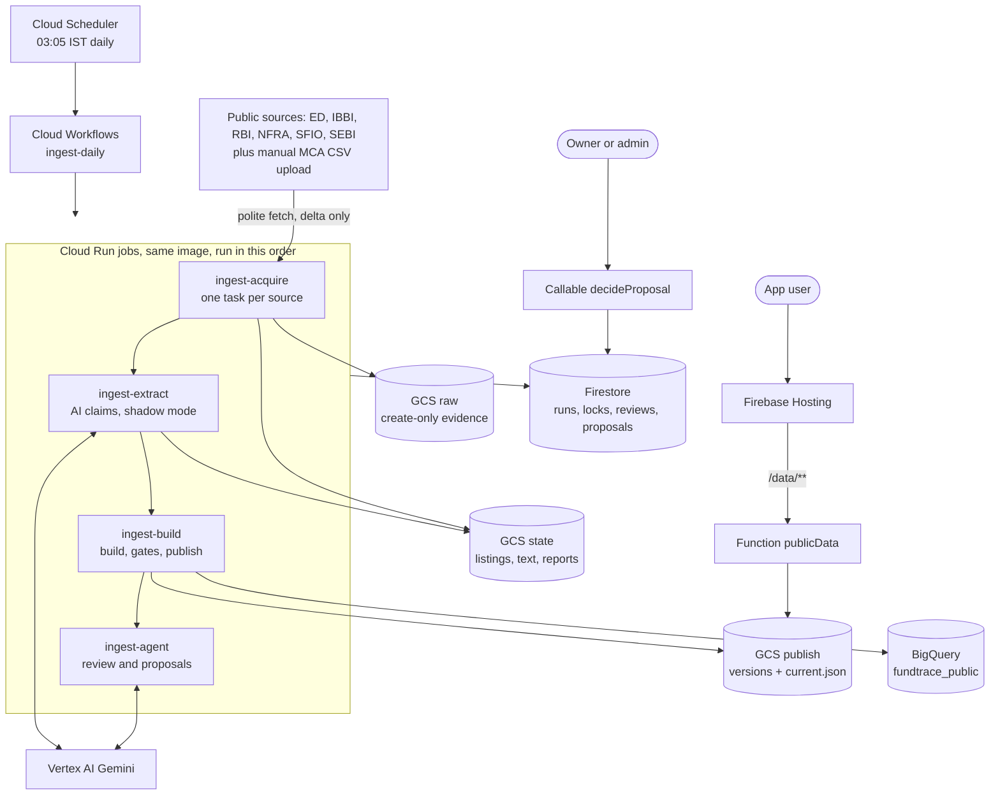
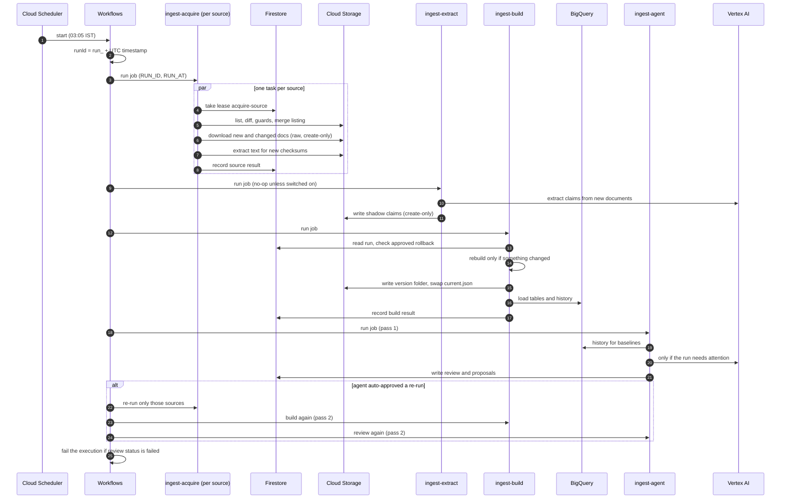
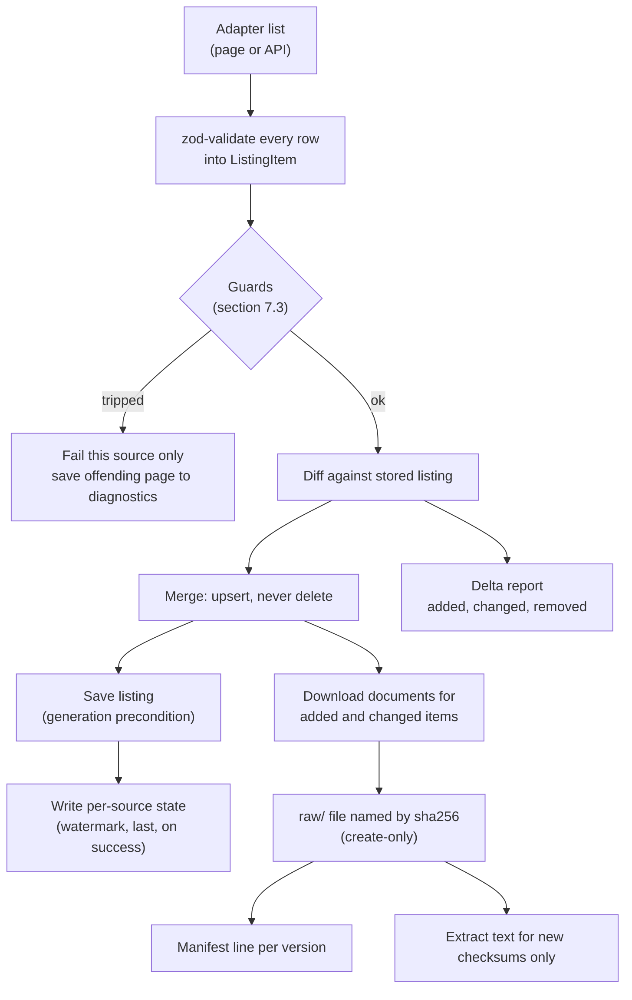
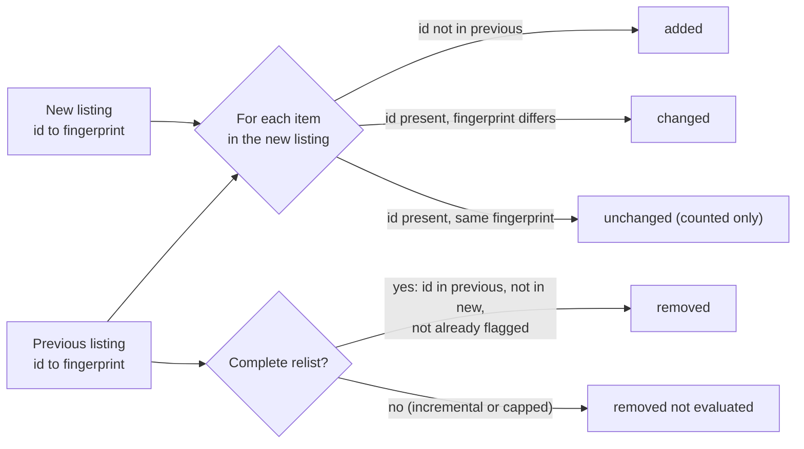
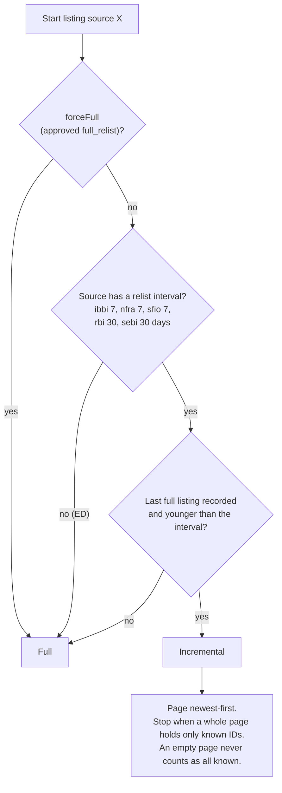
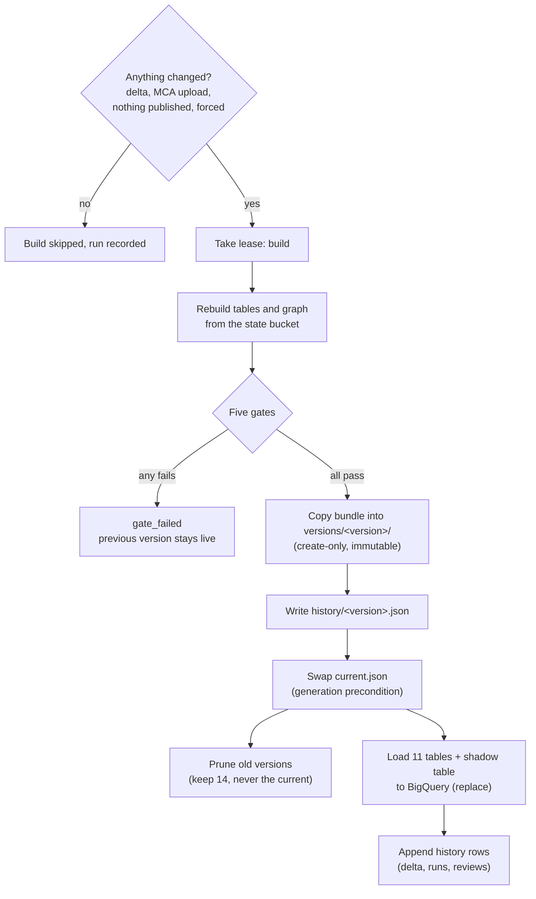
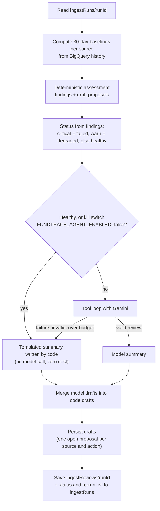
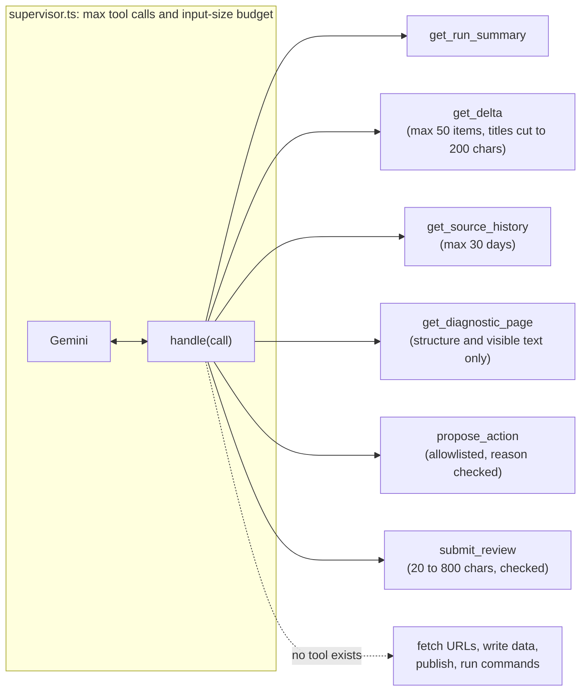
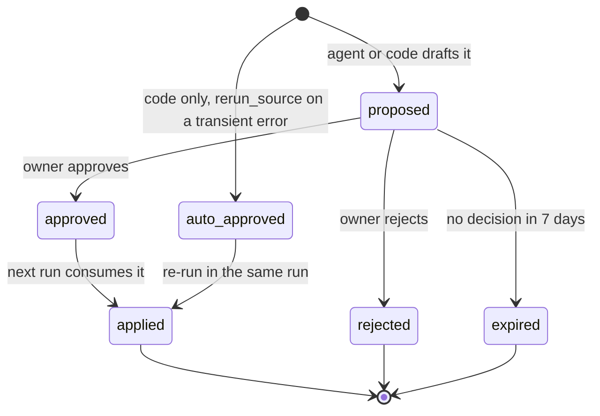
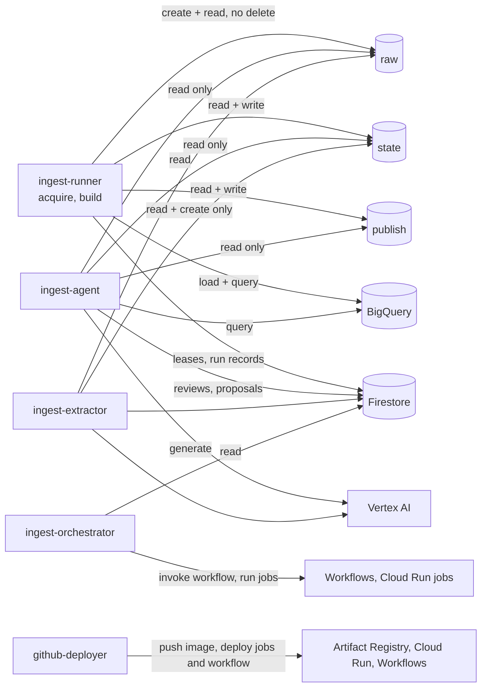

# Ingestion pipeline and data agent: what was built on `ingestion-agent`

Companion to the design docs `docs/plans/GCP_INGESTION_AGENT_PLAN.md` and
`docs/plans/DELTA_INGESTION_PLAN.md`. Those say what was planned; this file says what the code on
this branch does, what exists in Google Cloud, and how the parts fit together. Project
`fund-tracer`, region `asia-south1`.

## 1. Summary in 10 points

1. **The public-records pipeline now runs in the cloud, not on a laptop.** Cloud Scheduler starts
   Cloud Workflows every day at 03:05 IST; Workflows runs Cloud Run jobs in order: acquire, extract,
   build, agent review (`infra/workflows/ingest-daily.yaml`).
2. **Only what changed is fetched (delta ingestion).** Each source's listing is diffed against the
   stored one by item ID and content fingerprint. Only added or changed items have their documents
   downloaded, and only new checksums have their text extracted.
3. **Listings are cheap by default.** Sources that page newest-first run incrementally (stop at the
   first page of already-known items) and do a full relist weekly (IBBI, NFRA, SFIO) or monthly
   (RBI, SEBI). ED is one call, so it is always full.
4. **Three guards stop a broken scrape from doing damage:** an empty listing, a changed page layout
   and a large shrink all fail that source before anything is written. The offending page is saved
   for diagnosis.
5. **Storage is split by purpose.** Raw evidence goes in a create-only bucket, pipeline state in a
   versioned bucket, and published bundles in a third bucket. Tables are loaded to BigQuery, and run
   state lives in Firestore.
6. **Publishing is gated and reversible.** A rebuilt dataset must pass five gates. A passing build
   becomes an immutable version folder, then a compare-and-swap on `current.json` makes it live.
   Rollback re-points the pointer. A first dry-run period publishes to a `dry-run` channel only.
7. **The agent supervises; it never touches data.** After every build a small Gemini tool loop
   explains the run and may propose allowlisted actions. Numbers and findings come from code. Healthy
   days skip the model entirely.
8. **The agent's authority is deliberately tiny.** Its identity is read-only apart from Firestore
   reviews and proposals. Every action it proposes needs the owner's approval, except one automatic
   re-run per source for transient errors.
9. **The app reads the cloud data.** A `publicData` function serves the current bundle behind sign-in
   and App Check; `decideProposal` lets an admin approve or reject proposals.
10. **GCP resources were created with `scripts/setup-ingest-gcp.sh`.** The Cloud Run jobs and the
    workflow are not deployed yet: they are created by the deploy pipeline after the branch is merged
    to `main` (section 4).

## 2. What changed in the branch

| Area                              | Change                                                                                                                                                                                                 |
| --------------------------------- | ------------------------------------------------------------------------------------------------------------------------------------------------------------------------------------------------------ |
| `ingest/src/delta/`               | Listing diff and merge, listing-mode policy, guards, per-source watermark, delta reports, run lock.                                                                                                    |
| `ingest/src/storage/`, `store/`   | Storage abstraction: file system for tests and dev, Cloud Storage in the cloud, with create-only and generation-precondition writes.                                                                   |
| `ingest/src/cloud/`               | Cloud Run entrypoints: `acquireTask`, `extractTask`, `buildTask`, `agentTask`, plus `gates`, `publish`, `bigquery`, `history`, `mcaState`, `env` (zod-validated config).                               |
| `ingest/src/coordination/`        | Leases (file-based locally, Firestore in the cloud) and the run log written to Firestore `ingestRuns`.                                                                                                 |
| `ingest/src/agent/`               | Findings (deterministic rules), tool loop (`supervisor`), tool list, proposals, wording check, history queries, page-structure summary for layout diagnosis.                                           |
| `ingest/src/ai/`                  | Model client for the agent and extraction: Gemini on Vertex AI, plus a mock model used by default in tests.                                                                                            |
| `ingest/src/extract/ai/`          | MVP 3: AI evidence extraction in shadow mode (writes a separate shadow table only).                                                                                                                    |
| `ingest/src/sources/`             | Adapters for ED, IBBI, RBI, NFRA, SFIO, SEBI (full index with a config switch) and the manual MCA master.                                                                                              |
| `functions/src/`                  | `http/publicData` (serves the published bundle) and `callable/decideProposal` (approvals), with `services/publishedData`, `profiles`, `access`.                                                        |
| `packages/shared/`                | zod schemas for runs, reviews, proposals, published versions and gate results.                                                                                                                         |
| `firestore.rules`                 | Rules for `ingestRuns`, `ingestReviews`, `agentProposals`; `ingestLocks` has no client access (default deny). Emulator tests added.                                                                    |
| `infra/`, `scripts/`              | `workflows/ingest-daily.yaml`, `monitoring/*.json` alert policies, `storage/state-lifecycle.json`, `artifact-registry/cleanup-policy.json`, `scripts/setup-ingest-gcp.sh`, `scripts/deploy-ingest.sh`. |
| `docs/`                           | The two plans, `DEPLOY.md` (cloud ingestion section), `SESSION_NOTES.md`, and this file.                                                                                                               |
| Fix made while creating resources | `scripts/setup-ingest-gcp.sh` used `bq add-iam-policy-binding --dataset`, which needs allowlisting on this project. It now edits the dataset ACL with `bq update` (idempotent).                        |
| Done (18 Oct 2026)                | The budget alerts: ₹450/month for the project and ₹200/month for the AI services, alerting at 50%, 90% and 100% (`SESSION_NOTES.md`).                                                                  |

## 3. System overview



## 4. GCP resources: what exists and what does not yet

Created by `scripts/setup-ingest-gcp.sh fund-tracer` (run in this session as the project owner,
without the budget step) and verified afterwards with read-only `gcloud` and `bq` commands.
The alert policies needed one retry because new log metrics take a few minutes to become visible.

| Resource              | Name                                                                                                                                                 | Purpose                                                                          |
| --------------------- | ---------------------------------------------------------------------------------------------------------------------------------------------------- | -------------------------------------------------------------------------------- |
| APIs enabled          | Cloud Run, Workflows (+ executions), Cloud Scheduler, BigQuery, Storage, Firestore, Artifact Registry, Logging, Monitoring, IAM, Vertex AI           | Everything the pipeline calls.                                                   |
| Service accounts      | `ingest-runner`, `ingest-orchestrator`, `ingest-agent`, `ingest-extractor`                                                                           | One identity per job type (section 8).                                           |
| Buckets (private)     | `fund-tracer-ingest-raw`, `fund-tracer-ingest-state` (versioning on, lifecycle file), `fund-tracer-ingest-publish`                                   | Uniform access, public access prevention, `asia-south1`.                         |
| BigQuery datasets     | `fundtrace_public`, `fundtrace_public_dryrun`                                                                                                        | Live tables and the dry-run copy.                                                |
| Artifact Registry     | `ingest` (Docker, cleanup policy keeps the last 10 images)                                                                                           | Holds the pipeline image.                                                        |
| IAM for deploys       | `github-deployer`: `artifactregistry.writer` on `ingest`, `run.developer`, `workflows.editor`, `iam.serviceAccountUser` on the four runtime accounts | Lets the main-branch deploy ship the jobs.                                       |
| Firestore TTL         | `expiresAt` on collection group `ingestLocks`                                                                                                        | Expired leases are deleted automatically.                                        |
| Log-based metrics     | `ingest_source_failed`, `ingest_publish_gate_failed`                                                                                                 | Feed the alert policies.                                                         |
| Cloud Scheduler       | `ingest-daily`, `5 3 * * *`, `Asia/Kolkata`, enabled                                                                                                 | Starts the workflow. It targets a workflow that is not deployed yet (see below). |
| Alert policies        | "Ingest: a source failed", "Ingest: daily run failed", "Ingest: publish gate failed"                                                                 | No notification channel (decided); visible in the console.                       |
| MCA and registry seed | `state/raw/mca_ogd/company_master.part1of5..part5of5.csv`, `state/registry/sources.json`                                                             | Copied from the repository so the first build has them.                          |

**Not created yet (by design):**

- The Cloud Run jobs `ingest-acquire`, `ingest-extract`, `ingest-build`, `ingest-agent` and the
  `ingest-daily` workflow. They need a built image, so `.github/workflows/deploy.yml` creates them on
  merge to `main` (repository variable `INGEST_ENABLED=true`), through `scripts/deploy-ingest.sh`.
- The functions `publicData` and `decideProposal`; the same deploy publishes them. After that, the
  owner must allow network-level invocation once (see `docs/DEPLOY.md`).
- The budget alerts (done, 18 Oct 2026).

**Until the deploy runs,** the Scheduler job fires at 03:05 IST against a workflow that does not
exist, so those executions will fail. Either merge and deploy first, or pause the job with
`gcloud scheduler jobs pause ingest-daily --location asia-south1 --project fund-tracer`.

## 5. The daily run



Details that matter:

- A failing step is recorded and the workflow keeps going, so the build always records the run and
  the agent always reviews it.
- `rerun_count` and `review_status` are read back from `ingestRuns/<runId>`.
- The execution itself fails (so alerting fires) when the agent's code-computed status is `failed`,
  or when the agent step failed.
- Passing `{"force_build": "true"}` rebuilds and republishes even if nothing changed.

## 6. How data is fetched

### 6.1 Sources

| Source | What is fetched                         | Notes                                                                                                                                      |
| ------ | --------------------------------------- | ------------------------------------------------------------------------------------------------------------------------------------------ |
| ED     | Press releases from one public JSON API | One call, integer IDs; always a full list.                                                                                                 |
| IBBI   | Announcement tables (HTML)              | Relisted fully every 7 days; slowest source (extra delay between requests).                                                                |
| RBI    | Press-release table, per year           | Full relist every 30 days.                                                                                                                 |
| NFRA   | S3WaaS HTML pages                       | Full relist every 7 days.                                                                                                                  |
| SFIO   | S3WaaS HTML pages                       | Full relist every 7 days. Small source.                                                                                                    |
| SEBI   | Enforcement orders by sub-menu          | Full index is used in the cloud (`FUNDTRACE_SEBI_SAMPLE=false`); full relist every 30 days. The 10-order sample is never incremental.      |
| MCA    | Company master CSV parts                | Not crawled (robots.txt forbids it). The owner uploads CSV parts to `state/raw/mca_ogd/`; a change in their generation triggers a rebuild. |

Access rules baked into the shared HTTP layer: robots.txt respected, minimum delay per host,
back-off on 429 or 5xx, stop on 403, an identifying user agent, and per-source caps on documents per
run (`FUNDTRACE_MAX_DOCS_PER_SOURCE`, default 300).

### 6.2 From a page to stored evidence



Safe-write properties:

- **Raw files are content-addressed and create-only.** The runner's role (`objectCreator` plus
  `objectViewer`) cannot overwrite or delete them, so evidence is tamper-evident. A changed document
  becomes a new object.
- **Listings use generation preconditions.** If another writer changed the listing between read and
  write, the write fails instead of losing an update.
- **The state watermark is written last,** and only after the listing succeeded.

## 7. How the delta is calculated

### 7.1 The diff

`ingest/src/delta/diff.ts`. Each listed item has a stable `item_id` and a content fingerprint:
SHA-256 of `source_id`, `collection`, `title`, `detail_url`, `document_urls`, `published_date` and
the sorted extra `fields`. `listed_at` is excluded, so merely being listed again is not a change.



- **Added** items are new IDs. **Changed** items keep their ID but have a different fingerprint.
- **Removed** is only evaluated on a complete relist, because a partial listing cannot say what
  disappeared. Removed items are flagged once in the state file (`missing_ids`) and kept in the
  listing: a soft delete, never a hard delete.
- `mergeListing` upserts: unchanged items keep their stored record, changed items are replaced,
  new ones appended.

### 7.2 Choosing full or incremental

`ingest/src/delta/policy.ts`.



### 7.3 Guards (nothing is written if one trips)

`ingest/src/delta/guards.ts`, `policy.ts`.

| Guard         | Trips when                                                                                           | Result                                                                                   |
| ------------- | ---------------------------------------------------------------------------------------------------- | ---------------------------------------------------------------------------------------- |
| Empty listing | The adapter returns no items for a source that already has some                                      | Source fails: "returned no items but N were listed before".                              |
| Layout change | The first page has no rows for a collection that was listed before                                   | `LayoutChangedError`; the page (first 200,000 chars) is saved to `interim/diagnostics/`. |
| Shrink        | A complete relist returns fewer than 50% of the items still listed (only judged at 20 or more items) | Source fails; an approved `accept_shrink` proposal overrides it for one run.             |

### 7.4 What the delta is used for

- Which documents to download (added and changed items only).
- Which text to extract (new checksums only).
- Whether to rebuild at all (any source with added, changed or removed items, a changed MCA upload,
  nothing published yet, or a forced run).
- The delta report per source (`delta/<source>/<run>.json`), the audit trail the agent reads.
- BigQuery history, which the agent uses for its 30-day baselines.

A second run on the same day finds no delta and records a quiet run.

## 8. Build, gates, publishing and serving



**The five gates** (`ingest/src/cloud/gates.ts`, pure functions):

| Gate                   | Passes when                                                                                  |
| ---------------------- | -------------------------------------------------------------------------------------------- |
| `required_tables`      | `documents`, `case_events`, `entities`, `relationships` are all non-empty.                   |
| `max_row_drop`         | No table fell by more than 20% against the last published version (default `GATE_MAX_DROP`). |
| `bundle_size`          | The compressed graph bundle is at most 48 MB (the web loader's limit is 64 MB, B-41).        |
| `newer_than_published` | The new `built_at` is later than the published one.                                          |
| `seed_cases_kept`      | Every seed case present in the previous version is still present.                            |

**Channels.** `FUNDTRACE_PUBLISH_ENABLED=false` (the default at first deploy) publishes to the
`dry-run` channel and loads `fundtrace_public_dryrun`. After a clean week it is switched to `live`
and tables load to `fundtrace_public`.

**Rollback.** An approved `rollback_publish` proposal makes the next build re-point the channel to
the newest earlier version whose files still exist; nothing new is published that run.

**Serving.**

```mermaid
sequenceDiagram
  participant U as Browser (signed in, App Check)
  participant H as Firebase Hosting
  participant F as Function publicData
  participant G as GCS publish bucket
  U->>H: GET /data/public-records/index.json
  H->>F: rewrite /data/**
  F->>F: verify ID token and App Check token
  F->>G: read current.json
  F-->>U: pointer (short cache)
  U->>H: GET versions/&lt;version&gt;/graph-lab.json.gz
  H->>F: rewrite
  F->>G: stream the file
  F-->>U: bundle (immutable, cached for a year)
```

The app never queries BigQuery or Firestore for public records; it only reads the published bundle.

## 9. The agent

### 9.1 What it is, and is not

The agent is a small TypeScript tool loop on Gemini (`gemini-3.1-flash-lite` by default, Vertex AI
with the job's own service account, no API key). It is **not** in the data path: it cannot fetch URLs,
write listings or raw files, publish, or load BigQuery. A wrong model output can produce a wrong
summary or a wrong proposal, never wrong or lost data.

### 9.2 One review



### 9.3 What the code decides before any model call

`ingest/src/agent/findings.ts`:

| Finding                                                                  | Condition                                                                                       | Proposal drafted by code                 |
| ------------------------------------------------------------------------ | ----------------------------------------------------------------------------------------------- | ---------------------------------------- |
| `source_failed` (critical)                                               | A source failed                                                                                 | See the next three rows.                 |
| shrink                                                                   | Error matches "shrank from A to B"                                                              | `accept_shrink` (owner approval)         |
| layout                                                                   | Error matches "No rows parsed" or "returned no items"                                           | `adapter_fix_needed` (owner approval)    |
| transient                                                                | Error matches timeout, reset, 5xx, 429 and similar                                              | `rerun_source`, **auto-approved**        |
| `lease_conflict` (warn)                                                  | Another run held the lease                                                                      | none                                     |
| `no_new_items` (warn)                                                    | Zero new for 3 or more runs on a source that averages 5 or more, with 5 or more runs of history | `full_relist` if the run was incremental |
| `spike_in_items` (info)                                                  | New or changed items above max(50, mean + 4 standard deviations)                                | none                                     |
| `items_removed`                                                          | Removed items (warn above 10, else info)                                                        | none                                     |
| `slow_source` (info)                                                     | More than 3x the median duration and over 10 minutes                                            | none                                     |
| `text_extraction_failed`                                                 | Documents could not be read (scanned PDFs need OCR)                                             | none                                     |
| `full_relist_overdue`                                                    | Last full relist is older than its interval plus 2 days                                         | none                                     |
| `build_failed`, `gate_failed`, `bigquery_failed`, `ai_extraction_failed` | From the build and extraction records                                                           | none                                     |

### 9.4 The tool loop



Guardrails inside the loop:

- Arguments are zod-validated; a validation error goes back to the model and nothing runs.
- Text from websites (titles, pages) is returned under an `untrusted_data` key: data, never
  instructions.
- `propose_action`: the reason is checked by `wording.ts` (no verdict words such as "fraud
  confirmed"); at most 5 model proposals per run; `rollback_publish` takes no source, every other
  action needs one; a model proposal is **never** auto-approved.
- `submit_review` summary goes through the same wording check.
- When the input budget is used up the loop answers "call submit_review now".
- Any model failure falls back to the templated summary with an agent note.
- Each review records the model, prompt version, an input hash and the tool-call count; never the
  prompt text.

### 9.5 Proposals and approvals



| Action               | Effect when approved                                           | Approval                                      |
| -------------------- | -------------------------------------------------------------- | --------------------------------------------- |
| `rerun_source`       | Re-run that source's acquire task in the same run (pass 2)     | Automatic only for transient errors, code-set |
| `full_relist`        | Force a full listing for that source on the next run           | Owner                                         |
| `accept_shrink`      | Allow one large drop for that source, one run                  | Owner                                         |
| `pause_source`       | Skip the source until the owner resolves it (stays in force)   | Owner                                         |
| `adapter_fix_needed` | Nothing automatic; flags a code change with the diagnosis      | Owner or developer                            |
| `rollback_publish`   | Re-point the channel to the previous version on the next build | Owner                                         |

The owner approves through the `decideProposal` callable (admin claim, App Check, zod input) or, until
the admin page exists, by setting `status: approved` on the document in the Firestore console. One-shot
actions are marked `applied` with the run ID once an acquire task finishes that source successfully.

### 9.6 AI extraction (MVP 3, shadow mode)

`ingest-extract` runs between acquire and build. It is off unless
`FUNDTRACE_AI_EXTRACT_ENABLED=true`, skips under the kill switch, and does nothing with the mock
provider (no fake claims are stored). When on, it reads pending documents (cap
`FUNDTRACE_AI_EXTRACT_MAX_DOCS`, default 50 per run; page and character caps per document), and writes
claims as create-only objects. The build loads them into the separate table
`evidence_claims_ai_shadow` only. Claims never reach the graph until a measured quality gate passes and
the owner approves (B-52); evidence status is never upgraded.

## 10. Identity and permissions



Notes: Firestore rules restrict client access to admin reads of runs, reviews and proposals;
`ingestLocks` is unreachable from clients. The functions' runtime accounts get read access to the
publish bucket only. No API keys exist anywhere: GitHub deploys use Workload Identity Federation and the
jobs use their own service-account credentials.

## 11. Where state lives

| Store                        | Contents                                                                                                                                                                                                              |
| ---------------------------- | --------------------------------------------------------------------------------------------------------------------------------------------------------------------------------------------------------------------- |
| `fund-tracer-ingest-raw`     | Original PDFs, HTML and API responses named by SHA-256. Kept forever.                                                                                                                                                 |
| `fund-tracer-ingest-state`   | Listings and their history, item-to-document links, manifests, extracted text, per-source state, delta reports, diagnostics, MCA uploads. Versioned; superseded versions follow `infra/storage/state-lifecycle.json`. |
| `fund-tracer-ingest-publish` | `publish/<channel>/versions/<version>/...`, `history/<version>.json`, `current.json`.                                                                                                                                 |
| BigQuery `fundtrace_public`  | The canonical tables (replaced on each published build), the shadow claims table, and history (delta events, runs, reviews).                                                                                          |
| Firestore                    | `ingestRuns/{runId}`, `ingestLocks/{name}`, `ingestReviews/{runId}`, `agentProposals/{id}`.                                                                                                                           |

Leases (`acquire-<source>` and `build`) are Firestore documents with an expiry; an expired lease can be
taken over, and the TTL policy deletes stale ones. Overlapping executions therefore cannot merge the
same listing or build twice at once.

## 12. Cost and safety controls

- Cloud Run jobs scale to zero; per-job CPU, memory, timeout and retry caps are set in
  `scripts/deploy-ingest.sh`.
- The model is called only on non-healthy days, with a tool-call and input budget; the kill switch is
  `FUNDTRACE_AGENT_ENABLED=false`. Tests and CI use the mock model.
- BigQuery loads are free; the agent's queries are parameterised and bounded.
- Artifact Registry keeps the last 10 images.
- Budget alerts exist (₹450 and ₹200 a month); they warn, they do not stop spend.
- Alert policies (`infra/monitoring/`): run failed, source failed, publish gate failed. No notification
  channel yet (decided); they show in the console.

## 13. How to operate it

```bash
# one-time setup, already done once; safe to re-run
SEED=1 scripts/setup-ingest-gcp.sh fund-tracer

# after the branch is merged to main and INGEST_ENABLED=true, the deploy builds the image and runs
scripts/deploy-ingest.sh fund-tracer <image-uri>

# run now / force a rebuild
gcloud workflows run ingest-daily --location asia-south1 --project fund-tracer --data '{}'
gcloud workflows run ingest-daily --location asia-south1 --project fund-tracer --data '{"force_build":"true"}'
```

What to look at after a run: Firestore `ingestRuns/<runId>` (per-source status, counts, build result),
`ingestReviews/<runId>` (summary and findings), `agentProposals` (anything waiting for approval).

Going live: run dry for about a week (7 clean scheduled runs; a second same-day run is quiet; the drills
in the plan pass), then set `INGEST_PUBLISH_ENABLED=true` and redeploy.

## 14. Boundary conditions this touches

B-15 (cost), B-24 (idempotent re-runs), B-27 (a day is IST), B-29 and B-36 (evidence immutable, status
never upgraded), B-30 (long jobs), B-31 (no keys), B-32 (billing plan), B-34 (region), B-35 (private
buckets, polite crawling, ED/SFIO permission not yet confirmed), B-41 (bundle size), B-43 (data age
shown), B-47 (listing guards), B-48 to B-52 (leases, agent authority, publish pointer, AI extraction).
Open decisions are in section 18 of the GCP plan (D2 provider, D3 app sign-in, D5 retention, D6 ED/SFIO,
D7 budget (parked), D8 backfill pace).
