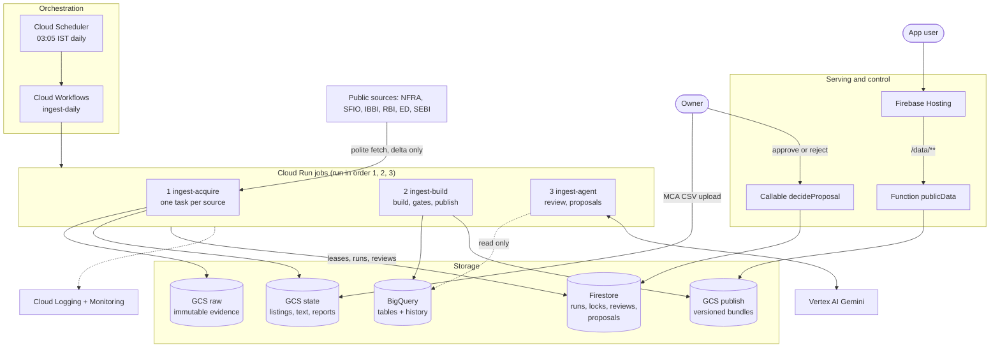
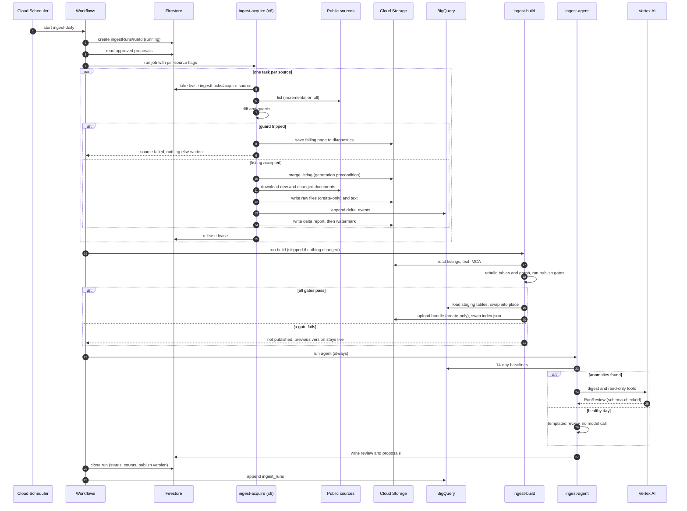
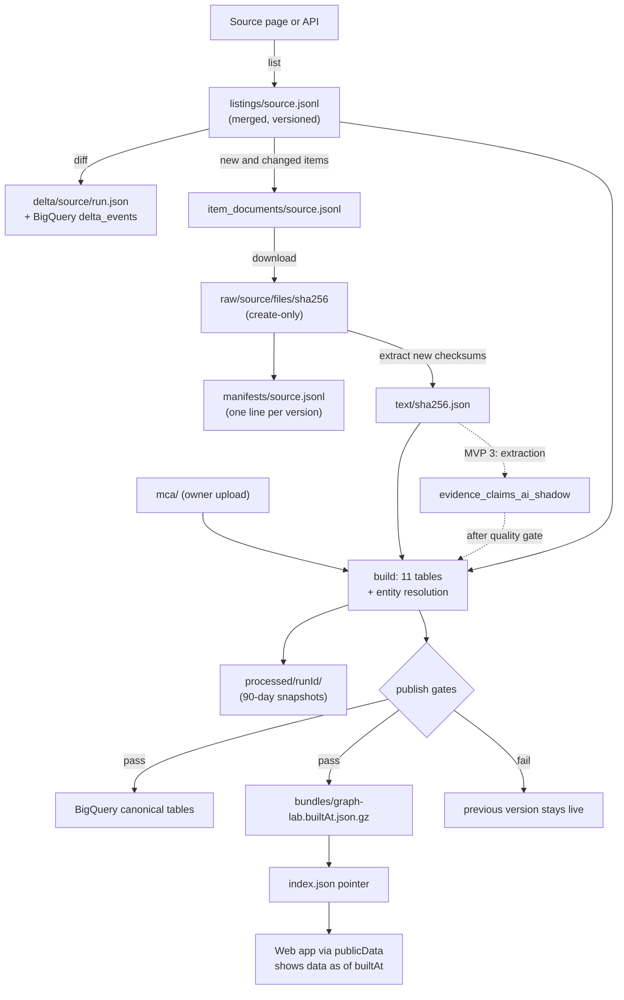
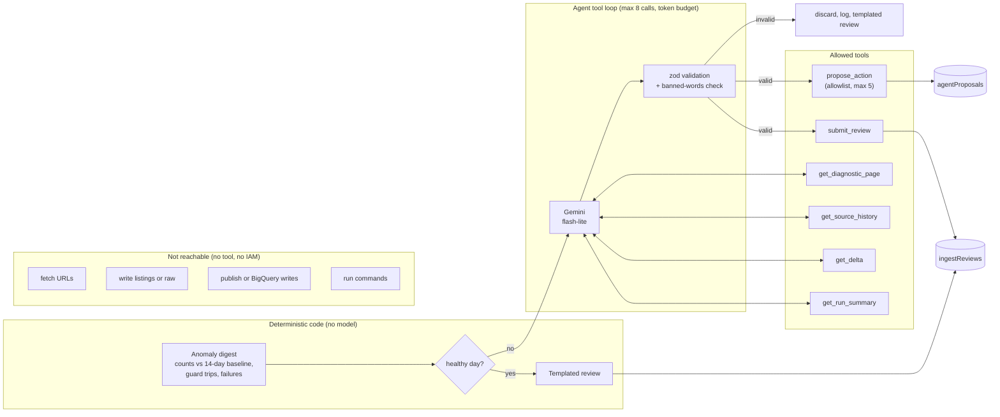
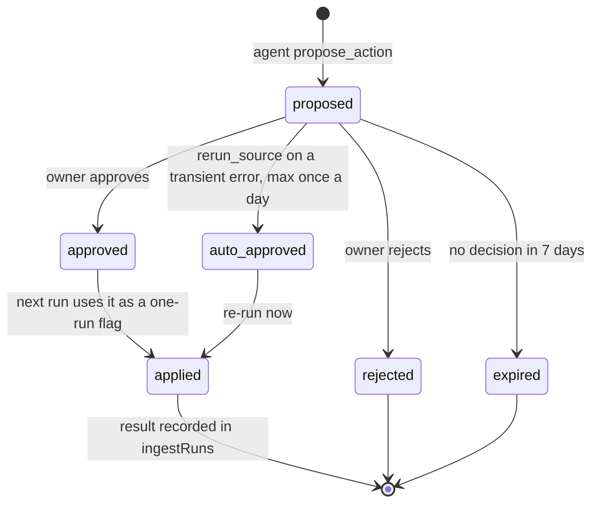
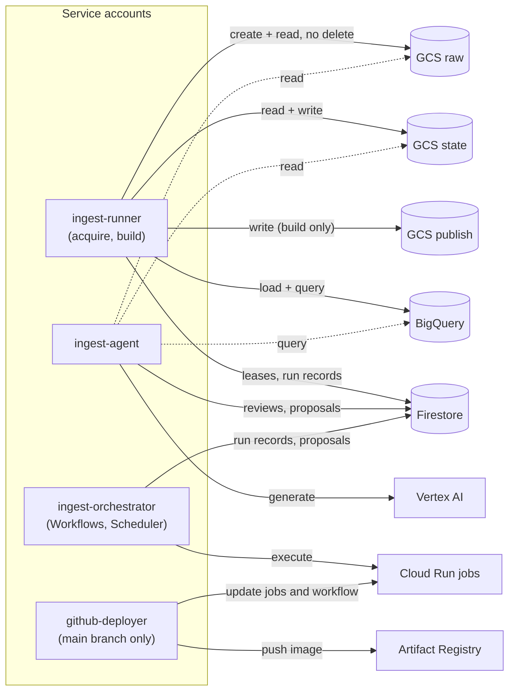
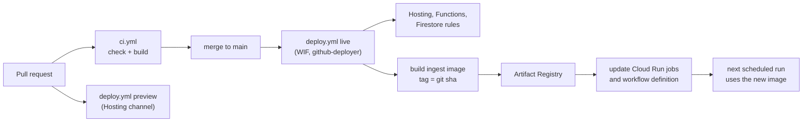

# Plan: cloud ingestion pipeline and data agent on GCP

_Status: MVP 1 implemented on branch `ingestion-agent` (code, container, infra scripts, workflow); GCP resources are created by `scripts/setup-ingest-gcp.sh` (not run yet). MVP 2 and 3 follow._
_Project `fund-tracer` (number 728958349363), region `asia-south1`, as set up in `docs/DEPLOY.md`._

## 1. Goal

Move the public-records pipeline from a laptop to Google Cloud and add an agent that supervises it:

- Every day, **in the cloud**, call each source, find the delta, fetch only what changed, store raw
  evidence and the rebuilt dataset, and publish a verified version the UI reads.
- An **agent** (Gemini) reviews each run, explains anomalies, proposes fixes, and (from MVP 3) reads
  new documents to extract structured evidence. It works behind hard guardrails: it can read
  everything, but it cannot change data on its own; risky actions need the owner's approval.
- No ingestion step runs on a local machine any more. Local runs remain only for tests (with fakes,
  never real GCP or a billed model).

```
Cloud Scheduler (daily 03:05 IST)
   │
   ▼
Cloud Workflows: ingest-daily ───────────────────────────────────────────────────────────┐
   │ 1. acquire (Cloud Run job, 1 task per source, in parallel)                            │
   │      list → diff → guards → merge listing → download new/changed docs → extract text │
   │ 2. build + validate + publish (Cloud Run job, 1 task)                                  │
   │      rebuild tables + graph → publish gates → BigQuery load → versioned bundle       │
   │ 3. agent review (Cloud Run job, always runs, even after failures)                     │
   │      reads run results → review + proposals (needs approval) → Firestore             │
   └─ 4. close run record ◀─────────────────────────────────────────────────────────────┘

Storage:  GCS raw (immutable evidence)  ·  GCS state (listings, manifests, text, reports)
          GCS publish (versioned bundles + index pointer)  ·  BigQuery (tables + history)
          Firestore (run records, locks, reviews, proposals)
Serving:  Hosting rewrite /data/** → function → GCS publish bucket → web app ("data as of …")
```

The full list of services and data stores is in §2, and the Mermaid diagrams are in §3.

## 2. GCP services and data stores at a glance

### 2.1 Services

| Service                                | Role in this system                                                      | Status                                          | Billing model                                                | Key settings                                                    |
| -------------------------------------- | ------------------------------------------------------------------------ | ----------------------------------------------- | ------------------------------------------------------------ | --------------------------------------------------------------- |
| **Cloud Scheduler**                    | Starts the daily run                                                     | New                                             | 3 jobs free per billing account                              | `5 3 * * *` Asia/Kolkata, 1 retry                               |
| **Cloud Workflows**                    | Orchestrates acquire → build → agent → close; applies approved proposals | New                                             | Per step; 5,000 internal steps/month free                    | One workflow `ingest-daily`, ~10 steps per run                  |
| **Cloud Run jobs**                     | Run the pipeline code: `ingest-acquire`, `ingest-build`, `ingest-agent`  | New                                             | Per vCPU-second and GiB-second while running; zero when idle | Caps on CPU, memory, timeout and retries (§6)                   |
| **Artifact Registry**                  | Stores the ingest container image                                        | Exists (functions images); new repo `ingest`    | Per GB stored                                                | Cleanup policy keeps the last 10 images                         |
| **Cloud Storage**                      | Raw evidence, pipeline state, published bundles                          | New (3 buckets)                                 | Per GB-month + operations                                    | Private, uniform access, public access prevention, asia-south1  |
| **BigQuery**                           | Analytical copy of the dataset and the change/run history                | New dataset                                     | Storage per GB; queries per TB scanned; batch loads free     | Partitioned history tables, `maximumBytesBilled` on every query |
| **Firestore** (Native mode)            | Operational state: run records, locks, reviews, proposals                | Exists (database + rules); new collections      | Per read/write/delete; free daily quota                      | Default-deny rules, emulator tests                              |
| **Vertex AI (Gemini)**                 | The agent's model (supervisor, later extraction)                         | New use (D2)                                    | Per 1M input/output tokens                                   | `gemini-3.1-flash-lite`, token and call caps, kill switch       |
| **Cloud Functions (2nd gen)**          | `publicData` (serves the bundle), `decideProposal` (approvals)           | Exists (`health`, `askGemini`); 2 new           | Per invocation and compute                                   | `maxInstances`, 256 MiB, `minInstances: 0`                      |
| **Firebase Hosting**                   | Serves the web app; rewrite `/data/**` → `publicData`                    | Exists                                          | Free tier for storage/transfer                               | Same-origin, so the CSP stays strict (B-44)                     |
| **Firebase Auth + App Check**          | Sign-in for the web app and the admin page                               | App Check exists on callables; Auth to add (D3) | Free tier                                                    | Admin custom claim for approvals                                |
| **Secret Manager**                     | Gemini API key, only if the API-key provider is kept (D2)                | Exists                                          | Per secret version + access                                  | Runtime accounts get accessor on one secret only                |
| **IAM + Workload Identity Federation** | Keyless CI deploys; one service account per job                          | Exists (WIF, deploy accounts); 3–4 new accounts | Free                                                         | Least privilege (§11)                                           |
| **Cloud Logging**                      | Structured JSON logs from every job and function                         | Exists                                          | 50 GiB/month free ingestion                                  | Log-based metrics for failures, guards, gates                   |
| **Cloud Monitoring**                   | Alert policies and a pipeline dashboard                                  | New                                             | Free for these metrics                                       | No notification channel yet (decided)                           |
| **Cloud Billing budgets**              | Spend alert for the project                                              | Planned (B-15)                                  | Free                                                         | Threshold per D7                                                |
| **Cloud Build**                        | Builds function images during Firebase deploys                           | Exists                                          | Free tier minutes                                            | Unchanged; the ingest image is built in GitHub Actions          |

**Deliberately not used (for now):**

| Service                                 | Why not                                                                                                              |
| --------------------------------------- | -------------------------------------------------------------------------------------------------------------------- |
| Vertex AI Agent Engine / ADK            | Extra runtime outside our TypeScript-only rule; our agent is a small tool loop where every guardrail is our own code |
| Cloud Composer (Airflow)                | Always-on environment with a monthly cost; Workflows covers one daily DAG                                            |
| Cloud SQL / AlloyDB / Spanner           | Always-on database cost; no relational, transactional workload here                                                  |
| Dataflow / Dataproc                     | The data is small (~1 GB); a single job rebuilds it in about a minute                                                |
| Pub/Sub, Eventarc, Cloud Tasks          | Not needed for one daily run; MCA uploads are picked up by the next run. Revisit for event-driven runs               |
| A graph database (Neo4j, Spanner Graph) | Per-hour cost; needed only when the graph outgrows a browser bundle (B-41)                                           |
| Cloud NAT (static egress IP)            | Only if a government site blocks Cloud Run's shared IP ranges (§16)                                                  |

### 2.2 Databases and data stores

| Store                             | Type                                | What lives there                                                                                                                   | Why this store                                                                                                                     | Retention                                                     |
| --------------------------------- | ----------------------------------- | ---------------------------------------------------------------------------------------------------------------------------------- | ---------------------------------------------------------------------------------------------------------------------------------- | ------------------------------------------------------------- |
| `gs://fund-tracer-ingest-raw`     | Object storage                      | Original PDFs, HTML and API responses, named by sha256                                                                             | Cheap, immutable, any size; create-only writes make evidence tamper-evident                                                        | Forever (decided)                                             |
| `gs://fund-tracer-ingest-state`   | Object storage                      | Listings, manifests, item→document links, extracted text, watermarks, delta reports, diagnostics, MCA uploads, processed snapshots | Same files the pipeline already reads and writes; generation preconditions give safe concurrent updates; versioning gives rollback | Versions kept; `processed/` snapshots 90 days (D5)            |
| `gs://fund-tracer-ingest-publish` | Object storage                      | Versioned graph bundles and the `index.json` pointer                                                                               | Atomic pointer swap and instant rollback                                                                                           | Last 14 versions                                              |
| BigQuery `fundtrace_public`       | Analytical warehouse (columnar SQL) | The 11 canonical tables; `delta_events`, `ingest_runs`, `agent_reviews` history                                                    | SQL over the whole dataset for the agent, analysis and later APIs; batch loads are free; schemas already generated from zod        | Current snapshot replaced per build; history kept             |
| Firestore                         | Operational document database       | `ingestRuns`, `ingestLocks`, `ingestReviews`, `agentProposals` (plus the app's existing `funds`)                                   | Small documents, transactions for leases, security rules for the admin UI, already in the project                                  | Runs and reviews kept; expired leases removed by a TTL policy |
| Artifact Registry `ingest`        | Container registry                  | The pipeline image                                                                                                                 | Required by Cloud Run jobs                                                                                                         | Last 10 images                                                |
| Secret Manager                    | Secret store                        | Gemini API key (only with the API-key provider)                                                                                    | Never in code or env files                                                                                                         | Current version                                               |

The web app does **not** query BigQuery or Firestore for public records: it reads the published
bundle through `publicData`. That keeps the per-user cost near zero and the current in-browser
graph code unchanged (B-41 is the trigger to add a query API later).

## 3. Architecture diagrams

### 3.1 System overview

Everything except the public sources, the owner and the app user runs in project `fund-tracer`, region `asia-south1`.



### 3.2 Daily run (sequence)



### 3.3 Data flow and lineage



### 3.4 Agent loop and guardrail boundary



### 3.5 Proposal lifecycle



### 3.6 Identity and permission boundaries



### 3.7 Build and deploy (CI/CD)



## 4. What exists today (main @ 13d4ef3)

| Area               | State                                                                                                                                                                                                                                                                                                                                                                            |
| ------------------ | -------------------------------------------------------------------------------------------------------------------------------------------------------------------------------------------------------------------------------------------------------------------------------------------------------------------------------------------------------------------------------- |
| GCP                | Project `fund-tracer`, `asia-south1`. Keyless deploys from GitHub (Workload Identity Federation): `github-preview` (Hosting previews) and `github-deployer` (main only: Hosting, Functions, rules). `scripts/setup-gcp.sh` is the idempotent setup pattern.                                                                                                                      |
| Functions          | `health`, `askGemini` (asia-south1, App Check, `maxInstances: 5`, Gemini key in Secret Manager, provider `mock / apikey / vertex`, mock by default in tests/CI/emulator).                                                                                                                                                                                                        |
| Ingest (`ingest/`) | Adapters for NFRA, SFIO, ED, IBBI, RBI, SEBI (10-order sample); MCA master is a manual CSV. Delta logic merged in #11: listing diff/merge, incremental paging with weekly/monthly full relist, guards (empty, layout change, shrink), refresh of changed documents, local file lock, delta reports and run summary. All storage is the local file system (`FUNDTRACE_DATA_DIR`). |
| Build              | `build` is a full rebuild (~30 s) of 11 tables with global entity resolution; `graphCli` builds the graph bundle (~5 MB gz, ~36 MB JSON).                                                                                                                                                                                                                                        |
| Web                | Loads `/graph-lab/*.json.gz` from Hosting (git-ignored, copied by hand). **No Firebase SDK, no real sign-in yet** (demo sign-in).                                                                                                                                                                                                                                                |
| Rules / docs       | Firestore default-deny; `COST_GUIDELINES.md` (cheapest model, `maxInstances`, no always-on resources, BigQuery limits); B-01…B-48.                                                                                                                                                                                                                                               |

## 5. Design decisions (recommended)

1. **Deterministic pipeline, agent on top.** Fetching, diffing and storing stay plain TypeScript code
   (already written and tested). The agent never sits in the data path: a model mistake can produce a
   wrong report or a wrong proposal, never wrong or lost data.
2. **Cloud Run jobs + Cloud Workflows + Cloud Scheduler.** Jobs run for hours if needed (Functions
   cannot, B-30), cost nothing when idle, and Workflows gives per-step retries, ordering and a run
   history for a few steps a day (inside the free tier). No always-on service.
3. **Agent = a small TypeScript tool loop on `@google/genai` function calling** (already a
   dependency), run as its own Cloud Run job. Not Vertex AI Agent Engine or ADK: keeps the
   TypeScript-only rule, no extra runtime or per-hour cost, and every guardrail stays in our code.
   Revisit only if the agent becomes conversational or grows past ~10 tools.
4. **Cloud Storage as the system of record for files, BigQuery for tables, Firestore for run state.**
   The GCS client is used directly (not a FUSE mount) so raw objects can be **create-only** and
   listing updates can use generation preconditions (compare-and-swap).
5. **Publish = new versioned object + atomic pointer swap.** The UI only ever sees a bundle that
   passed every gate; rollback is repointing `index.json`.
6. **Same cost rules as Functions:** mock model in tests and CI, caps on every resource, a kill
   switch for the agent, and a monthly estimate in `COST_GUIDELINES.md` before anything is enabled.

## 6. Components

| Component       | Resource                                                                           | Settings                                                                                                                     |
| --------------- | ---------------------------------------------------------------------------------- | ---------------------------------------------------------------------------------------------------------------------------- |
| Trigger         | Cloud Scheduler `ingest-daily`                                                     | `5 3 * * *` `Asia/Kolkata` (jittered off :00), calls Workflows, 1 retry                                                      |
| Orchestrator    | Cloud Workflows `ingest-daily` (`infra/workflows/ingest-daily.yaml`)               | Runs the three jobs in order, catches failures so the agent and the run record always run, passes `RUN_ID` and per-run flags |
| Acquire         | Cloud Run job `ingest-acquire`                                                     | 6 tasks (task index → source), parallelism 6, 1 vCPU / 1 GiB, task timeout 6 h, `maxRetries: 1`                              |
| Build + publish | Cloud Run job `ingest-build`                                                       | 1 task, 2 vCPU / 4 GiB (graph build holds ~36 MB JSON plus indexes), timeout 1 h, `maxRetries: 0`                            |
| Agent           | Cloud Run job `ingest-agent`                                                       | 1 task, 1 vCPU / 512 MiB, timeout 15 min, `maxRetries: 0`, `AGENT_ENABLED` kill switch                                       |
| Image           | Artifact Registry `asia-south1-docker.pkg.dev/fund-tracer/ingest/ingest:<git-sha>` | One image, three entrypoints; cleanup policy keeps the last 10                                                               |
| Serving         | Function `publicData` (HTTP, asia-south1) behind a Hosting rewrite `/data/**`      | Streams the current bundle from GCS; `maxInstances: 3`, 256 MiB; auth per decision D3                                        |
| Approvals       | Callable `decideProposal` (MVP 2)                                                  | Auth + admin custom claim, zod input, writes an audit entry                                                                  |

## 7. Daily run, step by step

1. **Scheduler → Workflows** starts run `run_<UTC timestamp>` and writes `ingestRuns/{runId}`
   (`status: running`, git sha of the image, flags).
2. **Apply approved proposals.** Workflows reads proposals the owner approved since the last run
   (e.g. "full relist of NFRA", "accept the IBBI shrink once") and turns them into per-source flags
   for this run only. Each proposal is marked `applied` with the run ID.
3. **Acquire (one task per source, in parallel):**
   1. Take a Firestore lease `ingestLocks/acquire-<source>` (expires after the task timeout).
   2. Choose full or incremental listing (existing `delta/policy.ts`), list, validate with zod.
   3. Guards (existing `delta/guards.ts`, B-47): empty, layout change, shrink. A tripped guard fails
      this source only, saves the offending page to `state/diagnostics/<runId>/<source>/` for the
      agent and the owner, and writes nothing else.
   4. Merge the listing and write it back with a **generation precondition** (if another writer
      changed it, the write fails instead of losing an update).
   5. Download documents for new and changed items (polite fetcher, robots.txt, ≥ 1.5 s/host,
      per-source daily caps). Raw files are written **create-only** under their sha256.
   6. Extract text for new checksums only.
   7. Write the delta report, the state watermark (last), and append rows to BigQuery
      `delta_events` (one row per added/changed/removed item).
4. **Build + validate + publish (skipped when no source changed and MCA is unchanged):**
   1. Lease `ingestLocks/build`. Rebuild the 11 tables and the graph from the state bucket.
   2. **Publish gates** (all must pass): zod on every row; no table drops by more than 20 % against the
      last published build; required tables non-empty; bundle under 64 MB (B-41); `dataset_built_at`
      newer than the published one; seed-case fixtures still resolve (DHFL etc. present).
   3. Load BigQuery: load job into `<table>__staging`, then copy over `<table>` with
      `WRITE_TRUNCATE` (each table swaps atomically; loads are free).
   4. Upload `bundles/graph-lab.<builtAt>.json.gz` (create-only), then compare-and-swap
      `index.json` to point at it. Keep the last 14 versions.
   5. While `PUBLISH_ENABLED=false` (the first week, see MVP 1), steps 3–4 write to a `dry-run/`
      prefix and a `_dryrun` dataset only.
5. **Agent review** (always runs): see §9. Writes `ingestReviews/{runId}` and any proposals.
6. **Close the run:** `ingestRuns/{runId}` gets per-source results, gate results, publish version,
   duration and a link to the review; a row is appended to BigQuery `ingest_runs`.

A second run on the same day finds nothing new and only records a quiet run (idempotent, B-24).

## 8. Storage layout

### Cloud Storage (all private, uniform access, public access prevention enforced, asia-south1)

| Bucket                       | Contents                                                                                                                                                                              | Protection                                                                                                                                                                                                                  |
| ---------------------------- | ------------------------------------------------------------------------------------------------------------------------------------------------------------------------------------- | --------------------------------------------------------------------------------------------------------------------------------------------------------------------------------------------------------------------------- |
| `fund-tracer-ingest-raw`     | `raw/<source>/files/<aa>/<sha256>.<ext>` (PDF/HTML/JSON originals)                                                                                                                    | Content-addressed and create-only; runtime account has **no delete permission**; retention policy (unlocked first; locking is irreversible, decision D5). Kept forever, as decided. ED/SFIO documents stay internal (B-35). |
| `fund-tracer-ingest-state`   | `listings/`, `listings/history/`, `item_documents/`, `manifests/<source>.jsonl`, `text/`, `state/`, `delta/`, `diagnostics/`, `mca/` (manual uploads), `processed/<runId>/` snapshots | Object versioning on (rollback of any listing); listing writes use generation preconditions; `processed/` snapshots deleted after 90 days (derived data, decision D5)                                                       |
| `fund-tracer-ingest-publish` | `bundles/graph-lab.<builtAt>.json.gz`, test bundles, `index.json` (pointer)                                                                                                           | Only the build job writes; only `publicData` reads                                                                                                                                                                          |

The MCA master moves out of git: the owner uploads new CSV parts to `state/mca/` in the console
(manual, as decided). The next daily run sees a new object generation and rebuilds. A one-off
GitHub Actions bootstrap (workflow_dispatch, WIF, no local machine) copies today's five committed
parts and `data/registry/sources.json` into the bucket.

### BigQuery dataset `fundtrace_public` (asia-south1)

| Table                                                                                               | Kind                                            | Notes                                                                                                                |
| --------------------------------------------------------------------------------------------------- | ----------------------------------------------- | -------------------------------------------------------------------------------------------------------------------- |
| 11 canonical tables (`entities`, `relationships`, `case_events`, `documents`, `evidence_claims`, …) | Current snapshot, replaced each published build | Schemas already generated from zod (`data/processed/bigquery/*.schema.json`); clustered by `source_id` / `entity_id` |
| `delta_events`                                                                                      | Append-only history                             | Partitioned by `run_date`; `run_id, source_id, item_id, change, title, published_date`                               |
| `ingest_runs`                                                                                       | Append-only history                             | Partitioned by `run_date`; per-source counts, mode, status, durations, gate results                                  |
| `agent_reviews`                                                                                     | Append-only history                             | Structured review output only (no prompts, per CLAUDE.md logging rule)                                               |

Every query (agent and app) sets `maximumBytesBilled`; nothing uses `SELECT *` (COST_GUIDELINES).

### Firestore (asia-south1, default-deny rules, each collection gets a rule and an emulator test)

| Collection              | Written by                                                                                 | Read by                       |
| ----------------------- | ------------------------------------------------------------------------------------------ | ----------------------------- |
| `ingestRuns/{runId}`    | Workflows / jobs (service accounts)                                                        | Admin UI (admin claim), agent |
| `ingestLocks/{name}`    | Jobs (transactional lease with `expiresAt`)                                                | Jobs only; clients denied     |
| `ingestReviews/{runId}` | Agent job                                                                                  | Admin UI                      |
| `agentProposals/{id}`   | Agent job (create), `decideProposal` / owner (approve or reject), Workflows (mark applied) | Admin UI, Workflows           |

## 9. The agent

### 9.1 Responsibilities by MVP

| MVP | Role                                                                                                | Output                                                                                             |
| --- | --------------------------------------------------------------------------------------------------- | -------------------------------------------------------------------------------------------------- |
| 2   | **Run supervisor**: after every run, explain what happened and what needs attention                 | `RunReview` (status `healthy / degraded / failed`, per-source findings, recommended actions)       |
| 2   | **Proposer**: turn findings into actions from a fixed list, for approval                            | `AgentProposal` documents                                                                          |
| 3   | **Evidence extractor**: read new and changed documents and extract structured claims                | `evidence_claims` rows with `extraction_method: gemini`, in shadow mode first                      |
| 3   | **Layout diagnostician**: when a guard trips, compare the saved failing page with the last good one | A diagnosis and a suggested selector change, as text for a developer (never applied automatically) |

### 9.2 How it reasons (cheap and grounded)

Numbers come from code, words from the model. Before the model is called, the job computes
anomalies deterministically: per source, today's added/changed counts against a 14-day baseline
from `delta_events` (e.g. "IBBI: 0 new announcements, usual 30–60/day"), guard trips, failed
steps, duration outliers, days since the last full relist. The model receives this compact digest
(a few KB), can call read-only tools for detail, and returns a schema-checked review. A quiet,
healthy day skips the model entirely and records a templated review (zero cost).

### 9.3 Tools (the complete list)

| Tool                                       | Kind  | Limits                                                            |
| ------------------------------------------ | ----- | ----------------------------------------------------------------- |
| `get_run_summary(runId)`                   | read  | current or a past run                                             |
| `get_delta(source, runId, limit)`          | read  | ≤ 50 items, titles truncated to 200 chars                         |
| `get_source_history(source, days)`         | read  | ≤ 30 days, parameterised BigQuery query with `maximumBytesBilled` |
| `get_diagnostic_page(runId, source)`       | read  | saved failing page, text only, ≤ 20 k chars                       |
| `get_document_text(sha256, pages)` (MVP 3) | read  | ≤ 10 pages / 30 k chars per call                                  |
| `submit_review(review)`                    | write | once per run; zod-validated `RunReview`                           |
| `propose_action(source, action, reason)`   | write | ≤ 5 per run; `action` from the allowlist below                    |
| `record_claims(sha256, claims)` (MVP 3)    | write | zod-validated; shadow table until approved                        |

The agent has **no** tool to fetch URLs, run commands, write listings, raw files, BigQuery tables or
the publish bucket. Its service account cannot do those things either, so a prompt-injected or
confused model has nothing dangerous to call.

### 9.4 Actions it may propose

| Action               | Effect when approved                                      | Approval                                                                                                          |
| -------------------- | --------------------------------------------------------- | ----------------------------------------------------------------------------------------------------------------- |
| `rerun_source`       | Re-run one source's acquire task now                      | **Automatic** only for transient errors (timeout, 5xx), at most once per source per day; otherwise needs approval |
| `full_relist`        | `--full` for that source on the next run                  | Owner                                                                                                             |
| `accept_shrink`      | `--allow-shrink` for that source, next run only           | Owner (the guard exists for this)                                                                                 |
| `pause_source`       | Skip the source until resumed                             | Owner                                                                                                             |
| `adapter_fix_needed` | Nothing automatic; flags a code change with the diagnosis | Owner / developer                                                                                                 |
| `rollback_publish`   | Repoint `index.json` to the previous bundle               | Owner                                                                                                             |

Until the web app has real sign-in, the owner approves in the Firestore console (set
`status: approved`); the admin page and `decideProposal` callable come with web auth (D3).

### 9.5 Model and provider

- `gemini-3.1-flash-lite` (current cheapest default in `COST_GUIDELINES.md`), configurable per task.
- Recommended provider for jobs: **Vertex AI with the job's service account (ADC)**, which matches
  the architecture rule "no API keys" and keeps real documents off free-tier keys. Needs
  `roles/aiplatform.user` and a check that the model is available for our region (D2).
- The Gemini client and its mock move into a small server-only package (`packages/ai`) shared by
  `functions` and `ingest`, so cost guards and limits are written once.
- Prompts are versioned files (`ingest/src/agent/prompts/run-review.v1.ts`); every review records
  model, prompt version and input object hashes, never the prompt text.

### 9.6 Evaluation before it is trusted

- **Supervisor:** golden run digests (normal day, quiet day, IBBI layout break, NFRA shrink, ED API
  down, all sources failed) with the expected status and actions. Run with the mock provider in CI
  (deterministic parts), and with the live model on demand only, tiny inputs (COST_GUIDELINES).
- **Extractor (MVP 3):** ~30 seed-case documents with hand-checked claims. Gate before claims leave
  shadow mode: CIN and amount precision ≥ 0.95, entity-name precision ≥ 0.9, zero upgraded evidence
  statuses, zero individual noticees. Results are recorded in the PR.

## 10. Guardrails

| Area                  | Guardrail                                                                                                                                                                                                | Ref                     |
| --------------------- | -------------------------------------------------------------------------------------------------------------------------------------------------------------------------------------------------------- | ----------------------- |
| Source access         | robots.txt, ≥ 1.5 s per host (2.5 s IBBI), back-off on 429/5xx, stop on 403, no CAPTCHA/login bypass, identifying user agent, per-source daily request and document caps                                 | B-35                    |
| Listing integrity     | zod on every row; empty, layout-change and shrink guards; failing page saved for diagnosis; nothing written on failure                                                                                   | B-47                    |
| Concurrent runs       | Firestore lease per source and for build; generation-precondition writes; Workflows schedule plus lease prevents overlap                                                                                 | B-48 (extends to cloud) |
| Evidence immutability | Raw objects create-only, no delete permission, retention policy; changed documents become new versions                                                                                                   | B-29, B-36              |
| Publish safety        | Gates in §7.4.2; versioned bundle + pointer swap; 14-version rollback; dry-run week before go-live                                                                                                       | B-41, B-43              |
| Data meaning          | Evidence status never upgraded by code or model; "named in" is not "accused"; leads not verdicts (labels from `domain/labels.ts`); review text checked against a banned-words list ("fraud confirmed" …) | B-36, B-42              |
| Personal data         | No individual noticees extracted; MCA registered addresses used only for linking, not shown (bundle served per D3)                                                                                       | B-38                    |
| AI input              | Listing titles and document text are untrusted: placed in delimited data sections, system instruction to ignore instructions inside data, length caps                                                    | CLAUDE.md security      |
| AI output             | Structured output only, zod-validated, enum actions, at most 5 proposals and 8 tool calls per run, no free-form writes                                                                                   | B-13                    |
| AI authority          | Read-only service account; only `rerun_source` (transient errors, once a day) is automatic; everything else waits for the owner                                                                          | new B-49                |
| AI cost               | Skip the model on healthy days; per-run token budget; per-document page caps; documents per run capped; `AGENT_ENABLED` kill switch; mock in tests and CI                                                | B-15, COST_GUIDELINES   |
| Cloud cost            | Jobs scale to zero; resource and timeout caps; BigQuery `maximumBytesBilled`, partitioned tables, free load jobs; Artifact Registry cleanup; project budget alert                                        | COST_GUIDELINES         |
| Secrets and identity  | No keys anywhere: WIF for CI, ADC for jobs; Secret Manager only if the API-key provider is kept                                                                                                          | B-31                    |

## 11. Identity and permissions (least privilege)

| Service account            | Used by                          | Roles                                                                                                                                                                                                                                                                                                              |
| -------------------------- | -------------------------------- | ------------------------------------------------------------------------------------------------------------------------------------------------------------------------------------------------------------------------------------------------------------------------------------------------------------------ |
| `ingest-runner`            | `ingest-acquire`, `ingest-build` | raw bucket: `objectCreator` + `objectViewer` (no delete); state bucket: `objectUser`; publish bucket: `objectUser` (build only, via a separate `ingest-builder` SA if we want acquire unable to publish); BigQuery `dataEditor` on the dataset + `jobUser`; Firestore `datastore.user`; logging and metrics writer |
| `ingest-agent`             | `ingest-agent`                   | all buckets: `objectViewer`; BigQuery `dataViewer` + `jobUser`; Firestore `datastore.user` (rules restrict it to reviews and proposals); `aiplatform.user` (if Vertex)                                                                                                                                             |
| `ingest-orchestrator`      | Workflows, Scheduler             | run the three jobs (the smallest Cloud Run role that can execute them, scoped to those jobs), Firestore `datastore.user`, logging writer                                                                                                                                                                           |
| `github-deployer` (exists) | deploy workflow on main          | add: `artifactregistry.writer` on the ingest repo, `run.developer` on the three jobs, `workflows.editor`, `iam.serviceAccountUser` on the three runtime accounts                                                                                                                                                   |

All created by a new idempotent `scripts/setup-ingest-gcp.sh`, in the style of `setup-gcp.sh`
(buckets, dataset, tables, Firestore indexes, service accounts, Scheduler, Workflows, alert
policies, budget). The owner runs it once from Cloud Shell; nothing runs on a laptop.

## 12. Observability

- Jobs already log one JSON line per event to stderr; Cloud Logging parses these as structured logs.
- Log-based metrics: `ingest/source_failed`, `ingest/guard_tripped`, `ingest/items_added` (by source),
  `ingest/publish_gate_failed`, `agent/proposals_open`.
- Alert policies (no notification channel yet, as decided; visible in the console):
  job execution failed; no successful run in 26 h; a guard tripped; a publish gate failed;
  proposals waiting more than 2 days; budget at 50/90/100 %.
- `ingestRuns` + `ingestReviews` give the per-run story; BigQuery `ingest_runs` gives trends.

## 13. Cost estimate (monthly, to confirm in MVP 1 with real numbers)

| Item                     | Assumption                                                  | Estimate                                                    |
| ------------------------ | ----------------------------------------------------------- | ----------------------------------------------------------- |
| Cloud Run jobs           | ~40 min/day acquire (6 tasks), 5 min build, 1 min agent     | within free tier to ~US$3                                   |
| Workflows + Scheduler    | ~10 steps/day, 1 scheduler job                              | free tier                                                   |
| Cloud Storage            | ~1–3 GB Standard, growing slowly (raw kept forever)         | < US$0.20                                                   |
| BigQuery                 | ~100 MB stored, small parameterised queries, free load jobs | < US$0.50                                                   |
| Firestore                | a few hundred reads/writes per day                          | free tier                                                   |
| Gemini supervisor        | model called only on non-healthy days, ~20 k tokens         | < US$0.10                                                   |
| Gemini extractor (MVP 3) | ~50 new documents/day × ~8 k in / 1 k out                   | ~US$5 (one-off backfill ~US$5–10)                           |
| **Total**                |                                                             | **~US$5–10 / month** after MVP 3; well under US$5 before it |

Prices from `COST_GUIDELINES.md` (Gemini API, 16 Oct 2026); Vertex AI prices and Cloud Run free
tier must be re-checked when the estimate is written into that file.

## 14. MVPs and pull requests

### MVP 1: Cloud ingestion pipeline (no AI)

**Outcome:** the existing pipeline runs daily in GCP, stores everything in GCS/BigQuery/Firestore,
publishes a gated bundle, and alerts on failure. No local data step remains.

| PR                      | Content                                                                                                                                                                                                                                                                                                                                                                                             |
| ----------------------- | --------------------------------------------------------------------------------------------------------------------------------------------------------------------------------------------------------------------------------------------------------------------------------------------------------------------------------------------------------------------------------------------------- |
| 1.1 Storage abstraction | `ObjectStore` interface (`get`, `putIfAbsent`, `putIfGeneration`, `list`, `stat`) with a file-system implementation (tests and dev) and a GCS implementation (`@google-cloud/storage`, new dependency); refactor `store/jsonl.ts`, `store/rawStore.ts`, `delta/state.ts`, `delta/report.ts`, `extract/`, `dataset/build.ts`, `graphCli.ts` onto it. Fake GCS in tests; behaviour unchanged locally. |
| 1.2 Cloud entrypoints   | `ingest/src/cloud/`: `acquireTask.ts` (task index → source), `buildTask.ts`, `gates.ts`, `bigquery.ts` (staging load + copy swap), `publish.ts` (create-only bundle + pointer CAS), Firestore lease lock and run record. Config: `STORAGE=fs                                                                                                                                                        | gcs`, bucket names, `RUN_ID`, `PUBLISH_ENABLED`, all zod-validated. |
| 1.3 Container + infra   | `ingest/Dockerfile` (node 22 slim, non-root, workspaces `shared` + `ingest`), `scripts/setup-ingest-gcp.sh`, `infra/workflows/ingest-daily.yaml`, deploy workflow job that builds the image on main and updates the three jobs and the workflow; `github-deployer` roles; `docs/DEPLOY.md` and `COST_GUIDELINES.md` updates.                                                                        |
| 1.4 Bootstrap + go-live | workflow_dispatch action that seeds MCA parts and registry into the state bucket; first forced full listing; backfill spread over days by the per-source caps; 7 days with `PUBLISH_ENABLED=false`, then switch on.                                                                                                                                                                                 |

**Exit criteria:** 7 consecutive scheduled runs succeed; a second run the same day is a quiet run;
drills pass (kill a task mid-run and re-run; inject an empty listing; inject a 60 % shrink; run two
executions at once): nothing is lost or overwritten and the right alert fires; BigQuery row counts
match the gates; monthly cost matches the estimate.

### MVP 2: UI on cloud data + agent v1 (supervisor and proposals)

**Outcome:** the app reads the published dataset from the cloud and shows its age; every run gets a
review; problems arrive as proposals the owner approves.

| PR                    | Content                                                                                                                                                                                                                                                                                                                                                  |
| --------------------- | -------------------------------------------------------------------------------------------------------------------------------------------------------------------------------------------------------------------------------------------------------------------------------------------------------------------------------------------------------- |
| 2.1 Serving           | `publicData` HTTP function + Hosting rewrite `/data/**`; web loaders (`lib/graph-lab.ts`, `lib/public-records.ts`) read `/data/public-records/index.json`; "Data as of …" and last-run status (B-43); CSP unchanged (same origin). Auth per D3.                                                                                                          |
| 2.2 Shared AI package | `packages/ai` (server-only Gemini client, mock, limits, provider switch) used by `functions` and `ingest`; Vertex provider for jobs (D2).                                                                                                                                                                                                                |
| 2.3 Agent supervisor  | `ingest/src/agent/`: anomaly digest from BigQuery, tool loop (≤ 8 calls), tools in §9.3, `RunReview` / `AgentProposal` schemas in `packages/shared`, prompt v1, banned-words check, templated review on healthy days, kill switch; Workflows step; Firestore rules + emulator tests for the new collections; golden-digest tests with the mock provider. |
| 2.4 Proposals loop    | Workflows applies approved proposals as one-run flags; automatic `rerun_source` for transient errors; `decideProposal` callable and an admin "Data pipeline" page (runs, reviews, proposals) once web sign-in exists (D3).                                                                                                                               |

**Exit criteria:** UI shows the cloud dataset with its build date; the golden digests produce the
expected status and actions; an injected guard trip produces a correct proposal; approving it
changes only the next run for that source; agent cost per month measured and recorded.

### MVP 3: agent v2 (evidence extraction) + full coverage

**Outcome:** new documents are read by the agent and their facts flow into the graph after a
measured quality gate; SEBI is covered in full.

| PR                            | Content                                                                                                                                                                                                                                        |
| ----------------------------- | ---------------------------------------------------------------------------------------------------------------------------------------------------------------------------------------------------------------------------------------------- |
| 3.1 Extraction in shadow mode | `record_claims` tool, extraction prompt v1 with a strict schema (entities, CIN, amounts in minor units + currency, dates, case type, evidence status capped by source rules), page and token caps, writes to `evidence_claims_ai_shadow` only. |
| 3.2 Quality gate              | Golden set of ~30 seed documents, precision report, owner review; on approval `build` merges gemini claims (never upgrading statuses, B-36; names stay candidates, B-37).                                                                      |
| 3.3 SEBI full index           | Remove the 10-item cap behind config; resumable backfill of ~24.5k orders over several days; daily newest-first afterwards; add SEBI to the incremental set.                                                                                   |
| 3.4 Layout diagnostician      | Diagnosis from saved failing pages as an `adapter_fix_needed` proposal with a suggested selector change.                                                                                                                                       |

**Exit criteria:** extractor passes the gate on the golden set; shadow results reviewed by the owner;
SEBI backfill complete; monthly cost within the estimate.

### Not in these MVPs

Bank loan-book sync (TBD, manual), national MCA coverage (blocked by B-41 bundle size: needs a
query API instead of a whole bundle), email or chat notifications (not wanted yet).

## 15. Testing strategy

- Unit tests with the file-system store and a fake GCS; no test touches real GCP or a billed model.
- Firestore rules and callables against the emulator (`npm run emulators`).
- Workflow YAML: linted in CI, then smoke-executed in the cloud during the dry-run week (no local
  emulator is assumed).
- Agent: golden digests in CI with the mock provider; live-model evaluation only on demand.
- Go-live drills listed under MVP 1 exit criteria, run in the cloud during the dry-run week.

## 16. Risks

| Risk                                                                           | Mitigation                                                                                                                                          |
| ------------------------------------------------------------------------------ | --------------------------------------------------------------------------------------------------------------------------------------------------- |
| Government sites block cloud IP ranges or rate-limit harder than from a laptop | Polite limits already; per-source caps; failures isolated; if blocked, a static egress IP via Cloud NAT (adds a fixed monthly cost; owner decision) |
| A source changes layout silently but still returns rows                        | Shrink guard, baseline anomalies, weekly full relist, agent review                                                                                  |
| Bundle grows past browser limits with SEBI full index                          | Bundle size gate (B-41); plan a subgraph query API before national scale                                                                            |
| Model availability or price changes                                            | Model is configuration; supervisor works without the model on healthy days; mock fallback                                                           |
| ED/SFIO permission not yet obtained                                            | Private bucket, internal use only (B-35); can skip their document downloads until confirmed (D6)                                                    |

## 17. Boundary conditions

Touched: B-15, B-24, B-27, B-29, B-30, B-31, B-32, B-34, B-35, B-36, B-37, B-38, B-41, B-43,
B-44, B-47, B-48. New ones to add with the implementing PRs:

- **B-49 Agent authority**: read-only identity, allowlisted actions, owner approval, automatic
  re-run limited to transient errors once a day.
- **B-50 Publish pointer and rollback**: only gated bundles are published; pointer swap is atomic;
  14 versions kept; dry-run mode.
- **B-51 Cloud leases**: Firestore leases replace the local lock; an expired lease is taken over;
  writes use generation preconditions.
- **B-52 AI extraction**: shadow mode until the quality gate passes; statuses never upgraded;
  page/token caps per document and per run.

## 18. Decisions needed from the owner

| #   | Decision                                                                                                                                                                                                                                                                              | Recommendation                                                                                 |
| --- | ------------------------------------------------------------------------------------------------------------------------------------------------------------------------------------------------------------------------------------------------------------------------------------- | ---------------------------------------------------------------------------------------------- |
| D1  | Agent scope: supervisor + proposals (MVP 2), extraction (MVP 3), everything except `rerun_source` needs approval                                                                                                                                                                      | As written                                                                                     |
| D2  | Gemini provider for the jobs: Vertex AI with ADC, or the existing API key in Secret Manager                                                                                                                                                                                           | Vertex AI (no key; paid tier for real documents), after checking the model is available for us |
| D3  | How the web app may read the cloud data. The app has no real sign-in yet. (a) add Firebase Auth + App Check to the web app and serve the bundle only to signed-in users; (b) interim: serve without sign-in, with registered addresses removed from the served bundle and rate limits | (a); (b) only as a short bridge                                                                |
| D4  | What "a day" means for runs and reports (B-27)                                                                                                                                                                                                                                        | Schedule and "day" in IST, store UTC                                                           |
| D5  | Retention: raw kept forever (decided); lock the raw retention policy (irreversible) or keep it unlocked; delete derived `processed/` snapshots after 90 days                                                                                                                          | Unlocked for now; 90 days                                                                      |
| D6  | ED/SFIO documents in the cloud before permission is confirmed                                                                                                                                                                                                                         | Private bucket, internal only; or listings only until confirmed                                |
| D7  | Monthly budget figure for the budget alert                                                                                                                                                                                                                                            | e.g. US$25                                                                                     |
| D8  | Backfill pace: documents per source per day during backfill                                                                                                                                                                                                                           | 300/day per source                                                                             |
