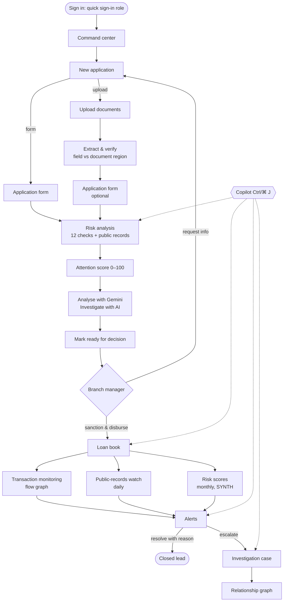

# 2. User flows, step by step

[← Back to the index](README.md)

Every flow below can be repeated in the local demo ([Quick start](01-QUICK-START.md)). Record IDs
(`A-1013`, `L-2026-0110`, `CASE-2026-007` …) are from the built-in demo workspace.

**Wording rule used everywhere:** the app produces **leads for a person to verify**, never verdicts.
Every status is one of _Routine review_, _Needs attention_ or _Urgent review_, always shown with an icon
and text (never colour alone). Words such as "fraud" are blocked, even in AI output.

## Contents

- [Flow A: Sign in and the command center](#flow-a-sign-in-and-the-command-center)
- [Flow B: New loan application (form path)](#flow-b-new-loan-application-form-path)
- [Flow C: New loan application from documents (upload path)](#flow-c-new-loan-application-from-documents-upload-path)
- [Flow D: Risk analysis: checks, attention score and public records](#flow-d-risk-analysis-checks-attention-score-and-public-records)
- [Flow E: AI analysis and the AI investigator](#flow-e-ai-analysis-and-the-ai-investigator)
- [Flow F: Application detail, review and decision](#flow-f-application-detail-review-and-decision)
- [Flow G: Loan book and transaction monitoring](#flow-g-loan-book-and-transaction-monitoring)
- [Flow H: Daily public-records watch after disbursement](#flow-h-daily-public-records-watch-after-disbursement)
- [Flow I: Synthetic monthly risk scores](#flow-i-synthetic-monthly-risk-scores)
- [Flow J: Alert triage](#flow-j-alert-triage)
- [Flow K: Investigation cases](#flow-k-investigation-cases)
- [Flow L: Relationship graph of public records](#flow-l-relationship-graph-of-public-records)
- [Flow M: FinRakshak Copilot (on any screen)](#flow-m-finrakshak-copilot-on-any-screen)
- [Flow N: Borrowers and documents](#flow-n-borrowers-and-documents)
- [Flow O: Reports, settings and help](#flow-o-reports-settings-and-help)
- [Flow P: Shell features: queue, search, dark mode, mobile](#flow-p-shell-features-queue-search-dark-mode-mobile)
- [Flow Q: Administrator: approving AI proposals](#flow-q-administrator-approving-ai-proposals)
- [The real-data scenarios (TEST loans)](#the-real-data-scenarios-test-loans)

---

## The whole journey

---

## Flow A: Sign in and the command center

**Who:** everyone · **Where:** `/login` → `/dashboard`

1. Open the app. Under **Quick sign-in**, choose a role and click **Continue with quick sign-in**.
2. You land on the **Command center**. It greets you by first name and shows, for your branch scope:
   - KPI tiles: applications awaiting decision, urgent alerts, open cases, watched loans.
   - The **risk mix** of the loan book (routine / attention / urgent).
   - **Recent alerts**, each linked to its loan or application.
   - **Public records on disbursed loans**: any loan whose borrower appeared in a record after disbursement.
3. Change the **branch scope** with the switcher at the top of the sidebar (All branches or one
   branch). Every page, count and list follows it.

---

## Flow B: New loan application (form path)

**Who:** branch officer · **Where:** **New application** → `/applications/new`

1. Click **New application** in the top bar. The **Application form** opens straight away.
2. Fill in the applicant, loan, address, income, collateral, business and guarantor sections.
   Fields are validated with the same zod schema the server uses; errors appear inline under the
   field, and the submit button is disabled while saving (no double submit).
3. Business applicants also enter their **PAN** and their **largest customers** with their share of
   receivables. The public-records check uses these in Flow D.
4. **Continue** → the **Risk analysis** step (Flow D). Name, amount and purpose are required on this path.

Steps on this path: **Application form → Risk analysis**.

---

## Flow C: New loan application from documents (upload path)

**Who:** branch officer · **Where:** `/applications/new` → **Upload documents instead**

1. Click **Upload documents instead**. The steps become **Upload documents → Extract & verify →
   Application form (optional) → Risk analysis**.
2. **Upload** PDFs or images (7/12 land extract, Aadhaar, bank statement, warehouse receipt, GST,
   Udyam …). Quality checks run **locally in the browser** (pdf.js + canvas): page count, blur,
   darkness and resolution warnings. Upload size and decompression limits apply.
3. **Extract & verify:** each extracted field is shown next to the **exact region of the source
   document**. The officer confirms or corrects each field, in Marathi or English (Marathi digits and
   names are supported).
   > OCR is not connected yet. Sample documents show values labelled _Simulated demo output_. The
   > field-by-field review, the regions and the audit trail are real.
4. **Application form (optional):** continuing fills empty fields from confirmed document fields.
   Nothing is required on this path; the checks report what is missing.
5. Continue to **Risk analysis** (Flow D).

| Upload path                                                     | Wizard for an existing application                           |
| --------------------------------------------------------------- | ------------------------------------------------------------ |
|  |  |

---

## Flow D: Risk analysis: checks, attention score and public records

**Who:** branch officer / risk analyst · **Where:** application wizard → **Risk analysis**
(e.g. `/applications/A-1013/edit`)

1. Click **Run checks** (or **Re-run checks**). Twelve **deterministic rules** run in the browser on
   the saved data and the reviewed document fields (`web/src/lib/checks/`):

   | Check                                       | Catches                                                                                |
   | ------------------------------------------- | -------------------------------------------------------------------------------------- |
   | Required fields present                     | Missing mandatory data                                                                 |
   | Document checklist for the product          | Missing documents (checklist configurable in Settings)                                 |
   | Name consistency across documents           | Applicant name differs between form and documents                                      |
   | Date-of-birth consistency                   | DOB conflicts                                                                          |
   | Land area vs 7/12 extract                   | Declared land area does not match the extract                                          |
   | Existing charges                            | Land already mortgaged                                                                 |
   | Survey / gat number reuse                   | Same land offered as collateral in another application                                 |
   | Warehouse receipt reuse                     | Same receipt pledged twice                                                             |
   | Declared income vs bank credits             | Income far above what the bank statement shows                                         |
   | Relationships to open investigations        | Applicant linked to a party in an open case                                            |
   | Field review status                         | Extracted fields not yet verified by a person                                          |
   | **Public records: applicant and customers** | Applicant or a declared customer in IBBI / ED / NFRA / RBI / SFIO / SEBI / MCA records |

   A check that cannot run says why ("Nothing to compare: needs a survey / Gat number").

2. The **public-records check** matches the applicant and its customers against 18,286 real
   entities. For a business it follows the **chain of unpaid dues**: if a customer, or a customer's
   customer, is in **liquidation**, the finding shows each link and the **share of receivables at
   risk** (≥ 20% of receivables makes it _Urgent review_). "Not found" is shown as _absence of a record
   is not evidence of good standing_.
3. The **Attention score (0–100)** is computed **by code** from unresolved findings. Each kind of
   finding has its own weight, scaled by priority, and the top drivers are listed (e.g. "+30 applicant
   related to a party in an open investigation, +18 income higher than bank credits"). The AI never
   sets this number.
4. The **Findings** table lists each finding with category, priority, evidence count, certainty,
   status and recommended next step. Open one to see its evidence, harmless explanations and what to
   verify.
5. **Submit for review** moves the application on.

---

## Flow E: AI analysis and the AI investigator

**Who:** branch officer / risk analyst · **Where:** Risk analysis → **AI review** card

With a cloud account (Firebase Auth + AI access), the AI review card offers two buttons. Both run on
**Gemini on Vertex AI** through Cloud Functions; in the local demo the card says _Not connected — no
AI review ran_ (visible in the screenshot above), so nothing is ever presented as AI that was not.

1. **Analyse with Gemini** (`analyseApplication` callable):
   - Gemini writes a short risk summary (≤ 6 sentences), facts tied to the recorded fields, and one
     note per finding.
   - Code checks that every fact quotes a field that was sent, that there is exactly one note per
     finding, and withholds the summary if it contains verdict words or a stated score.
2. **Investigate with AI** (`investigateApplication` callable): the **AI investigator agent**.
   - The browser builds a bundle (identifiers masked; ratios, the public-records shortlist and related
     entities are all computed by code).
   - Gemini reads the application through **8 tools** (≤ 10 turns, ≤ 8 reads) and proposes findings
     and draft questions for the applicant.
   - Code verifies every citation, quote and number. The card shows, for example, **"AI made 9 claims:
     7 verified, 2 rejected (unknown_number, quote_mismatch)"**.
   - Verified findings add to the attention score as their own kinds; the officer **edits and
     approves** each draft question.

Full detail: [04-AI-AGENTS.md](04-AI-AGENTS.md).

---

## Flow F: Application detail, review and decision

**Who:** branch officer → branch manager · **Where:** `/applications` → `/applications/:id`

1. **Applications** lists every application with its status, review priority and branch; filter and
   sort to find one.
2. The **application page** has a summary strip (review priority, open findings, missing documents,
   fields reviewed, when the checks last ran) and four tabs:
   - **Overview:** summary, document checklist, outstanding verification, findings requiring
     attention, recent actions and notes, then applicant, loan, address, income, collateral, business,
     guarantor and declaration.
   - **Documents & verification:** each document with its fields and verification status.
   - **Findings & entities:** findings with evidence, and the people and companies linked to them.
   - **Activity:** the audit log (every change writes an audit entry).
3. Actions: **Pin** (adds it to the sidebar for quick return), **Edit** (back into the wizard),
   **More**, and **Mark ready for decision**. Approve / decline is deliberately outside the
   prototype: findings are review prompts, not a lending decision.

| Applications list                                | Application overview                                         |
| ------------------------------------------------ | ------------------------------------------------------------ |
|  |  |

| Documents & verification tab                                    | Findings & entities tab                                       |
| --------------------------------------------------------------- | ------------------------------------------------------------- |
|  |  |

---

## Flow G: Loan book and transaction monitoring

**Who:** risk analyst / branch manager · **Where:** **Loan book** → `/monitoring`

1. The **Loan book** shows loans under monitoring and transactions analysed, with filters for loan,
   borrower, branch and date range.
2. Pick a loan (e.g. `L-2026-0110 · Om Sai Krishi Seva Kendra`). You see the disbursement, the
   stated purpose, **Alerts for this loan**, and the **Transaction flow** graph: where the money went
   in the days after disbursement.
3. **Five monitoring rules** run on the transactions (`web/src/lib/monitoring.ts`):

   | Rule                  | Example lead                                                          |
   | --------------------- | --------------------------------------------------------------------- |
   | Rapid onward transfer | 75% of the disbursement moved out within 72 h                         |
   | Linked counterparty   | Payment to a company that shares a director with the borrower         |
   | Repeated counterparty | Same counterparty receives funds from several monitored loans         |
   | Circular flow         | Funds come back to the borrower's account after 3 hops                |
   | Split cash            | Several cash withdrawals near a reference amount, splitting the money |

4. Select an alert to highlight its path in the flow graph; open it for evidence.
5. **Import transaction file** loads a CSV of transactions (validated, formula-injection safe).
   **Run** re-runs the rules. Thresholds are editable in Settings (risk analyst / administrator).

| Loan book                                  | One loan: alerts and transaction flow               |
| ------------------------------------------ | --------------------------------------------------- |
|  |  |

---

## Flow H: Daily public-records watch after disbursement

**Who:** risk analyst · **Where:** **Public records** → `/monitoring/public-records`

1. After sign-in (once a day), **every disbursed loan** is re-checked automatically against the
   latest public-records bundle (served by the `publicData` function in the cloud, or the local
   bundle in the demo).
2. Each record **dated after disbursement** raises one **Urgent review** alert: insolvency (CIRP),
   liquidation, ED search or attachment, NFRA / RBI / SFIO / SEBI action.
3. The page lists each watched loan, its matched records with source, date and a link to the original
   document, and the alerts raised. The same results feed the Command center card, the Loan book
   banner, Alerts (source `public_records`) and the notification bell.

---

## Flow I: Synthetic monthly risk scores

**Who:** risk analyst · **Where:** **Risk scores** (badge **SYNTH**) → `/monitoring/risk-scores`

1. A monthly scoring job (`ingest/src/risk/`, Cloud Run job `ingest-score`) gives each loan a
   0–100 score from **behaviour** (EMIs inferred from repayments: late, partial, missed, prepayment)
   and **typology patterns** (a versioned pattern library).
2. The page reads the scores through the `getRiskScores` callable. Each alert shows its recorded
   reasons and a "what changed" block; when the **risk explainer agent** is on, a plain-language
   explanation appears, labelled as AI.
3. All of this runs on a **labelled synthetic loan book** (never mixed with real data). Replayed over
   24 months it catches **105 of 105 defaulters with 0 false alarms** among 85 controls and look-alikes
   (settings v2 + behaviour option 4 + prepayment rule; see [`docs/RISK_SCORING.md`](../docs/RISK_SCORING.md)).

---

## Flow J: Alert triage

**Who:** branch manager / risk analyst · **Where:** **Alerts** → `/alerts`

1. Tiles count open alerts by priority: **Urgent review**, **Needs attention**, **Routine review**.
   Click a tile to filter.
2. Filter by search, priority, source (checks, monitoring, public records, risk scores) and more;
   tabs split **New / In review / Escalated / Resolved**.
3. Open an alert: its evidence, the linked loan or application, the suggested next action, and
   **Ask AI** for the Copilot's cited explanation.
4. Triage it:
   - **In review:** you are working on it.
   - **Resolved:** you must choose a reason (e.g. a harmless explanation was confirmed).
   - **Escalate:** opens an **investigation case** (Flow K) with the alert's evidence attached.

| All alerts                           | Filtered to Urgent review                                 |
| ------------------------------------ | --------------------------------------------------------- |
|  |  |

---

## Flow K: Investigation cases

**Who:** investigator · **Where:** **Cases** → `/investigations` → `/investigations/:caseId`

1. **Cases** lists open cases with status, assignee, priority and linked records.
2. A case (e.g. `CASE-2026-007`) holds:
   - status and assignee;
   - a **checklist** of verification steps (configurable in Settings);
   - **evidence** (alerts, documents, transactions) and **notes**;
   - an **entity graph** of the people, companies and accounts involved;
   - the **audit trail** of every change.
3. Use **Ask AI** on the case for a summary or a draft of risk observations; every sentence cites a fact.

| Cases list                                  | Case detail                                    |
| ------------------------------------------- | ---------------------------------------------- |
|  |  |

---

## Flow L: Relationship graph of public records

**Who:** investigator / risk analyst · **Where:** **Relationship graph** → `/graph-lab`

1. The graph is built from **real public records**: 43,405 nodes, 47,116 links and 3,349 networks,
   built by `ingest/src/graph/`.
2. Tabs:
   - **Explore:** find a company, bank, address or case; show direct links (1 hop) or more; include
     weak and candidate links if you want them.
   - **Networks:** connected groups of entities.
   - **Path finder:** the shortest path between two entities.
   - **Identity review:** 972 "possibly the same entity" candidates for a person to confirm.
3. Each link shows its **basis** (established record, weak, or candidate) and opens the source document.
   The page states plainly that _a connection is not evidence of wrongdoing_.

---

## Flow M: FinRakshak Copilot (on any screen)

**Who:** everyone · **Where:** **Ask AI** in the top bar, or **Ctrl/⌘ J**

1. Open the Copilot on any record (a loan, application, alert or case). It reads **only that record**:
   at most 60 numbered facts, with identifiers masked.
2. Pick a starter or type a question:
   - **Why was this flagged?** the leads, most serious first, with any harmless explanation;
   - **Where did the money go?** transfers after disbursement, in time order;
   - **What should I verify next?** checks tied to the evidence that needs them;
   - **Draft risk observations** for the credit appraisal note or case file;
   - **Draft an information request** to the borrower.
3. Each statement cites facts (`A1`, `A2` …). The **grounding check** keeps only statements that cite
   facts that were sent, and whose numbers all appear in those facts. The panel reports, for example,
   _"Grounding check: 4 of 4 statements kept"_.
4. **Data the copilot can use** opens the exact facts sent to the model. **Copy** copies the answer.

In a demo session the answer is labelled **Simulated demo output · no model called** (it still passes
the same grounding check). Signed in with a cloud account, it calls `assistRecord` → Gemini on Vertex AI.

---

## Flow N: Borrowers and documents

**Where:** `/borrowers`, `/borrowers/:id`, `/documents`

- **Borrowers:** every borrower with applications, loans, alerts and cases in one profile.
- **Documents:** every uploaded document with its type, language, quality warnings and verification
  status; open one to review its fields against the page region.

| Borrowers                                  | Borrower profile                                         | Documents                                  |
| ------------------------------------------ | -------------------------------------------------------- | ------------------------------------------ |
|  |  |  |

---

## Flow O: Reports, settings and help

- **Reports** (`/reports`): period and branch reports (applications, findings, alerts, cases,
  outcomes) with **CSV / TXT export**. Cells are protected against spreadsheet formula injection.
- **Settings** (`/settings`): your profile and preferences and, for authorised roles, risk
  configuration: monitoring thresholds, alert routing, document checklists per product, and **Data**
  (reset or clear the demo workspace). Other roles see these read-only.
- **Help** (`/help`): how the prototype works, what is and is not connected, and a guided walkthrough.

| Reports                                | Settings                                 | Help                             |
| -------------------------------------- | ---------------------------------------- | -------------------------------- |
|  |  |  |

---

## Flow P: Shell features: queue, search, dark mode, mobile

- **My queue** (`/queue`): what needs _you_ now, by role (applications to verify or decide, alerts to
  triage, cases assigned).
- **Command palette** (Ctrl/⌘ K): jump to any borrower, loan, alert or case.
- **Pinned records** appear in the sidebar.
- **Dark mode** (moon icon), and the app respects `prefers-color-scheme` and `prefers-reduced-motion`.
- **Mobile (360 px):** a single column with a bottom tab bar (Home, My queue, Applications, Alerts) and
  no horizontal scroll. This is tested in the Playwright `mobile-360` project.

| My queue                                 | Command palette                                        |
| ---------------------------------------- | ------------------------------------------------------ |
|  |  |

| Dark mode                                                 | Mobile: command center                                            | Mobile: application                                              |
| --------------------------------------------------------- | ----------------------------------------------------------------- | ---------------------------------------------------------------- |
|  |  |  |

---

## Flow Q: Administrator: approving AI proposals

**Who:** administrator · **Where:** the `decideProposal` and `decidePattern` callables (Firestore
console until the approval view is built)

The cloud agents never change anything on their own. They write **proposals** to Firestore:

1. The **ingestion agent** proposes allowlisted actions after a daily run (e.g. re-run a failed
   source, roll back a publish). The administrator approves or rejects each one with `decideProposal`.
2. The **pattern miner** proposes new risk patterns, back-tested on synthetic cases. The administrator
   approves each one with `decidePattern`; approved patterns enter the versioned pattern library.

See [04-AI-AGENTS.md](04-AI-AGENTS.md#approval-flow-for-agent-proposals).

---

## The real-data scenarios (TEST loans)

Three end-to-end Playwright scenarios (`e2e/scenarios/`) use **real borrowers from public records**
with made-up loan values, labelled **TEST**:

| Scenario                               | Kind              | What the app shows                                                                |
| -------------------------------------- | ----------------- | --------------------------------------------------------------------------------- |
| `maheep-trade-credit-chain`            | Loan application  | **Urgent review**: a customer in liquidation at the end of 4 links of unpaid dues |
| `advantage-overseas-post-disbursement` | Post-disbursement | TEST loan `L-2023-0601`: 6 alerts (CIRP, liquidation, ED search, 3 attachments)   |
| `jai-corp-sudden-enforcement`          | Post-disbursement | TEST loan `L-2024-0401`: 1 alert (ED attachment of ₹230 crore, 6 Oct 2026)        |

You can see scenarios 2 and 3 straight away on **Alerts** and **Public records** (screenshots 13, 15 and 16).

[Next: Screenshot gallery →](03-SCREENSHOTS.md)
