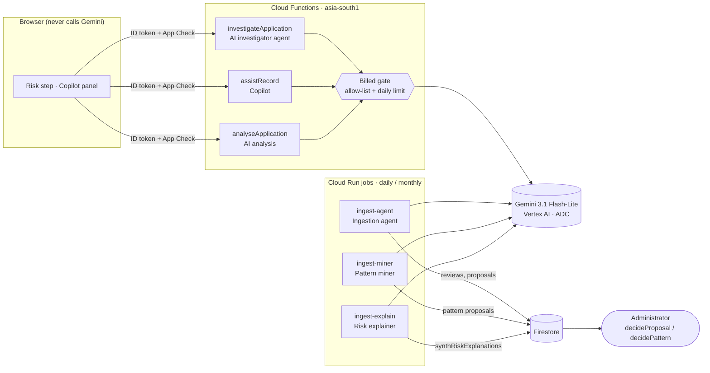
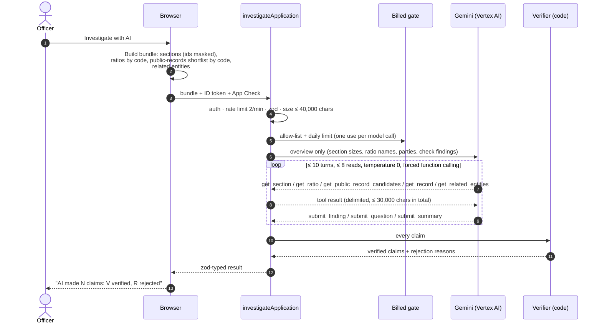
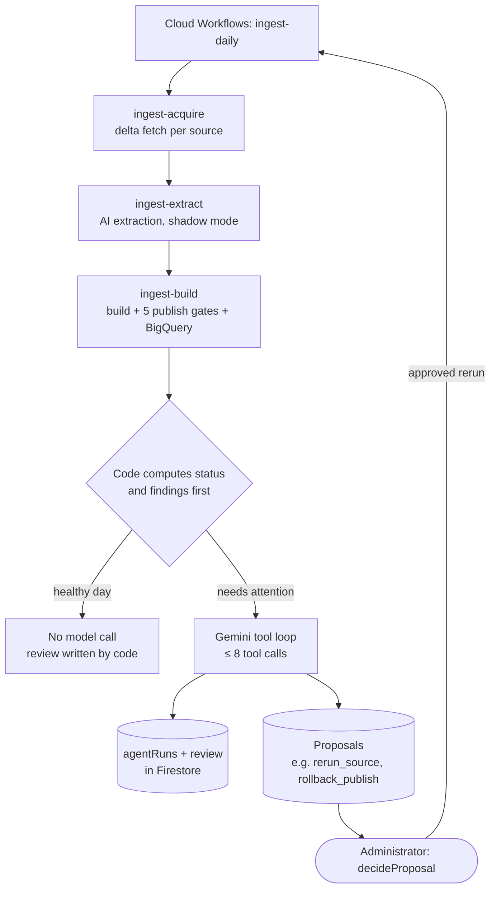
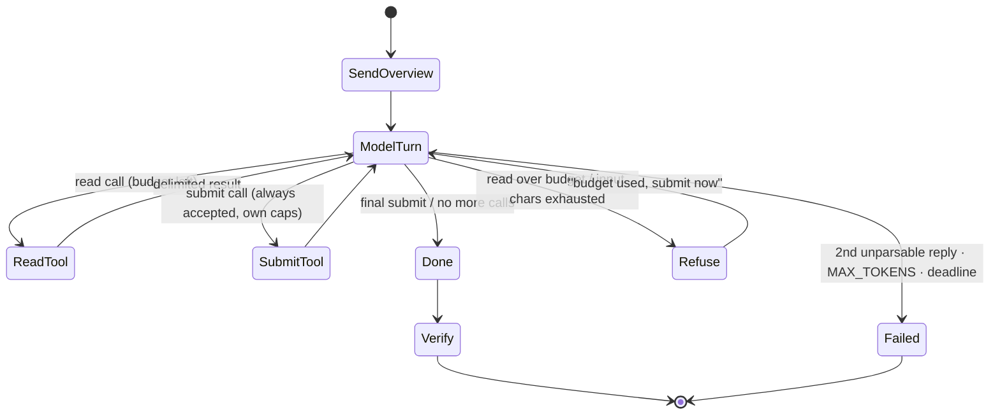
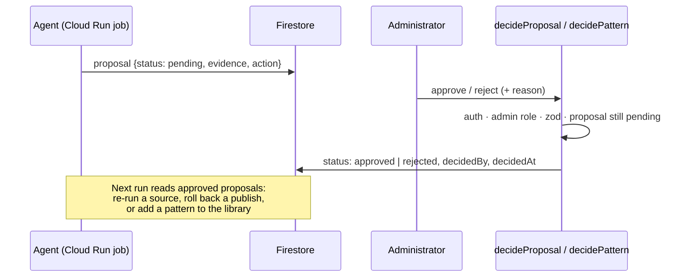

# 4. AI features and agents: how they work

[← Back to the index](README.md)

FinRakshak AI uses **Gemini (`gemini-3.1-flash-lite`) on Vertex AI** in six places. Four of them are
**agents**: the model calls tools in a loop. All six follow the same contract:

> **Code builds the evidence → Gemini proposes → code verifies → a person decides.**

The model never sets a score, never writes to the database on its own, and never sees data outside
delimited blocks. Every number it writes must already exist in the evidence it was given.

## Contents

- [Overview: the six AI features](#overview-the-six-ai-features)
- [Shared guardrails (every AI path)](#shared-guardrails-every-ai-path)
- [Agent 1: AI investigator](#agent-1-ai-investigator-investigateapplication)
- [Agent 2: Ingestion agent](#agent-2-ingestion-agent-cloud-run-job-ingest-agent)
- [Agent 3: Pattern miner](#agent-3-pattern-miner-cloud-run-job-ingest-miner)
- [Agent 4: Risk explainer](#agent-4-risk-explainer-cloud-run-job-ingest-explain)
- [Feature 5: FinRakshak Copilot](#feature-5-finrakshak-copilot-assistrecord)
- [Feature 6: AI analysis of an application](#feature-6-ai-analysis-of-an-application-analyseapplication)
- [Shared agent runtime: the tool loop](#shared-agent-runtime-the-tool-loop)
- [Approval flow for agent proposals](#approval-flow-for-agent-proposals)
- [How the AI code is tested](#how-the-ai-code-is-tested)
- [Where to read the code](#where-to-read-the-code)

---

## Overview: the six AI features

| #   | Feature                | Kind                  | Runs in                                 | Trigger                              | Output                                                       | Who decides                      |
| --- | ---------------------- | --------------------- | --------------------------------------- | ------------------------------------ | ------------------------------------------------------------ | -------------------------------- |
| 1   | **AI investigator**    | Agent (8 tools)       | Cloud Function `investigateApplication` | Officer clicks _Investigate with AI_ | Verified findings + draft questions for the applicant        | Officer approves each question   |
| 2   | **Ingestion agent**    | Agent (6 tools)       | Cloud Run job `ingest-agent`            | Daily workflow, after the build      | Run review + allowlisted action proposals                    | Administrator (`decideProposal`) |
| 3   | **Pattern miner**      | Agent (5 tools)       | Cloud Run job `ingest-miner`            | On demand, when switched on          | Back-tested risk-pattern proposals                           | Administrator (`decidePattern`)  |
| 4   | **Risk explainer**     | Agent step (no tools) | Cloud Run job `ingest-explain`          | After the monthly scoring job        | Plain-language explanation of a risk alert                   | Shown labelled; number-checked   |
| 5   | **FinRakshak Copilot** | Grounded Q&A          | Cloud Function `assistRecord`           | Ctrl/⌘ J / **Ask AI** on any record  | Cited answers, drafts of info requests and risk observations | Officer reads and copies         |
| 6   | **AI analysis**        | Structured analysis   | Cloud Function `analyseApplication`     | Officer clicks _Analyse with Gemini_ | Summary, facts per field, a note per finding                 | Officer                          |



---

## Shared guardrails (every AI path)

| Guardrail                    | How it is enforced                                                                                                 | Where                                                                                                         |
| ---------------------------- | ------------------------------------------------------------------------------------------------------------------ | ------------------------------------------------------------------------------------------------------------- |
| No AI from the browser       | The web bundle has no Gemini SDK and no key; every call goes through a callable                                    | `web/src/lib/cloud/`                                                                                          |
| No API keys                  | Vertex AI uses **Application Default Credentials** of the service account (`roles/aiplatform.user`)                | `functions/src/services/gemini.ts`                                                                            |
| Identity                     | `request.auth` required, **App Check enforced** (`enforceAppCheck: true`)                                          | every callable                                                                                                |
| Input validation             | **zod** schema from `packages/shared`; size checked before any use is counted                                      | `functions/src/callable/*`                                                                                    |
| Cost limits                  | Burst rate limit, **per-user daily AI limit (30) that is never crossed**, AI allow-list per user                   | `services/billed-gate.ts`, `usage-limit.ts`, `rate-limit.ts`                                                  |
| Prompt-injection defence     | User and public-record text only inside delimited data blocks (`<<<APPLICATION_OVERVIEW … >>>`); closed tool lists | prompts in `services/`                                                                                        |
| Output validation            | JSON-only replies parsed with zod; one retry on a malformed reply                                                  | `services/gemini.ts`, `tool-model.ts`                                                                         |
| **Grounding / verification** | Every claim must cite facts that were sent; every number must appear in them; verdict words blocked                | `packages/shared/src/assistGrounding.ts`, `services/investigation/verify.ts`, `ingest/src/ai/outputChecks.ts` |
| Privacy                      | PAN, Aadhaar, GSTIN, Udyam, account and phone numbers masked; DOB, mobile and street address left out              | `web/src/lib/investigation-bundle.ts`, `lib/assist*`                                                          |
| Logs                         | Counts only (facts, tool calls, claims kept / rejected): no names, values, prompts or model text                   | `services/log.ts`                                                                                             |
| Timeouts                     | 30 s per model call; 100 s deadline for an investigator run; capped output tokens                                  | `config/`                                                                                                     |
| Kill switches                | Per-job `*_ENABLED` flags; the one-click **emergency stop** disables the Vertex AI API                             | `docs/EMERGENCY_STOP.md`                                                                                      |

---

## Agent 1: AI investigator (`investigateApplication`)

**Goal:** read a loan application the way a careful credit officer would, connect sections that
disagree, check public-record candidates, and draft questions, **without inventing anything**.



**The bundle is built by code, in the browser** (`web/src/lib/investigation-bundle.ts`):

- **Sections:** applicant, business, loan, collateral, customers. PAN, GSTIN and Udyam are masked;
  DOB, mobile and street address are left out. Empty fields are kept so gaps can be asked about.
- **Ratios computed by code** (`investigation-ratios.ts`): loan to income or turnover, EMI to monthly
  income (at an assumed 12% a year, stated in the ratio), liabilities to income, loan to collateral,
  loan per acre, largest customer's share of receivables, receivables to loan.
- **Public-records shortlist by code** (`investigation-shortlist.ts`): up to 5 candidates per party by
  fuzzy name match (score ≥ 70/100). A different CIN is never shortlisted; `cinAgrees` and
  `addressAgrees` are computed by code.
- **Related entities:** workspace relationships (with any open case), and companies registered at the
  same address in public records.

**The 8 tools (a closed list):**

| Tool                           | Kind   | Returns / accepts                                                                |
| ------------------------------ | ------ | -------------------------------------------------------------------------------- |
| `get_section`                  | read   | One section of the application                                                   |
| `get_ratio`                    | read   | A ratio computed by code, with its inputs                                        |
| `get_public_record_candidates` | read   | The shortlist for one party                                                      |
| `get_record`                   | read   | One public record from the shortlist                                             |
| `get_related_entities`         | read   | Linked entities and their known concerns                                         |
| `submit_finding`               | submit | A finding citing fields, ratios, records or entities                             |
| `submit_question`              | submit | A draft question for the applicant                                               |
| `submit_summary`               | submit | A short summary (withheld if it has verdict words, a score or an unknown number) |

**The verifier** (`functions/src/services/investigation/verify.ts`) rejects a claim when:

| Rule                                                                                       | Rejection reason                     |
| ------------------------------------------------------------------------------------------ | ------------------------------------ |
| Cited field not in the bundle, or the quoted value is not in that field                    | `unknown_field`, `quote_mismatch`    |
| Cited ratio was not sent                                                                   | `unknown_ratio`                      |
| Cited record not in a shortlist, or not in **that party's** shortlist                      | `unknown_record`, `not_in_shortlist` |
| Cited entity or party not in the bundle                                                    | `unknown_entity`, `unknown_party`    |
| A number written that does not appear in the cited evidence (the model does no arithmetic) | `unknown_number`                     |
| Verdict words (fraud, scam, guilty, criminal, launder, cheat, forged) or a stated score    | `verdict_word`, `stated_score`       |
| A finding kind without the evidence it needs (e.g. a mismatch needs two fields)            | `missing_evidence`                   |
| More than 10 findings or 8 questions, or more than 300 characters                          | `over_limit`                         |

A shortlisted match is **possible** (at most _Needs attention_) unless the CIN or address also agrees
(**strong**). "Not enough evidence" is a valid outcome. Verified findings add to the **attention
score** as their own kinds (public-record match 45, related-entity link 40, implausible numbers 25,
sections that disagree 15, scaled by priority), but the AI never sets the number.

**Limits:** `maxInstances: 5`, 256 MiB, 120 s; every model call counts against the daily limit. When
the limit is reached, the run stops, keeps what was already verified, and says so.
Details: [`docs/AI_INVESTIGATOR.md`](../docs/AI_INVESTIGATOR.md).

---

## Agent 2: Ingestion agent (Cloud Run job `ingest-agent`)

**Goal:** review each daily public-data run like an on-call engineer. It explains what happened and
proposes safe next steps, but only from an allowlist and only with the owner's approval.



| Tool                  | What it gives the model                                               |
| --------------------- | --------------------------------------------------------------------- |
| `get_run_summary`     | The run record: per-source status, counts, gate results               |
| `get_delta`           | What changed per source today (added / changed / removed listings)    |
| `get_source_history`  | Recent runs for one source (to tell a blip from a trend)              |
| `get_diagnostic_page` | A saved layout diagnostic of a page that failed to parse              |
| `propose_action`      | Proposes one **allowlisted** action (e.g. re-run a source, roll back) |
| `submit_review`       | Submits the written review of the run                                 |

**What code decides before any model call:** the run status (`ok`, `degraded`, `failed`), the
findings (`build_failed`, `gate_failed`, `bigquery_failed`, `ai_extraction_failed`, source failures
and shrinking listings) and the baselines. The model only explains them and proposes; on healthy days
the model is **not called at all** (cost ≈ zero). Transient failures can be re-run once in the same
workflow when the agent asks. An approved `rollback_publish` re-points the channel to the previous
published version. Switch: `FINRAKSHAK_AI_AGENT_ENABLED`.
Details: [`docs/ingestion-agent-readme.md`](../docs/ingestion-agent-readme.md) §9.

---

## Agent 3: Pattern miner (Cloud Run job `ingest-miner`)

**Goal:** propose new risk patterns (typologies) from seed cases, so the scoring library improves
over time with a person always in the loop.

| Tool                | What it does                                                                    |
| ------------------- | ------------------------------------------------------------------------------- |
| `get_candidate`     | A candidate pattern found by code in the timelines (features, support)          |
| `get_case_timeline` | The month-by-month timeline of one seed case                                    |
| `propose_pattern`   | Proposes a pattern; code **back-tests** it on the synthetic book before storing |
| `reject_candidate`  | Rejects a candidate with a reason (only the **count** is kept)                  |
| `submit_summary`    | Summary of the mining run                                                       |

- Candidates come from code; the model words and justifies them, and the number check
  (`ingest/src/ai/outputChecks.ts`) rejects unknown numbers.
- Proposals go to Firestore; an administrator approves each one with `decidePattern` (B-61), and an
  approved pattern enters the versioned library that the scorer reads.
- Runs on demand: `npm run miner -- propose` prints proposals and writes nothing.
  Switch: `FINRAKSHAK_AI_MINER_ENABLED=false` by default.
  Plan: [`docs/plans/PATTERN_MINER_PLAN.md`](../docs/plans/PATTERN_MINER_PLAN.md).

---

## Agent 4: Risk explainer (Cloud Run job `ingest-explain`)

**Goal:** turn the recorded reasons of a monthly risk alert (behaviour points, matched patterns,
"what changed") into two or three plain sentences for the branch.

- A single structured call per alert, with **no tools**: the input is only the alert's recorded reasons.
- **Number check:** any sentence with a number that is not in the reasons is rejected.
- Stored in its own collection `synthRiskExplanations` (one per alert), **never on the alert itself**
  (B-57), and shown labelled in the risk score drawer (B-62). A prompt change applies to new alerts only.
- If the model fails, code-worded sentences are stored with `model: null`; the kill switch stores
  nothing. Switch: `FINRAKSHAK_AI_EXPLAIN_ENABLED`.
  Plan: [`docs/plans/RISK_EXPLAINER_PLAN.md`](../docs/plans/RISK_EXPLAINER_PLAN.md).

---

## Feature 5: FinRakshak Copilot (`assistRecord`)

**Goal:** answer "why was this flagged?", "what should I verify?", "where did the money go?" and draft
information requests and risk observations **about the record on screen**, with a citation for every sentence.

```mermaid
sequenceDiagram
    participant Web as Copilot panel
    participant Fn as assistRecord
    participant G as Gemini (Vertex AI)
    participant GC as Grounding check (shared)
    Web->>Web: Build ≤ 60 numbered facts (A1…A60), ids masked
    Web->>Fn: question + facts + ID token + App Check
    Fn->>Fn: auth · zod · rate limit · daily limit
    Fn->>G: facts in a delimited block + task
    G-->>Fn: JSON statements, each with cited fact ids
    Fn->>GC: keep a statement only if its cited facts were sent<br/>and every number appears in them; drop verdict words
    GC-->>Fn: kept + removed counts
    Fn-->>Web: statements + "kept 3 of 4 · 1 removed (number not in facts)"
```

- The grounding check is shared code (`packages/shared/src/assistGrounding.ts`) with test cases
  (`assist-grounding-cases.json`); functions run a runtime copy of it.
- **Data the copilot can use** shows the exact facts that were sent.
- Details: [`docs/COPILOT.md`](../docs/COPILOT.md).

---

## Feature 6: AI analysis of an application (`analyseApplication`)

- Input: the recorded fields and the findings from the checks (≤ 20,000 characters).
- Gemini returns a **summary** (≤ 6 sentences), **facts** tied to recorded fields, and **one note per finding**.
- Code checks that each fact quotes a field that was sent and that there is one note per finding, and
  it withholds the summary on verdict words or a stated score. Matched patterns do not apply before
  disbursement. Details: [`docs/APPLICATION_AI_ANALYSIS.md`](../docs/APPLICATION_AI_ANALYSIS.md).

---

## Shared agent runtime: the tool loop

`ingest/src/ai/toolLoop.ts` (and its functions-side counterpart `services/investigation/loop.ts`) runs
every agent:



- Hard caps on turns, tool calls (`FINRAKSHAK_AI_AI_MAX_TOOL_CALLS`, `FINRAKSHAK_AI_MINER_MAX_TOOL_CALLS`),
  input characters (`FINRAKSHAK_AI_AI_MAX_INPUT_CHARS`) and output tokens.
- Once the read budget is spent, reads are refused but **submissions are still accepted**, so the agent
  can always finish. (A test once found that `submit_review` was refused too; this was fixed in the shared loop.)
- Every agent writes one `agentRuns` envelope to Firestore (counts, outcome, model, duration).
- Tool handlers return errors to the model instead of throwing.

---

## Approval flow for agent proposals



A retried run after the owner has already decided is a no-op. Firestore rules allow client reads of
runs, reviews and proposals to administrators only.

---

## How the AI code is tested

- **Tests, CI and the emulator never call a billed model.** They feed the code fixed model replies,
  including tool calls, so the whole loop, the verifier and the limits are exercised.
- Unit tests cover the verifier rules, the grounding cases, the billed gate, daily limits under
  parallel calls, rate limits, the tool loop's edge cases (budget used, malformed replies, cut-off
  replies) and the approval callables.
- Real-model runs are rare and tiny: `npm run serve:live -w functions` (costs money; owner only).

## Where to read the code

| Piece                        | Path                                                                                                     |
| ---------------------------- | -------------------------------------------------------------------------------------------------------- |
| Vertex AI client             | `functions/src/services/gemini.ts`, `ingest/src/ai/geminiModel.ts`                                       |
| Billed gate and limits       | `functions/src/services/billed-gate.ts`, `usage-limit.ts`, `rate-limit.ts`                               |
| AI investigator              | `functions/src/services/investigation/` (`loop`, `tools`, `reads`, `verify`)                             |
| Copilot                      | `functions/src/callable/assistRecord.ts`, `services/assist.ts`, `packages/shared/src/assistGrounding.ts` |
| AI analysis                  | `functions/src/services/applicationAnalysis.ts`                                                          |
| Ingestion agent              | `ingest/src/agent/`                                                                                      |
| Pattern miner                | `ingest/src/miner/` (`agent`, `tools`, `wording`, `proposals`, `store`)                                  |
| Risk explainer               | `ingest/src/explain/`                                                                                    |
| Shared loop and number check | `ingest/src/ai/toolLoop.ts`, `ingest/src/ai/outputChecks.ts`                                             |
| Browser-side bundles         | `web/src/lib/investigation-*.ts`, `web/src/lib/assist*`                                                  |

[Next: Google Cloud services →](05-GCP-SERVICES.md)
