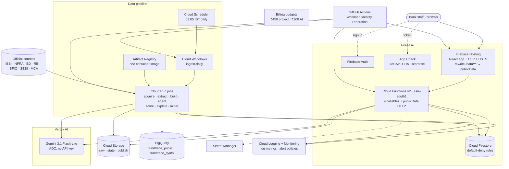
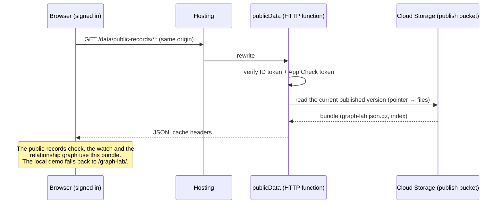
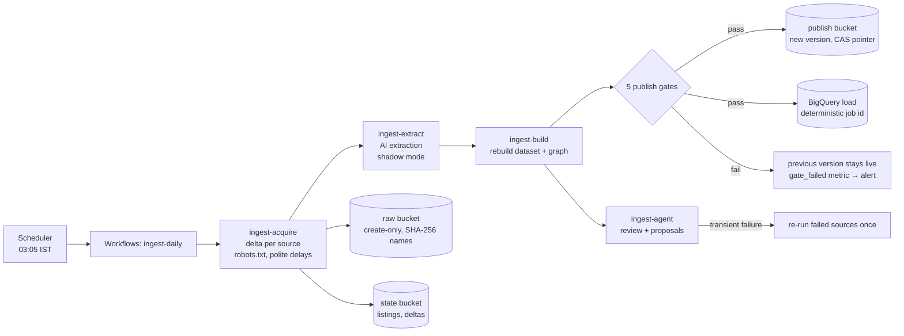
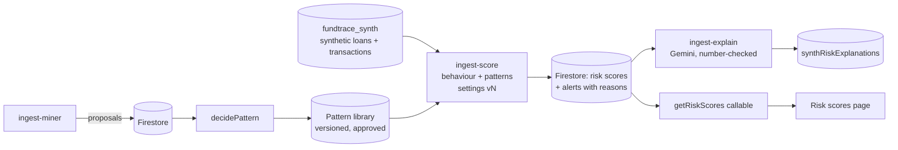
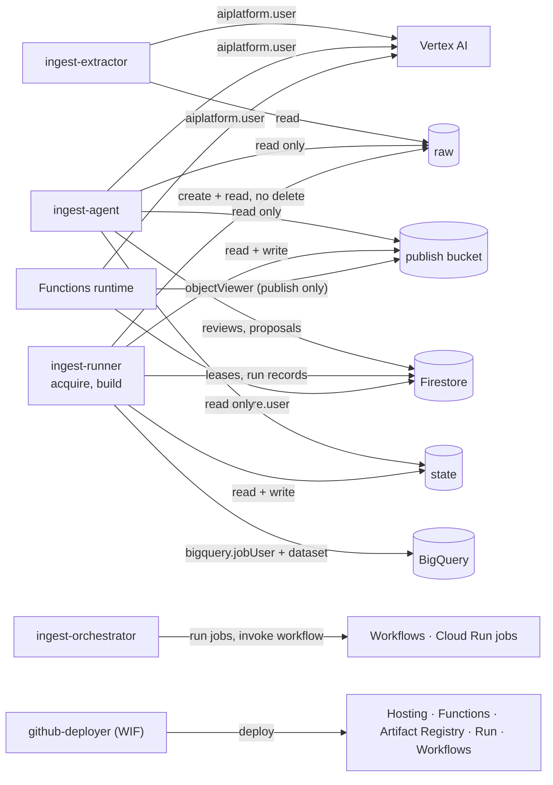

# 5. Google Cloud and Firebase services: how they work together

[← Back to the index](README.md)

FinRakshak AI runs entirely on Google Cloud (project `fund-tracer`, region **`asia-south1` /
Mumbai** for compute and data; Gemini through Vertex AI). Everything is **serverless and scales to
zero**: there are no always-on servers.

> Project IDs, bucket names and BigQuery dataset names cannot be renamed in place, so the cloud
> resources keep the project's original name `fund-tracer` / `fundtrace*`.

## Contents

- [The big picture](#the-big-picture)
- [Service by service](#service-by-service)
- [Path 1: a user request (app → functions → Gemini)](#path-1-a-user-request-app--functions--gemini)
- [Path 2: the public-records data feed](#path-2-the-public-records-data-feed)
- [Path 3: the daily ingestion pipeline](#path-3-the-daily-ingestion-pipeline)
- [Path 4: the monthly risk-scoring pipeline](#path-4-the-monthly-risk-scoring-pipeline)
- [Path 5: CI/CD and deployment](#path-5-cicd-and-deployment)
- [Identity and least privilege (IAM)](#identity-and-least-privilege-iam)
- [Security controls](#security-controls)
- [Cost controls and running cost](#cost-controls-and-running-cost)
- [Monitoring, logs and the emergency stop](#monitoring-logs-and-the-emergency-stop)

---

## The big picture



---

## Service by service

| Service                                  | What we use it for                                                                                                                                                                       | How it is set up                                                                                                            | Code / config                                                        |
| ---------------------------------------- | ---------------------------------------------------------------------------------------------------------------------------------------------------------------------------------------- | --------------------------------------------------------------------------------------------------------------------------- | -------------------------------------------------------------------- |
| **Firebase Hosting**                     | Serves the React SPA; rewrites `/data/**` to `publicData` so data comes from the same origin                                                                                             | Strict Content-Security-Policy (`connect-src 'self'`), HSTS, preview channels per PR                                        | `firebase.json`, `.github/workflows/deploy.yml`                      |
| **Firebase Authentication**              | Signs in bank staff; the ID token goes with every callable                                                                                                                               | Every callable checks `request.auth`; a profile (role, branch, AI access) comes from `getProfile`                           | `functions/src/callable/getProfile.ts`                               |
| **Firebase App Check**                   | Proves calls come from our app, not a script                                                                                                                                             | reCAPTCHA Enterprise provider; `enforceAppCheck: true` on every callable; `publicData` verifies the token too               | `web/src/lib/cloud/`, `functions/src/http/publicData.ts`             |
| **Cloud Functions (2nd gen)**            | The API: `assistRecord`, `analyseApplication`, `investigateApplication`, `askGemini`, `getRiskScores`, `decideProposal`, `decidePattern`, `getProfile`, `health`, plus HTTP `publicData` | Node 22, `asia-south1`, 256 MiB, `minInstances: 0`, `maxInstances` 2–5, timeouts on every external call                     | `functions/src/` (`callable/` → `services/` → `config/`)             |
| **Vertex AI (Gemini)**                   | All Gen AI: Copilot, analysis, investigator, ingestion agent, pattern miner, risk explainer                                                                                              | `@google/genai` with `vertexai: true`; model `gemini-3.1-flash-lite`, location `global`; **ADC only**                       | `functions/src/services/gemini.ts`, `ingest/src/ai/geminiModel.ts`   |
| **Cloud Firestore**                      | Profiles, AI usage counters, rate limits, risk scores, agent runs, reviews, proposals, patterns, explanations, run leases                                                                | **Default-deny security rules**, each collection with an explicit rule and an emulator test; composite indexes              | `firestore.rules`, `firestore.indexes.json`, `functions/src/rules/`  |
| **Cloud Run jobs**                       | The batch pipeline: `ingest-acquire`, `ingest-extract`, `ingest-build`, `ingest-agent`, `ingest-score`, `ingest-explain`, `ingest-miner`                                                 | One container image, a different task per job; each job has its own service account and CPU / memory / timeout caps         | `ingest/Dockerfile`, `ingest/src/cloud/`, `scripts/deploy-ingest.sh` |
| **Cloud Workflows**                      | Orchestrates the daily run: each step a Cloud Run job; a failing step is recorded and the rest still run                                                                                 | Re-runs transient source failures once when the agent asks; fails the execution (so alerting fires) on `failed`             | `infra/workflows/ingest-daily.yaml`                                  |
| **Cloud Scheduler**                      | Starts the daily workflow                                                                                                                                                                | `5 3 * * *`, time zone `Asia/Kolkata` (03:05 IST)                                                                           | `scripts/setup-ingest-gcp.sh`                                        |
| **Cloud Storage**                        | `fund-tracer-ingest-raw` (original evidence, create-only), `-state` (listings, deltas; versions expire after 90 days), `-publish` (versioned published bundles)                          | Uniform access, lifecycle rules, per-account object roles                                                                   | `infra/storage/state-lifecycle.json`, `ingest/src/storage/`          |
| **BigQuery**                             | Analytics copy of the public-records dataset and the synthetic loan book                                                                                                                 | Datasets `fundtrace_public`, `fundtrace_public_dryrun`, `fundtrace_synth`; batch loads (free) with deterministic job IDs    | `ingest/src/cloud/bigquery.ts`                                       |
| **Artifact Registry**                    | Stores the pipeline's container image                                                                                                                                                    | Cleanup policy keeps the last 10 images                                                                                     | `infra/artifact-registry/cleanup-policy.json`                        |
| **Secret Manager**                       | The (non-default) Gemini API key provider's secret, via `defineSecret`                                                                                                                   | Never in code, `.env` or the web bundle; Vertex AI needs no key at all                                                      | `functions/src/config/secrets.ts`                                    |
| **Cloud Logging and Monitoring**         | Structured logs (counts only, no PII); log-based metrics and alert policies                                                                                                              | `ingest_source_failed`, `ingest_publish_gate_failed`; policies "a source failed", "daily run failed", "publish gate failed" | `infra/monitoring/*.json`, `docs/LOGS.md`                            |
| **IAM and Workload Identity Federation** | Keyless GitHub Actions deploys; one least-privilege service account per job                                                                                                              | WIF provider bound to the GitHub repository; no service-account JSON keys anywhere                                          | `scripts/setup-gcp.sh`, `scripts/setup-ingest-gcp.sh`                |
| **Cloud Billing budgets**                | Cost alarms                                                                                                                                                                              | `fund-tracer monthly budget` ₹450 / month (all services), `Vertex AI (agents)` ₹200 / month; alerts at 50 / 90 / 100%       | Console (owner step)                                                 |

---

## Path 1: a user request (app → functions → Gemini)

```mermaid
sequenceDiagram
    autonumber
    participant B as Browser
    participant H as Firebase Hosting
    participant A as Firebase Auth / App Check
    participant F as Cloud Function (asia-south1)
    participant FS as Firestore
    participant V as Vertex AI (Gemini)
    B->>H: load the SPA (CSP, HSTS)
    B->>A: sign in → ID token; App Check token
    B->>F: httpsCallable("assistRecord", payload) + both tokens
    F->>F: (1) request.auth (2) zod input (3) ownership / role
    F->>FS: profile, AI allow-list, daily usage counter (transaction)
    F->>V: models.generateContent (ADC; JSON output; 30 s timeout)
    V-->>F: JSON reply
    F->>F: zod output + grounding / number check
    F->>FS: +1 usage (never past the daily limit)
    F-->>B: (5) zod-typed result
```

The five steps every callable follows (from `CLAUDE.md`): **auth → validate → authorise → act →
typed result**, with App Check enforced. Handlers in `callable/` are thin; the logic lives in `services/`.

## Path 2: the public-records data feed



## Path 3: the daily ingestion pipeline



**Delta ingestion:** each source's listing is diffed against the last one (added / changed /
removed). IBBI, NFRA, SFIO and RBI are paged incrementally, with a weekly or monthly full relist.
Guards stop an empty, broken or shrunken listing from overwriting good data, and a Firestore lease
allows one `acquire` at a time.

**The five publish gates** (`ingest/src/cloud/gates.ts`, pure functions):

| Gate                   | Passes when                                                          |
| ---------------------- | -------------------------------------------------------------------- |
| `required_tables`      | documents, case events, entities and relationships are all non-empty |
| `max_row_drop`         | no table fell by more than 20% against the last published version    |
| `bundle_size`          | the compressed graph bundle is ≤ 48 MB                               |
| `newer_than_published` | the new build is newer than the published one                        |
| `seed_cases_kept`      | every seed case in the previous version is still present             |

Publishing starts on a **dry-run channel** (`fundtrace_public_dryrun`) and moves to `live` after a
clean week. **Rollback** is an approved `rollback_publish` proposal, which re-points the channel to
the previous version.

## Path 4: the monthly risk-scoring pipeline



## Path 5: CI/CD and deployment

| GitHub Actions workflow | What it does                                                                                                                         |
| ----------------------- | ------------------------------------------------------------------------------------------------------------------------------------ |
| `ci.yml`                | `npm ci`, prettier, ESLint (0 warnings), `tsc`, 1,579 unit tests, build, emulator tests, `npm audit` of production deps              |
| `up-to-date.yml`        | The **Up to date with main** check: a PR that is behind `main` cannot merge                                                          |
| `deploy.yml`            | Keyless login via **Workload Identity Federation** → builds → deploys Hosting (preview channel per PR), Functions, rules and indexes |
| `emergency-stop.yml`    | One click: closes the functions to outside calls and **disables the Vertex AI API**; the static site and demo still work             |

The pipeline is deployed by `scripts/deploy-ingest.sh` (builds the image into Artifact Registry and
deploys the jobs, the workflow and the scheduler). One-time setup: `scripts/setup-gcp.sh` (app) and
`scripts/setup-ingest-gcp.sh` (pipeline). Full steps: [`docs/DEPLOY.md`](../docs/DEPLOY.md).

---

## Identity and least privilege (IAM)

Every workload has its **own service account** with only the roles it needs:



**No API keys and no service-account JSON keys exist anywhere:** GitHub uses Workload Identity
Federation, functions and jobs use Application Default Credentials, and the one optional secret lives
in Secret Manager.

## Security controls

| Layer        | Control                                                                                                     |
| ------------ | ----------------------------------------------------------------------------------------------------------- |
| Edge         | CSP (`connect-src 'self'`), HSTS, no `dangerouslySetInnerHTML`, safe URLs only                              |
| Identity     | Firebase Auth + App Check on every callable and on `publicData`                                             |
| API          | zod on every input and output, size limits before counting, burst rate limits, per-user daily AI limits     |
| Data         | Firestore default-deny rules with emulator tests; raw evidence create-only; versioned publish with rollback |
| AI           | Delimited data blocks, closed tool lists, verifiers, verdict words blocked, PII masked, counts-only logs    |
| Supply chain | Lockfile + `npm ci`, Dependabot, `npm audit` in CI (0 known production vulnerabilities)                     |

Full threat table: [`SECURITY.md`](../SECURITY.md).

## Cost controls and running cost

| Control                                                  | Effect                                                  |
| -------------------------------------------------------- | ------------------------------------------------------- |
| `minInstances: 0`, `maxInstances` 2–5, 256 MiB           | No idle cost; spikes are capped                         |
| Cheapest Gemini model that passes the checks             | `gemini-3.1-flash-lite` (≈ US$0.002 per Copilot answer) |
| Per-user daily AI limit (30) + burst limits + allow-list | Abuse cannot run up a bill                              |
| Ingestion agent skips the model on healthy days          | Most days cost nothing for AI                           |
| Tests, CI and the emulator never call a billed model     | Development never bills                                 |
| Delta ingestion, batch BigQuery loads, storage lifecycle | Storage and compute grow slowly                         |
| Budget alerts ₹450 / month (project), ₹200 / month (AI)  | Early warning                                           |

**Estimated total for the prototype: about US$5–10 a month.** Per AI call: Copilot ≈ US$0.002,
analysis ≈ US$0.003, an investigator run ≤ US$0.04. See [`docs/COST_GUIDELINES.md`](../docs/COST_GUIDELINES.md).

## Monitoring, logs and the emergency stop

- **Logs** are structured JSON (`firebase-functions/logger`, `ingest/src/log.ts`), with counts only:
  never names, values, prompts or model output. Query recipes: [`docs/LOGS.md`](../docs/LOGS.md).
- **Alert policies** fire when a source fails, a daily run fails, or a publish gate fails.
- **Emergency stop** ([`docs/EMERGENCY_STOP.md`](../docs/EMERGENCY_STOP.md)): one GitHub Actions run
  closes the functions and disables Vertex AI; demo mode keeps working for presentations.

[Next: Architecture and code tour →](06-ARCHITECTURE-AND-CODE-TOUR.md)
