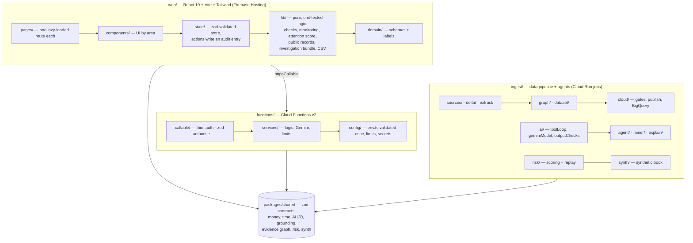
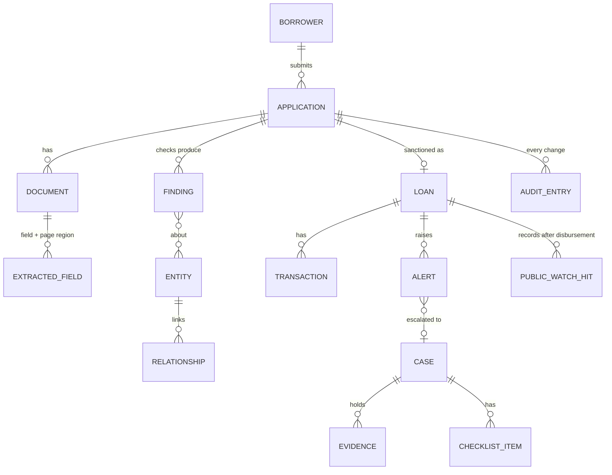

# 6. Architecture and code tour

[← Back to the index](README.md)

A TypeScript-only monorepo with five npm workspaces. One shared contract package (`packages/shared`,
zod schemas) is used by the browser, the Cloud Functions and the data pipeline, so a type is
defined once.

## Layers



**Rules that hold everywhere** (enforced by review, ESLint and CI; see [`CLAUDE.md`](../CLAUDE.md)):

- **Parse, don't cast.** HTTP / callable input, Firestore reads, Gemini output, env and
  `localStorage` are `unknown` until a zod schema validates them.
- **Money** is integer minor units (paise) plus an ISO-4217 code, never a float. **Time** is stored
  as UTC ISO-8601 and shown in local time; a "day" is an IST day.
- **Leads, not verdicts.** Status labels come from `web/src/domain/labels.ts`.
- **Append-only audit:** every state change in the web store goes through an action that writes an
  audit entry; financial records are soft-deleted.
- **Strict TypeScript:** `strict`, `noUncheckedIndexedAccess`, `exactOptionalPropertyTypes`; no
  `any`, no `!`, no `enum`; explicit return types.

## Where each feature lives

| Feature                               | Main code                                                                                                                     |
| ------------------------------------- | ----------------------------------------------------------------------------------------------------------------------------- |
| App shell, routes, mission rail       | `web/src/App.tsx`, `web/src/components/app-shell/`, `web/src/lib/nav-counts.ts`                                               |
| Application wizard                    | `web/src/pages/NewApplicationPage.tsx`, `web/src/components/applications/` (`Stepper`, `RiskStep`, `review/`)                 |
| Document quality checks (local)       | `web/src/lib/` (pdf.js + canvas)                                                                                              |
| 12 pre-sanction checks                | `web/src/lib/checks/`                                                                                                         |
| Public-records check, chain of dues   | `web/src/lib/public-records*.ts`, `components/applications/PublicRecordsCheck.tsx`, `DebtChain.tsx`, `ReceivablesSection.tsx` |
| Attention score                       | `web/src/lib/attention-score.ts`                                                                                              |
| Transaction monitoring rules          | `web/src/lib/monitoring.ts`                                                                                                   |
| Public-records watch                  | `web/src/lib/public-watch.ts`, `state/public-watch-auto.ts`, `state/useAutoWatch.ts`                                          |
| Copilot (browser)                     | `web/src/components/copilot/`, `web/src/lib/assist/`                                                                          |
| AI investigator bundle                | `web/src/lib/investigation-bundle.ts`, `investigation-ratios.ts`, `investigation-shortlist.ts`                                |
| Cloud calls from the web              | `web/src/lib/cloud/` (`httpsCallable`, App Check, `data-access.ts`)                                                           |
| Callables                             | `functions/src/callable/*.ts`                                                                                                 |
| Gemini client, billed gate, limits    | `functions/src/services/gemini.ts`, `billed-gate.ts`, `usage-limit.ts`, `rate-limit.ts`                                       |
| AI investigator (server)              | `functions/src/services/investigation/`                                                                                       |
| Public data feed                      | `functions/src/http/publicData.ts`, `services/publishedData.ts`                                                               |
| Public sources and delta              | `ingest/src/sources/`, `ingest/src/delta/`                                                                                    |
| Dataset and graph build               | `ingest/src/dataset/`, `ingest/src/graph/`, `ingest/src/graphCli.ts`                                                          |
| Cloud tasks, gates, publish, BigQuery | `ingest/src/cloud/`                                                                                                           |
| Agents                                | `ingest/src/agent/`, `ingest/src/miner/`, `ingest/src/explain/`, `ingest/src/ai/`                                             |
| Risk scoring and replay               | `ingest/src/risk/`, `packages/shared/src/risk/scoring/`                                                                       |
| Synthetic loan book                   | `ingest/src/synth/`, `data/synthetic/`                                                                                        |
| Firestore rules and indexes           | `firestore.rules`, `firestore.indexes.json`, `functions/src/rules/firestoreRules.emulator.test.ts`                            |
| Infrastructure                        | `infra/` (workflow, monitoring, storage lifecycle, registry cleanup), `scripts/`                                              |

## Data model (main types)



Zod schemas: `web/src/domain/schemas/` (one module per aggregate) and `packages/shared/src/`
(money, time, AI input and output, grounding, evidence graph, risk, synthetic data).

## Repository map

```text
how-to-use/             ← this guide (flows, screenshots, agents, GCP)
web/                    React + Vite app
  src/pages/            one lazy-loaded route per page (20 pages)
  src/components/       applications/, monitoring/, investigations/, copilot/, graph/, settings/, dashboard/, ui/
  src/lib/              pure logic (checks/, monitoring, attention score, public records, investigation, assist, CSV)
  src/state/            store + actions/ (audited)
  src/domain/           schemas/ + labels
  src/demo/             synthetic seed/ + sample documents
  e2e/                  Playwright tests (desktop + 360 px)
functions/src/          callable/ → services/ → config/ ; http/publicData ; rules/ (emulator tests)
packages/shared/src/    zod contracts shared by all workspaces
ingest/src/             sources, delta, extract, dataset, graph, cloud, agent, miner, explain, risk, synth, ai
e2e/                    Playwright scenarios with real public records (scenarios/<id>/)
data/                   registry (source terms), raw, processed, graph, synthetic — see data/README.md
infra/                  workflows/ingest-daily.yaml, monitoring/, storage/, artifact-registry/
scripts/                setup-gcp.sh, setup-ingest-gcp.sh, deploy-ingest.sh
docs/                   architecture, AI features, boundary conditions (B-01…B-67), cost, deploy, plans/
```

## Testing and quality

| Layer               | Tooling                                                       | What is covered                                                                                       |
| ------------------- | ------------------------------------------------------------- | ----------------------------------------------------------------------------------------------------- |
| Unit                | Vitest (**1,579 tests**, 169 files)                           | checks, monitoring, attention score, public records, verifiers, grounding, limits, tool loop, scoring |
| Emulator            | Firebase Emulator Suite                                       | Firestore rules (default-deny), pipeline Firestore code, leases, proposals                            |
| Browser             | Playwright                                                    | login, new application (form and upload), 3 real-data scenarios, desktop + 360 px                     |
| Static              | ESLint strict type-checked + jsx-a11y strict, Prettier, `tsc` | `--max-warnings 0`                                                                                    |
| Supply chain        | `npm audit --omit=dev`, Dependabot                            | 0 known production vulnerabilities                                                                    |
| Boundary conditions | `docs/BOUNDARY_CONDITIONS.md` (B-01 … B-67)                   | money, auth, Firestore limits, Gemini limits, concurrency, cost; each one touched has a test          |

Definition of done for every commit: `npm run check && npm run build`.

## Further reading

| Topic                             | Document                                                                                                                                                                  |
| --------------------------------- | ------------------------------------------------------------------------------------------------------------------------------------------------------------------------- |
| Product overview (20 sections)    | [`README.md`](../README.md)                                                                                                                                               |
| Architecture                      | [`docs/ARCHITECTURE.md`](../docs/ARCHITECTURE.md)                                                                                                                         |
| UI spec (wording, behaviour)      | [`docs/finrakshak-ai-ui-spec.md`](../docs/finrakshak-ai-ui-spec.md)                                                                                                       |
| Pipeline and ingestion agent      | [`docs/ingestion-agent-readme.md`](../docs/ingestion-agent-readme.md)                                                                                                     |
| Risk scoring and replay           | [`docs/RISK_SCORING.md`](../docs/RISK_SCORING.md)                                                                                                                         |
| Copilot / analysis / investigator | [`docs/COPILOT.md`](../docs/COPILOT.md), [`docs/APPLICATION_AI_ANALYSIS.md`](../docs/APPLICATION_AI_ANALYSIS.md), [`docs/AI_INVESTIGATOR.md`](../docs/AI_INVESTIGATOR.md) |
| Performance                       | [`docs/PERFORMANCE_REPORT.md`](../docs/PERFORMANCE_REPORT.md)                                                                                                             |
| Cost                              | [`docs/COST_GUIDELINES.md`](../docs/COST_GUIDELINES.md)                                                                                                                   |
| Deploy and emergency stop         | [`docs/DEPLOY.md`](../docs/DEPLOY.md), [`docs/EMERGENCY_STOP.md`](../docs/EMERGENCY_STOP.md)                                                                              |
| Data sources and terms            | [`data/README.md`](../data/README.md), [`data/registry/sources.json`](../data/registry/sources.json)                                                                      |

[Next: Judges' demo script →](07-JUDGES-DEMO-SCRIPT.md)
