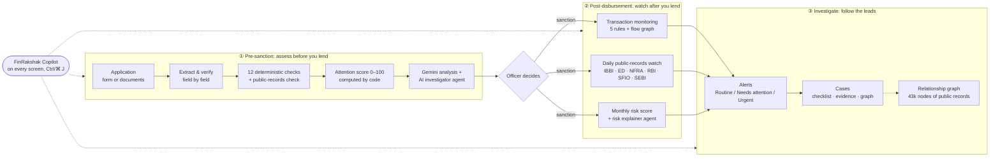
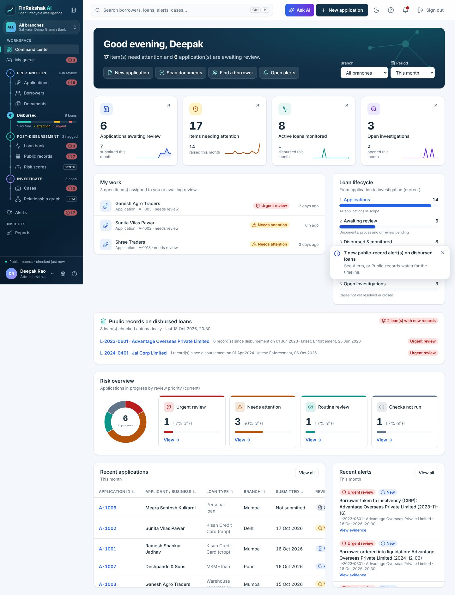

# How to use FinRakshak AI: a guide for judges and reviewers

> **FinRakshak AI** tracks every rupee a bank lends, from the first document to the last repayment,
> and gives early warnings backed by evidence.
> **The AI proposes with cited evidence, code verifies it, and a person decides.**

This folder is a guided tour of the repository. In about 15 minutes you can see what the product does
(with real screenshots of every tab), run it yourself, and follow how the Gen AI agents and the
Google Cloud services work.

| #   | Read this                                                      | What you get                                                                                                  | Time   |
| --- | -------------------------------------------------------------- | ------------------------------------------------------------------------------------------------------------- | ------ |
| 1   | [Quick start](01-QUICK-START.md)                               | Run it locally in 3 commands, sign in with a demo role, and see what each role can do                         | 5 min  |
| 2   | [User flows](02-USER-FLOWS.md)                                 | Every flow, step by step with screenshots: pre-sanction, disbursement, monitoring, alerts and investigation   | 15 min |
| 3   | [Screenshot gallery](03-SCREENSHOTS.md)                        | All 28 UI screens (desktop, dark mode, 360 px mobile) with a caption for each                                 | 5 min  |
| 4   | [AI features and agents](04-AI-AGENTS.md)                      | The 6 Gen AI features and 4 agents: their tools, loops, verifiers, guardrails and triggers                    | 15 min |
| 5   | [Google Cloud services](05-GCP-SERVICES.md)                    | Each GCP and Firebase service: why it is used, how it is set up, IAM, request paths, the daily pipeline, cost | 15 min |
| 6   | [Architecture and code tour](06-ARCHITECTURE-AND-CODE-TOUR.md) | Where every feature lives in the code, the layering rules, the data model, the tests and CI                   | 10 min |

## The product on one page

## Key facts in brief

| Item                     | Value                                                                                                                                                                                                                                                |
| ------------------------ | ---------------------------------------------------------------------------------------------------------------------------------------------------------------------------------------------------------------------------------------------------- |
| Users                    | Branch officer, branch manager, risk analyst, investigator, administrator (5 demo roles)                                                                                                                                                             |
| Gen AI                   | **Gemini (`gemini-3.1-flash-lite`) on Vertex AI**, called only from Cloud Functions and Cloud Run jobs, never from the browser                                                                                                                       |
| AI features              | Copilot, application analysis, AI investigator (agent), ingestion agent, pattern miner (agent), risk explainer (agent)                                                                                                                               |
| Real public data         | 18,286 entities and 57,382 relationships from 7 official Indian sources; the graph has 43,405 nodes and 47,116 links                                                                                                                                 |
| Google Cloud             | Firebase Hosting, Auth, App Check, Cloud Functions v2, Firestore, Vertex AI, Cloud Run jobs, Workflows, Scheduler, Cloud Storage, BigQuery, Secret Manager, Artifact Registry, Cloud Monitoring, IAM / Workload Identity Federation, Billing budgets |
| Quality gate             | 1,579 unit tests, emulator tests, Playwright scenarios, strict TypeScript, ESLint with 0 warnings, 0 known production vulnerabilities                                                                                                                |
| Running cost (prototype) | About **US$5–10 a month**, with budget alerts and per-user daily AI limits                                                                                                                                                                           |

## How the screenshots were made

All screenshots in [`screenshots/`](screenshots/) were captured on 18 Oct 2026 from this branch,
running `npm run dev -w web` and signing in with the **quick sign-in** demo roles (Playwright, Chromium,
1440 × 900 desktop and 360 × 780 mobile). The data is the built-in demo workspace: people, accounts
and amounts are fictional, **except** the two labelled **TEST** loans (`L-2023-0601`, `L-2024-0401`),
whose real borrowers are matched against real public records. The Gen AI features (Copilot, AI
analysis, AI investigator and the pipeline agents) call Gemini on Vertex AI and are explained in
[04-AI-AGENTS.md](04-AI-AGENTS.md).

To recapture them, see [Recreating the screenshots](01-QUICK-START.md#recreating-the-screenshots).
